# 🌸 Habit Tracker Collection for Everyone — by Dyu (v2.0 Final)

> **Bộ sưu tập 10 mẫu Excel Habit Tracker thẩm mỹ chuẩn Digital Planner** — **100% Offline, copy đi bất kỳ máy Windows hay Mac nào cũng chạy mượt ngay lập tức!**
> **KHÔNG cần cài Python • KHÔNG Macro (`.xlsm`) / không cảnh báo bảo mật • KHÔNG lỗi `#####` • KHÔNG cần Internet • Tương thích mọi phiên bản Excel (2016 / 2019 / 2021 / 365).**


---

## ⚡ Cài Đặt & Tải Nhanh Bằng 1 Dòng Lệnh (Interactive Installer)

Không cần tải thủ công từng file! Copy & chạy **1 dòng lệnh duy nhất** — trình tải tương tác sẽ tự tạo thư mục **`template/`** ngay tại vị trí hiện tại (hoặc `Desktop/template` nếu chạy từ thư mục hệ thống), hiện menu đánh số `[1]`–`[10]` để bạn chọn mẫu yêu thích (hỗ trợ chọn lẻ `1`, nhiều mẫu `1,3,7`, dải `1-5`, hoặc `A` tải toàn bộ 10 mẫu):

### 🪟 Windows (PowerShell)
```powershell
irm https://raw.githubusercontent.com/Thitrongdan202/Habit-tracker-for-everyone-by-Dyu/main/install.ps1 | iex
```

### 🍎 macOS / 🐧 Linux (Terminal)
```bash
curl -fsSL https://raw.githubusercontent.com/Thitrongdan202/Habit-tracker-for-everyone-by-Dyu/main/install.sh | bash
```

> **Người dùng cuối KHÔNG cần cài Python hay bất kỳ công cụ nào khác!** Tải xong chỉ cần nhấn đúp mở file `.xlsx` bằng Microsoft Excel và bắt đầu tick ngay.

---

## ✨ Điểm Nổi Bật Của Phiên Bản 2.0 Final

- 🔌 **100% Offline & Copy-Anywhere Portable:** Toàn bộ 10 mẫu chính trong `templates/` nhúng sẵn 6 ảnh hoạt ảnh `300×300px` ngay bên trong sheet ẩn `_Assets` (`B2:B7`) + 31 khung **Excel Native Linked Pictures** (`Anim_Day01`..`Anim_Day31`). Copy file sang USB, thư mục khác hay máy khác vẫn chạy mượt 100%, **không bao giờ hiện `#####` hay thanh cảnh báo Linked Data Types / Macro**!
- 📅 **Dropdown Tháng & Năm Động (Chuẩn Mọi Vùng Miền):** 2 ô riêng biệt không gộp ô (**Tháng `B3`** & **Năm `B5`**) liên kết trực tiếp vùng dữ liệu `_Calc` (tương thích cả dấu phẩy `,` lẫn chấm phẩy `;`). Chọn Tháng 2 tự động nhảy 28 ngày (hoặc 29 ngày năm nhuận) và ẩn sạch ngày thừa!
- ☑️ **Checkbox Bấm Trực Tiếp (Excel 2016–365 Win & Mac):** 12 dòng đầu (372 ô) gắn sẵn Form Control Checkboxes căn giữa từng ô + tự tô màu pastel khi tick; 8 dòng mở rộng bên dưới (`13–20`) nối sẵn công thức Streak & dropdown `✓`.
- 🎨 **Tự Đổi Bộ Ảnh Hoạt Ảnh Riêng Trong 3 Bước:** Chuột phải tên tab bất kỳ → **Unhide → `_Assets`** → dán 6 ảnh PNG/sticker của bạn vào `B2:B7` → ẩn lại → toàn bộ 31 ngày + Hero icon tự biến hình ngay lập tức!
- 📖 **Tích Hợp Trang Chào Mừng `📖 Hướng Dẫn` Tiếng Việt** trong từng file (cách tick, reset mẫu trong 5 giây, thêm thói quen, đổi tháng/năm, đổi ảnh hoạt ảnh).

---

## 📋 Bảng Tải Trực Tiếp 10 Mẫu Template

| # | Tên Mẫu & Chủ Đề | Điểm Nhấn Độc Quyền | ⭐ Excel Offline *(Mọi máy)* | ☁️ Google Sheets |
|---|---|---|---|---|
| **01** | 🌻 **Sunflower Garden Blush** | Khu vườn hướng dương, Yearly Goals Planner (*You Have Planted*) & Annual Overview | [Tải `.xlsx`](templates/01_Sunflower_Garden_Blush.xlsx) | [Google Sheets](templates/google_sheets_edition/01_Sunflower_Garden_Blush.xlsx) |
| **02** | 🌵 **Cactus Bloom Pastel Weeks** | 5 tuần màu pastel riêng biệt, Daily Productivity markers & Reflection Journal | [Tải `.xlsx`](templates/02_Cactus_Bloom_Pastel_Weeks.xlsx) | [Google Sheets](templates/google_sheets_edition/02_Cactus_Bloom_Pastel_Weeks.xlsx) |
| **03** | 🌈 **Rainbow Executive Donuts** | Lọ sao hoa sen, **5 biểu đồ Donut tuần**, Weekly Habits Checklist & Analytics | [Tải `.xlsx`](templates/03_Rainbow_Executive_Donuts.xlsx) | [Google Sheets](templates/google_sheets_edition/03_Rainbow_Executive_Donuts.xlsx) |
| **04** | 🌿 **Sage Botanical Habit & Budget** | Monstera nở hoa + **Monthly Budget Planner** (Cash Flow Donut, Bills, Log) + Life Overview | [Tải `.xlsx`](templates/04_Sage_Botanical_Habit_And_Budget.xlsx) | [Google Sheets](templates/google_sheets_edition/04_Sage_Botanical_Habit_And_Budget.xlsx) |
| **05** | 🌙 **Lavender Dream Wellness & Mood** | Chu kỳ Mặt trăng & Oải hương + Nhật ký Giấc ngủ / Tâm trạng / Năng lượng + Gratitude 31 ngày | [Tải `.xlsx`](templates/05_Lavender_Dream_Wellness_Mood.xlsx) | [Google Sheets](templates/google_sheets_edition/05_Lavender_Dream_Wellness_Mood.xlsx) |
| **06** | 🚀 **Midnight Navy Blush Focus** | Navy–Blush tương phản cao, Tên lửa phóng quỹ đạo + **Gamification XP & 10 Badges** | [Tải `.xlsx`](templates/06_Midnight_Navy_Blush_Focus.xlsx) | [Google Sheets](templates/google_sheets_edition/06_Midnight_Navy_Blush_Focus.xlsx) |
| **07** | 🌸 **Sakura Zen Study Planner** *(Mới!)* | Washi Nhật Bản, Cành anh đào nở hoa + **Giờ Focus / Pomodoro** + Course & Reading Progress | [Tải `.xlsx`](templates/07_Sakura_Zen_Study_Planner.xlsx) | [Google Sheets](templates/google_sheets_edition/07_Sakura_Zen_Study_Planner.xlsx) |
| **08** | 🪸 **Ocean Coral Fitness & Energy** *(Mới!)* | Rạn san hô & Ngọc trai tỏa sáng + Energy/Water Log + 5 Weekly Gauges + **Streak Hall of Fame** | [Tải `.xlsx`](templates/08_Ocean_Coral_Fitness_Energy.xlsx) | [Google Sheets](templates/google_sheets_edition/08_Ocean_Coral_Fitness_Energy.xlsx) |
| **09** | 🍵 **Matcha Cafe Daily Routine** *(Mới!)* | Tách Matcha Latte nghệ thuật + **Tách Thói quen Sáng / Tối** + Mood + Cozy Weekly Review | [Tải `.xlsx`](templates/09_Matcha_Cafe_Daily_Routine.xlsx) | [Google Sheets](templates/google_sheets_edition/09_Matcha_Cafe_Daily_Routine.xlsx) |
| **10** | 🌌 **Aurora Glow RPG Quest Tracker** *(Mới!)* | Đá Rune → Pha lê Cực Quang + **Hệ thống RPG Level, Combo Streak x1.2/x1.5 & 4 Nhánh Kỹ Năng** | [Tải `.xlsx`](templates/10_Aurora_Glow_RPG_Quest_Tracker.xlsx) | [Google Sheets](templates/google_sheets_edition/10_Aurora_Glow_RPG_Quest_Tracker.xlsx) |

> **Phiên bản bổ sung:** Người dùng Excel 365 thích ảnh nhúng trực tiếp vào ô tốc độ 0ms có thể tải thêm trong [`templates/pro_macro/`](templates/pro_macro/) hoặc cài thêm Macro tiện ích trong [`vba_scripts/`](vba_scripts/).

---

## 🎨 Bộ Sưu Tập Ảnh Chụp Thực Tế (10 Templates)

### 1. 🌻 Sunflower Garden Blush (`01_Sunflower_Garden_Blush.xlsx`)
- **Bảng màu:** Dusty Rose (`#D8A7A7`) · Warm Blush (`#F5E6E6`) · Cream (`#FFFDFB`) · Emerald Streak (`#4E9F76`)
- **Các sheet:** `📖 Hướng Dẫn` · `🌻 Monthly Tracker` · `🎯 Yearly Goals & Habits` · `📊 Annual Overview`


<details>
<summary>📸 Xem thêm: Trang Hướng Dẫn, Yearly Goals & Annual Overview</summary>


</details>

---

### 2. 🌵 Cactus Bloom Pastel Weeks (`02_Cactus_Bloom_Pastel_Weeks.xlsx`)
- **Bảng màu 5 tuần:** Pink (`#F8D7E8`) · Lavender (`#E2D7F8`) · Sky (`#D7EAF8`) · Mint (`#D7F8E5`) · Butter (`#FAF2CC`)
- **Các sheet:** `📖 Hướng Dẫn` · `🌵 Monthly Tracker` · `📝 Reflection & Notes`


<details>
<summary>📸 Xem tab Reflection & Notes</summary>


</details>

---

### 3. 🌈 Rainbow Executive Donuts (`03_Rainbow_Executive_Donuts.xlsx`)
- **Bảng màu:** Soft Pastel Rainbow (Ice Blue · Sage Mint · Rose Pink · Peach Apricot · Soft Olive)
- **Các sheet:** `📖 Hướng Dẫn` · `🌈 Habit Dashboard` · `📈 Analytics`

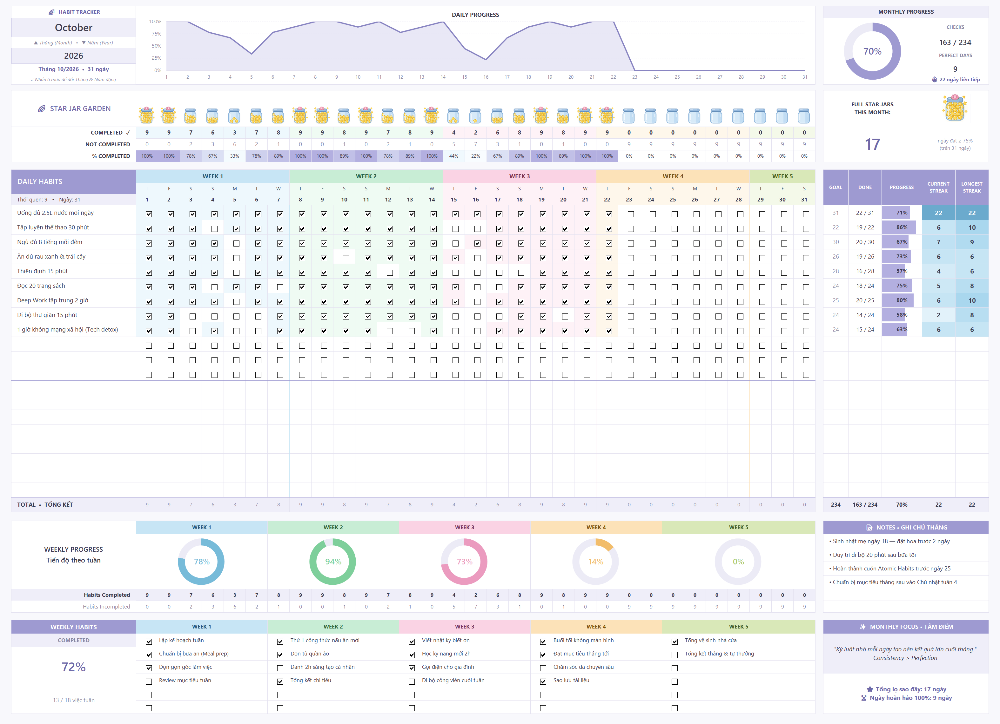

<details>
<summary>📸 Xem tab Analytics (Habit Leaderboard & Day-of-Week Breakdown)</summary>


</details>

---

### 4. 🌿 Sage Botanical Habit & Budget (`04_Sage_Botanical_Habit_And_Budget.xlsx`)
- **Bảng màu:** Sage Green (`#9FB8AD`) · Warm Sand (`#E8D5B7`) · Dusty Coral (`#E0A899`) · Ivory (`#FAF9F6`)
- **Các sheet:** `📖 Hướng Dẫn` · `🌿 Daily Habits` · `💰 Monthly Budget` · `🔗 Life Overview`


<details>
<summary>📸 Xem tab Monthly Budget & Life Overview</summary>

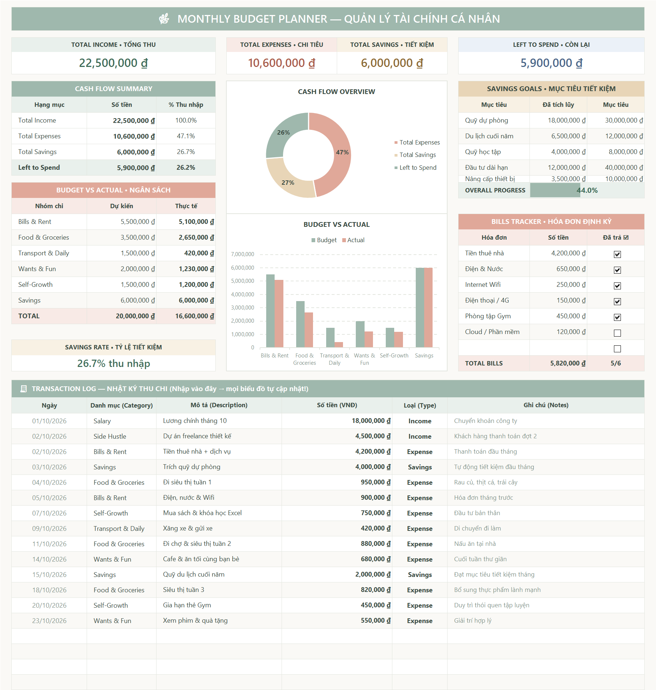
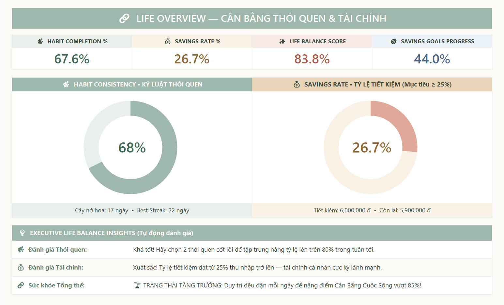

</details>

---

### 5. 🌙 Lavender Dream Wellness & Mood (`05_Lavender_Dream_Wellness_Mood.xlsx`)
- **Bảng màu:** Soft Lilac (`#C8B6E2`) · Periwinkle (`#A594F9`) · Mist Lavender (`#F3EFFB`) · Charcoal Ink (`#2D2A32`)
- **Các sheet:** `📖 Hướng Dẫn` · `🌙 Habit & Wellness` · `✨ Gratitude & Review`


<details>
<summary>📸 Xem tab Gratitude & Review</summary>


</details>

---

### 6. 🚀 Midnight Navy Blush Focus (`06_Midnight_Navy_Blush_Focus.xlsx`)
- **Bảng màu:** Deep Navy (`#2B3452`) · Soft Blush (`#F2D7D9`) · Slate Blue (`#5C6B9C`) · Crisp White (`#FFFFFF`)
- **Các sheet:** `📖 Hướng Dẫn` · `🚀 Focus Tracker` · `🏆 Milestones`

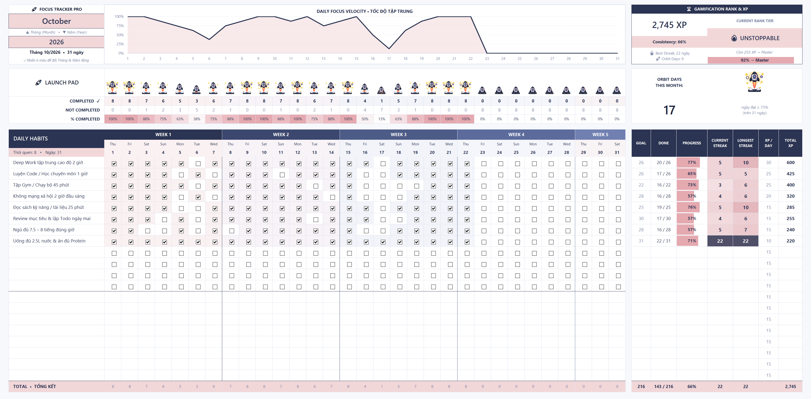

<details>
<summary>📸 Xem tab Milestones & Rank Ladder</summary>


</details>

---

### 7. 🌸 Sakura Zen Study Planner (`07_Sakura_Zen_Study_Planner.xlsx`) — *Mới!*
- **Bảng màu:** Washi Cream (`#FFFBF7`) · Sakura Petal (`#F7C5D0`) · Soft Matcha (`#A8C69F`) · Warm Charcoal (`#3D3535`)
- **Các sheet:** `📖 Hướng Dẫn` · `🌸 Study & Habits` *(Daily Focus Hours & Pomodoro Chart)* · `📚 Course & Reading`

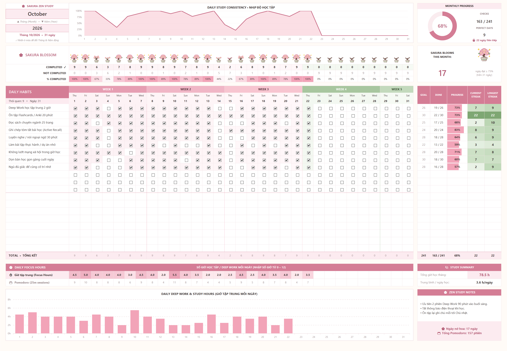

<details>
<summary>📸 Xem tab Course & Reading Progress</summary>

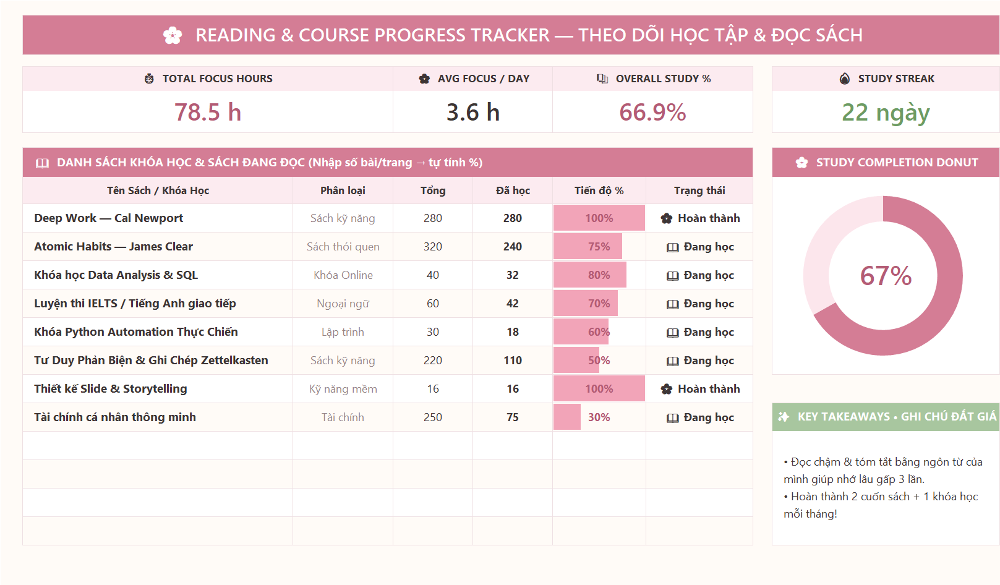

</details>

---

### 8. 🪸 Ocean Coral Fitness & Energy (`08_Ocean_Coral_Fitness_Energy.xlsx`) — *Mới!*
- **Bảng màu:** Seafoam Mint (`#D4F1EC`) · Deep Lagoon Teal (`#2E7D87`) · Warm Sandy Coral (`#F4A582`) · Pearl White (`#FFFFFF`)
- **Các sheet:** `📖 Hướng Dẫn` · `🪸 Fitness & Energy` *(Energy 1–5, Water Liters & 5 Weekly Donut Gauges)* · `🏅 Streak Hall of Fame`

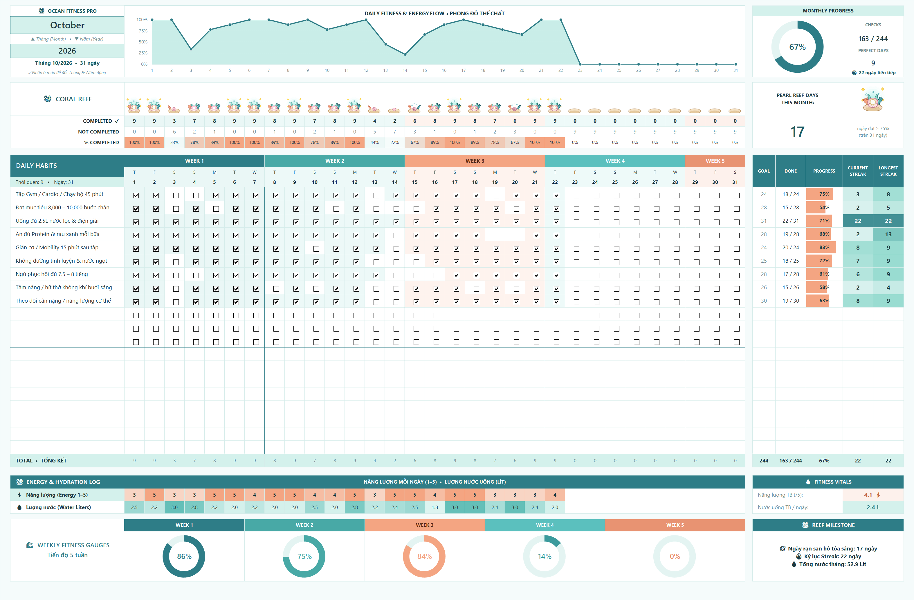

<details>
<summary>📸 Xem tab Streak Hall of Fame</summary>

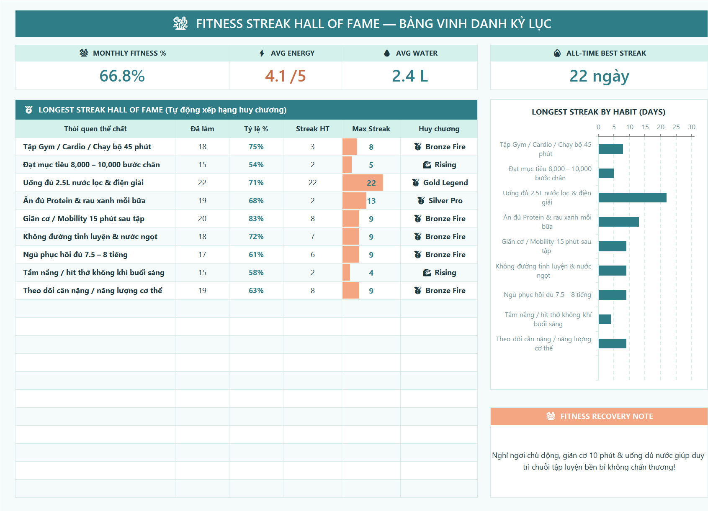

</details>

---

### 9. 🍵 Matcha Cafe Daily Routine (`09_Matcha_Cafe_Daily_Routine.xlsx`) — *Mới!*
- **Bảng màu:** Ceremonial Matcha (`#8FA97B`) · Oat Milk Cream (`#F6F1E7`) · Roasted Espresso (`#5C4033`) · Caramel (`#D4A373`)
- **Các sheet:** `📖 Hướng Dẫn` · `🍵 Daily Routine` *(Morning vs Evening Routine Split, Daily Mood & Cozy Reflection)* · `☕ Cozy Weekly Review`

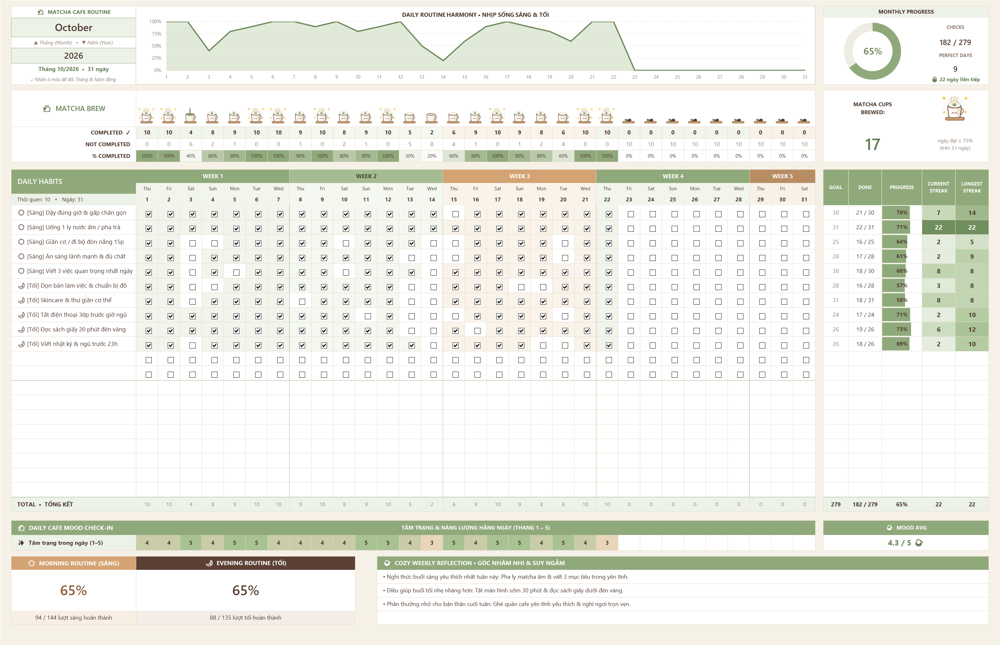

<details>
<summary>📸 Xem tab Cozy Weekly Review</summary>

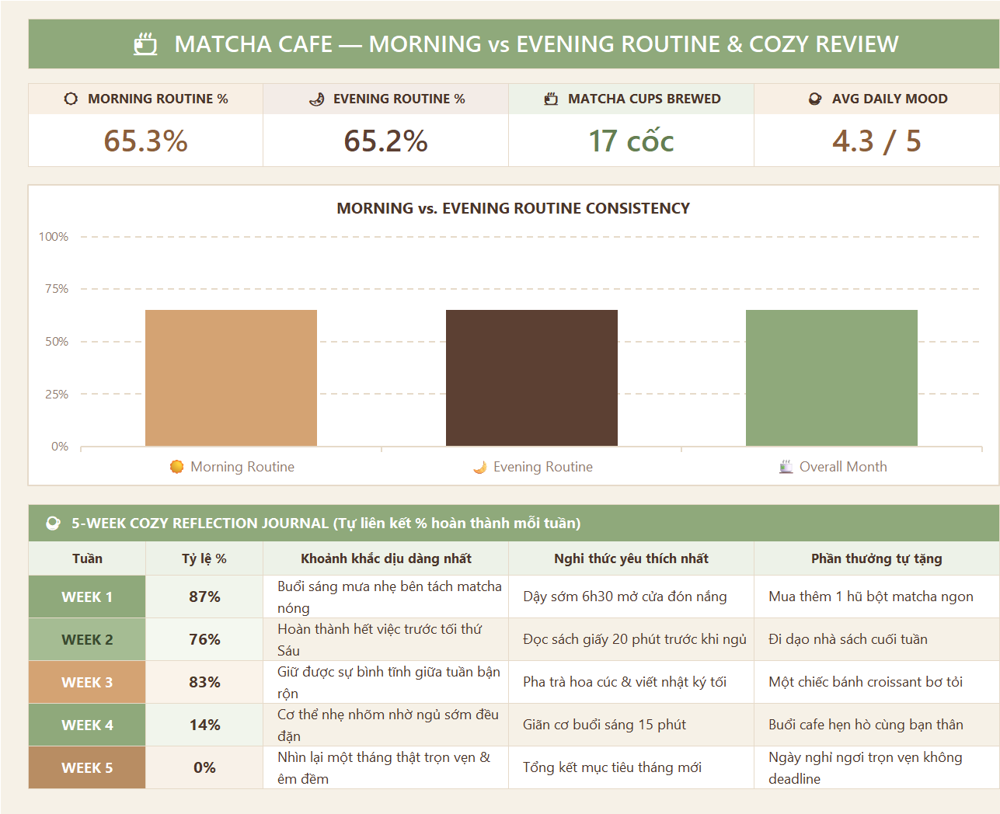

</details>

---

### 10. 🌌 Aurora Glow RPG Quest Tracker (`10_Aurora_Glow_RPG_Quest_Tracker.xlsx`) — *Mới!*
- **Bảng màu:** Nordic Slate (`#242B3D`) · Aurora Mint (`#4FD1C5`) · Aurora Violet (`#9F7AEA`) · Ice Mist (`#F0F4F8`)
- **Các sheet:** `📖 Hướng Dẫn` · `🌌 RPG Quest Tracker` *(Skill Class, Base XP, Combo Multiplier ×1.2/×1.5, Hero Level & Rank)* · `⚔️ Character Sheet`

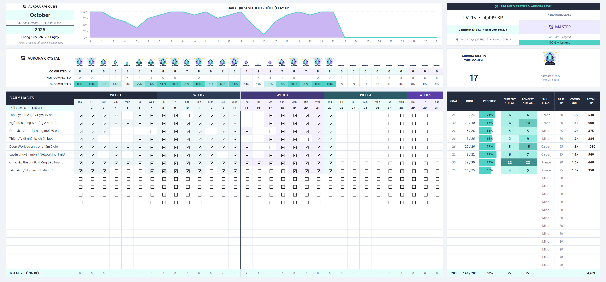

<details>
<summary>📸 Xem tab Character Sheet (Skill Category Breakdown & 10 RPG Quests)</summary>

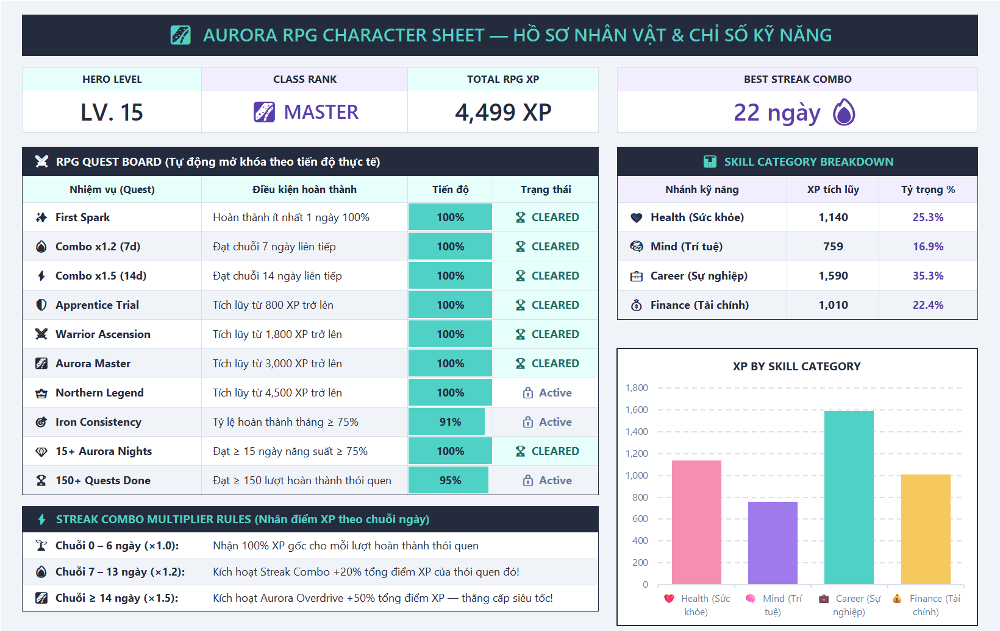

</details>

---

## 🖼️ Bộ 60 Sprite Hoạt Ảnh 300×300px (10 Chủ Đề × 6 Giai Đoạn)


---

## 📖 Hướng Dẫn Nhanh: Dropdown Tháng/Năm & Tự Đổi Ảnh Hoạt Ảnh

1. **Đổi Tháng & Năm động:** Tại góc trên bên trái bảng Tracker, nhấn trực tiếp vào ô màu **Tháng (`B3`)** hoặc **Năm (`B5`)** → chọn từ danh sách thả xuống. Toàn bộ ngày (28 / 29 năm nhuận / 30 / 31) và thứ (`Mon–Sun`) tự nhảy chuẩn xác!
2. **Reset dữ liệu mẫu trong 5 giây:** Quét chọn vùng checkbox `C17:AG36` → nhấn phím `Delete` (Mac: `fn + Backspace`).
3. **Tự đổi bộ ảnh hoạt ảnh (Custom Animation):** Chuột phải tên tab dưới cùng → **Unhide → `_Assets`** → thay 6 ảnh trong `B2:B7` bằng icon của bạn → **Hide** lại! Xem chi tiết tại [`docs/CUSTOMIZATION_GUIDE.md`](docs/CUSTOMIZATION_GUIDE.md).

---

## 📁 Cấu Trúc Repository

```text
Habit-tracker-for-everyone-by-Dyu/
├── README.md
├── install.ps1                         # Trình tải tương tác 1 dòng lệnh cho Windows PowerShell
├── install.sh                          # Trình tải tương tác 1 dòng lệnh cho macOS / Linux Terminal
├── assets/                             # 60 PNG 300×300px nền trong suốt (10 themes × 6 stages)
├── templates/
│   ├── 01_Sunflower_Garden_Blush.xlsx  # ⭐ 10 mẫu Excel Offline phổ quát (Excel 2016–365, Win/Mac)
│   ├── ...
│   ├── 10_Aurora_Glow_RPG_Quest_Tracker.xlsx
│   ├── google_sheets_edition/          # ☁️ 10 mẫu tối ưu cho Google Sheets (=IMAGE từ nhánh main)
│   └── pro_macro/                      # ⚡ 10 mẫu Excel 365 Offline Pro nhúng ảnh trực tiếp vào ô
├── vba_scripts/                        # Macro VBA tùy chọn (không bắt buộc)
├── previews/                           # Ảnh chụp thực tế từ Microsoft Excel Desktop (23 ảnh)
├── scripts/                            # Mã nguồn Python build & QA copy-portability
└── docs/
    └── CUSTOMIZATION_GUIDE.md
```

---

<p align="center">Made with 💛 for everyone building better daily habits — <b>100% Offline, Zero Install, Zero Macro</b> — by Dyu</p>
