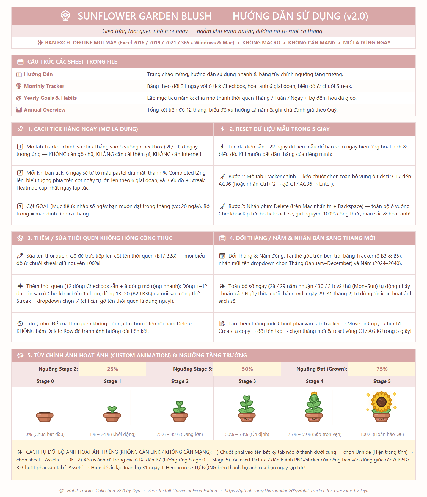
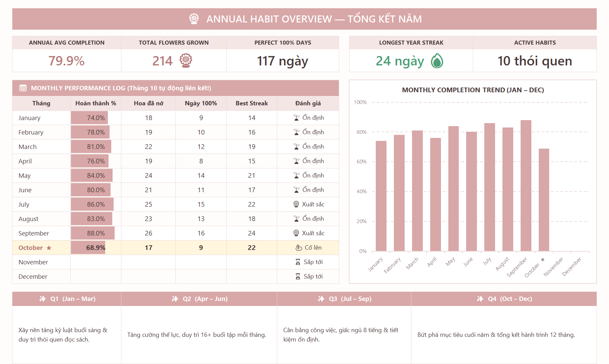
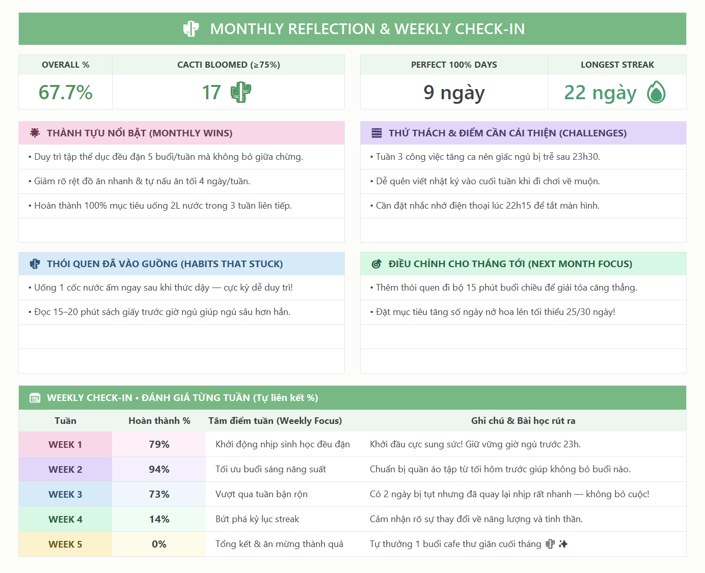
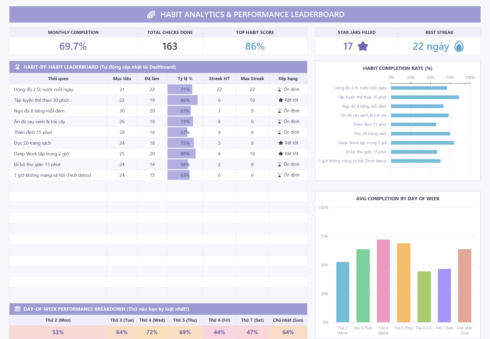
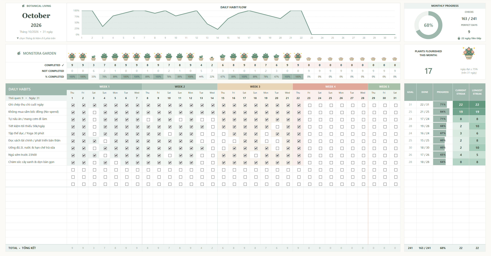

# 🌸 Habit Tracker Collection v2.0 — Universal Zero-Install Excel Edition (by Dyu)

> **Tải 1 file `.xlsx` duy nhất → Nhấn đúp mở bằng Microsoft Excel (2016 / 2019 / 2021 / 365 • Windows & Mac) → Dùng ngay 100% Offline!**
> **KHÔNG cần cài Python • KHÔNG Macro (`.xlsm`) / không cảnh báo bảo mật • KHÔNG cần kết nối Internet.**
> Tích hợp sẵn Checkbox bấm trực tiếp, hoạt ảnh cây/icon lớn dần theo 6 giai đoạn (Excel Native Linked Pictures), biểu đồ tương tác, lịch động & trang **`📖 Hướng Dẫn`** tiếng Việt trong từng file.


---

## 📦 Chọn Phiên Bản Phù Hợp (Quick Download)

| Phiên bản | Phù hợp với | Thư mục tải về | Tính năng nổi bật |
|---|---|---|---|
| **⭐ Bản Excel Offline Mọi Máy *(Khuyên dùng)*** | **Excel 2016 / 2019 / 2021 / 365** (Windows & Mac) | [`templates/excel_universal_offline/`](templates/excel_universal_offline/) | **100% Offline • Pure `.xlsx` (0 Macro)** • Form Control Checkboxes bấm trực tiếp • Hoạt ảnh 6 giai đoạn bằng Linked Pictures (`_Assets!B2:B7`) • Tự đổi ảnh riêng trong 3 bước! |
| **☁️ Bản Google Sheets & Excel 365 Cloud** | **Google Sheets** (miễn phí) hoặc **Excel 365 Web** | [`templates/google_sheets_and_excel365/`](templates/google_sheets_and_excel365/) | File siêu nhẹ (~40–50 KB) • Dùng hàm `=IMAGE(...)` trực tuyến từ nhánh `version2` • Native checkboxes gốc. |

---

## ✨ Điểm Đột Phá Của Version 2.0

- 🔌 **Zero-Install, Zero-Macro, Zero-Internet (Tier A):** Tải về máy bất kỳ có Excel là chạy trọn vẹn ngay lập tức — không yêu cầu Office 365, không cảnh báo Macro, không lỗi `#NAME?` hay `_xlfn.`.
- 🪴 **Hoạt ảnh tăng trưởng 6 giai đoạn Offline (Native Camera / Linked Pictures):** 31 khung ảnh động (`Anim_Day01`..`Anim_Day31`) liên kết `=INDEX(_Assets!$B$2:$B$8, ...)` tự động lớn lên mượt mà từ `0%` → `100%` ngay khi bạn tick Checkbox!
- 🎨 **Tự đổi bộ icon của riêng bạn không cần link:** Chỉ cần chuột phải tab dưới cùng → **Unhide → `_Assets`** → dán 6 ảnh PNG/sticker bất kỳ vào `B2:B7` → toàn bộ 31 ngày + Hero icon tự biến hình ngay lập tức!
- ☑️ **Checkbox bấm 1 chạm + 8 dòng mở rộng nhanh:** 12 dòng đầu (372 ô) gắn sẵn Form Control Checkboxes căn giữa từng ô + tô nền pastel dịu mắt khi tick; 8 dòng mở rộng bên dưới (`13–20`) nối sẵn công thức Streak & dropdown `✓`.
- 📅 **Lịch động & Streak chuẩn xác:** Đổi Tháng/Năm tự nhảy 28/29/30/31 ngày (tự ẩn icon ở ngày thừa cuối tháng); `Current Streak` tự tính đến ngày hoạt động gần nhất (`LastActiveDay`).

---

## 🎨 Bộ Sưu Tập 6 Mẫu Template (Ảnh Chụp Thực Tế Từ Bản Offline `.xlsx`)

### 1. 🌻 Sunflower Garden Blush
- **Tải về:** [**⭐ Excel Offline (Mọi máy)**](templates/excel_universal_offline/01_Sunflower_Garden_Blush.xlsx) · [☁️ Google Sheets / Excel 365](templates/google_sheets_and_excel365/01_Sunflower_Garden_Blush.xlsx)
- **Palette:** Dusty Rose (`#D8A7A7`) · Warm Blush (`#F5E6E6`) · Cream (`#FFFDFB`) · Emerald Streak (`#4E9F76`)
- **Tabs:** `📖 Hướng Dẫn` · `🌻 Monthly Tracker` · `🎯 Yearly Goals & Habits` *(kèm bộ đếm You Have Planted)* · `📊 Annual Overview`


<details>
<summary>📸 Xem thêm: Trang Hướng Dẫn v2.0, Yearly Goals & Annual Overview</summary>





</details>

---

### 2. 🌵 Cactus Bloom Pastel Weeks
- **Tải về:** [**⭐ Excel Offline (Mọi máy)**](templates/excel_universal_offline/02_Cactus_Bloom_Pastel_Weeks.xlsx) · [☁️ Google Sheets / Excel 365](templates/google_sheets_and_excel365/02_Cactus_Bloom_Pastel_Weeks.xlsx)
- **Palette 5 tuần:** Pink (`#F8D7E8`) · Lavender (`#E2D7F8`) · Sky (`#D7EAF8`) · Mint (`#D7F8E5`) · Butter (`#FAF2CC`)
- **Tabs:** `📖 Hướng Dẫn` · `🌵 Monthly Tracker` *(Daily Productivity area chart có markers + dải tổng kết 5 tuần + Side Stats)* · `📝 Reflection & Notes`


<details>
<summary>📸 Xem tab Reflection & Notes</summary>



</details>

---

### 3. 🌈 Rainbow Executive Donuts
- **Tải về:** [**⭐ Excel Offline (Mọi máy)**](templates/excel_universal_offline/03_Rainbow_Executive_Donuts.xlsx) · [☁️ Google Sheets / Excel 365](templates/google_sheets_and_excel365/03_Rainbow_Executive_Donuts.xlsx)
- **Palette:** Pastel Rainbow (Ice Blue · Sage Mint · Rose Pink · Peach Apricot · Soft Olive)
- **Tabs:** `📖 Hướng Dẫn` · `🌈 Habit Dashboard` *(Top Area Chart + Overall Donut + **5 Weekly Progress Donuts** + Weekly Habits Checklist + Notes)* · `📈 Analytics`


<details>
<summary>📸 Xem tab Analytics (Habit Leaderboard & Day-of-Week Breakdown)</summary>



</details>

---

### 4. 🌿 Sage Botanical Habit & Budget
- **Tải về:** [**⭐ Excel Offline (Mọi máy)**](templates/excel_universal_offline/04_Sage_Botanical_Habit_And_Budget.xlsx) · [☁️ Google Sheets / Excel 365](templates/google_sheets_and_excel365/04_Sage_Botanical_Habit_And_Budget.xlsx)
- **Palette:** Sage Green (`#9FB8AD`) · Warm Sand (`#E8D5B7`) · Dusty Coral (`#E0A899`) · Ivory (`#FAF9F6`)
- **Tabs:** `📖 Hướng Dẫn` · `🌿 Daily Habits` · `💰 Monthly Budget` *(Cash Flow Donut, Budget vs Actual, Savings Goals, Bills Checklist & Transaction Log)* · `🔗 Life Overview` *(Habit % + Savings Rate %)*



<details>
<summary>📸 Xem tab Monthly Budget & Life Overview</summary>


</details>

---

### 5. 🌙 Lavender Dream Wellness & Mood
- **Tải về:** [**⭐ Excel Offline (Mọi máy)**](templates/excel_universal_offline/05_Lavender_Dream_Wellness_Mood.xlsx) · [☁️ Google Sheets / Excel 365](templates/google_sheets_and_excel365/05_Lavender_Dream_Wellness_Mood.xlsx)
- **Palette:** Soft Lilac (`#C8B6E2`) · Periwinkle (`#A594F9`) · Mist Lavender (`#F3EFFB`) · Charcoal Ink (`#2D2A32`)
- **Tabs:** `📖 Hướng Dẫn` · `🌙 Habit & Wellness` *(Daily Habits + Sleep Hours + Mood / Energy / Calm 1–5 + Correlation Chart)* · `✨ Gratitude & Review`


<details>
<summary>📸 Xem tab Gratitude & Review</summary>


</details>

---

### 6. 🚀 Midnight Navy Blush Focus
- **Tải về:** [**⭐ Excel Offline (Mọi máy)**](templates/excel_universal_offline/06_Midnight_Navy_Blush_Focus.xlsx) · [☁️ Google Sheets / Excel 365](templates/google_sheets_and_excel365/06_Midnight_Navy_Blush_Focus.xlsx)
- **Palette:** Deep Navy (`#2B3452`) · Soft Blush (`#F2D7D9`) · Slate Blue (`#5C6B9C`) · Crisp White (`#FFFFFF`)
- **Tabs:** `📖 Hướng Dẫn` · `🚀 Focus Tracker` *(Gamification XP/Day, Total XP, Rank Tiers: Beginner → Consistent → Unstoppable → Master)* · `🏆 Milestones` *(10 Huy hiệu thành tích tự mở khóa)*


<details>
<summary>📸 Xem tab Milestones & Rank Ladder</summary>


</details>

---

## 🖼️ Bộ 36 Sprite Hoạt Ảnh 300×300px (6 Chủ Đề × 6 Giai Đoạn)


---

## 📁 Cấu Trúc Repository (Branch `version2`)

```text
Habit-tracker-for-everyone-by-Dyu/ (branch: version2)
├── README.md
├── assets/                                # 36 PNG 300×300px nền trong suốt (6 themes × 6 stages)
├── templates/
│   ├── excel_universal_offline/           # ⭐ Tier A: 6 file .xlsx Offline mọi phiên bản Excel (2016–365)
│   └── google_sheets_and_excel365/        # ☁️ Tier B: 6 file .xlsx Cloud (=IMAGE từ branch version2)
├── previews/                              # Ảnh chụp thực tế từ Microsoft Excel Desktop
├── scripts/
│   ├── generate_assets.py                 # Sinh 36 sprite 300×300px (4× supersampling)
│   ├── excel_builder.py                   # Tạo khung workbook chuẩn, _Calc, _Assets & manifest
│   ├── excel_com_enhancer.py              # Biên dịch COM: nhúng ảnh, Linked Pictures, Form Checkboxes & preview
│   ├── build_cloud_edition.py             # Sinh 6 file Tier B (Google Sheets / Excel 365)
│   ├── verify_v2.py                       # Kiểm toán 0 lỗi công thức, 0 _xlfn, test tick checkbox & đổi tháng
│   └── hx/                                # Module UI/UX, guide, tracker, addons & extras
└── docs/
    └── CUSTOMIZATION_GUIDE.md
```

---

## 🔧 Tự Biên Dịch Lại Từ Mã Nguồn (Dành Cho Developer — Người Dùng Cuối KHÔNG Cần)

```bash
pip install openpyxl xlsxwriter pillow numpy pywin32
python scripts/generate_assets.py      # 1. Tạo 36 ảnh 300x300px + contact sheet
python scripts/build_cloud_edition.py  # 2. Sinh 6 file Tier B (Google Sheets / Excel 365)
python scripts/excel_com_enhancer.py   # 3. Biên dịch 6 file Tier A Offline qua Excel COM + chụp preview
python scripts/verify_v2.py            # 4. Kiểm tra 0 lỗi công thức, 0 _xlfn & test reactivity thực tế
```

---

<p align="center">Built with 💛 for everyone — <b>Zero Install, Zero Macro, 100% Pure Excel `.xlsx`</b> — by Dyu</p>
