# 🐻 Habit Tracker Collection for Everyone — by Dyu (v3.6 Turbo — 35 Themes × 4 Editions)

> **Bộ sưu tập 35 mẫu Habit Tracker thẩm mỹ chuẩn Digital Planner — Đủ 4 phiên bản cho Máy tính & Điện thoại (140 file hoàn chỉnh + 210 ảnh hoạt ảnh 6 giai đoạn)!**
> **MỚI v3.6 TURBO: Tái kiến trúc hoàn toàn động cơ hiệu năng trên toàn bộ 35 file `Pro Interactive (.xlsm)` + tối ưu `google_sheets_1click_setup.gs` — thay thế 100% Camera Linked Pictures bằng Native Sprite Stacks nén 6 PNG duy nhất, chỉ mục `_Database` O(1) thuần VBA (Win & Mac), ghi mảng `.Value2` & Lazy-Flush! Đổi Tháng bằng nút 1 chạm chỉ ~51 ms (nhanh gấp 80×), đổi Ngày chỉ ~40 ms (nhanh gấp 68×), bổ sung `Ctrl+Z` / nút `↩ Undo` thực thụ, khóa bảo vệ dòng công thức `TOTAL` (`UserInterfaceOnly`) & vẽ lại 36 sprite thú cưng siêu sắc nét (Shiba, Akita, Ginger Kitten, Royal Cat, Starlight Lavender Cat, Mochi Cat)!**


---

## ⚡ KHUYÊN DÙNG SỐ 1: Phiên Bản `Pro Interactive (.xlsm)` — Turbo Engine & FX Suite v3.6

Nếu bạn dùng **Microsoft Excel trên Windows hoặc macOS**, hãy chọn ngay **`[1] Pro Interactive (.xlsm)`** trong [`templates/pro_macro/`](templates/pro_macro/) để trải nghiệm tốc độ mượt như **App Desktop gốc** hoàn toàn 100% Offline:

- **🚀 Động cơ v3.6 Turbo Performance Engine (Nhanh gấp 20×–80× so với cơ chế Linked Pictures cũ!):**
  - **Native Pre-Placed Sprite Stacks + Nén Đúng 6 PNG (`xl/media/`):** Bỏ hoàn toàn 54 Camera-Tool Linked Pictures gây giật lag GDI; thay bằng cụm ảnh PNG gốc siêu nét + bộ đệm so sánh thay đổi (`Stage-Diff Cache`) & tham chiếu Shape O(1) — dung lượng file thậm chí **nhẹ hơn ~30% (~257–380 KB)**!
  - **Chỉ mục `_Database` O(1) thuần VBA (`Collection`, tương thích cả Windows & macOS Excel) + `.Value2` + Lazy-Flush:** Tick ô Checkbox **KHÔNG ghi `_Database`** (tự động flush khi đổi Tháng/Ngày/Năm, mở tab Tổng Kết Năm, hoặc Lưu/Đóng file!).
  - **🛡️ Hoàn tác `Ctrl+Z` Thực Thụ & Khóa Bảo Vệ Công Thức (`UserInterfaceOnly:=True`):** Giữ snapshot trước mỗi thao tác tick/kéo-fill để bấm **`Ctrl+Z`** hoặc nút **`↩ Undo`** khôi phục tức thì cả dữ liệu lẫn sprite; đồng thời khóa an toàn dòng `TOTAL • TỔNG KẾT` (Row 37) & toàn bộ ô công thức để kéo thả checkbox không bao giờ ghi đè hỏng công thức!
  - **Giữ nguyên tính năng tự đổi ảnh trong `_Assets`:** Chỉ cần dán 6 ảnh mới vào `_Assets!B2:B7` rồi bấm nút **`🔄 Đồng bộ 6 ảnh mới (SyncSprites)`** 1 chạm!
- **🎉 Giữ nguyên 100% Bộ Hiệu Ứng Sống Động Pro (Bật/Tắt 1 chạm ngay trên sheet!):**
  1. **Hero Mascot Bounce (`PlayHeroBounce`):** Linh vật nảy nhẹ đầy hứng khởi mỗi khi đạt **100% Ngày**, hoàn thành **100% Nhiệm Vụ Ngày**, hoặc tick xong **Mục Tiêu Năm**!
  2. **Pastel Sparkle / Heart / Star Burst (`PlaySparkleBurst`):** Pháo hoa sao & trái tim phối đúng màu chủ đề bùng nổ quanh Hero khi chạm mốc **100% Perfect Day** hoặc chuỗi **7 / 14 / 21 / 30 ngày** (tự dọn 100% hình thừa — 0 rác!).
  3. **Floating Toast Banner (`ShowToast`):** Thông báo tiếng Việt góc trên-phải tái sử dụng O(1) & tự ẩn sau 2 giây (tuyệt đối không bật `MsgBox` chắn tay!).
  4. **Nút Quick-Action Pastel 1 Chạm:** **`◀ Tháng` · `Tháng ▶` · `✨ FX: BẬT/TẮT` · `↩ Undo`** ngay góc trái bảng Tracker, **`◀ Hôm qua` · `📅 Hôm nay` · `Ngày mai ▶`** trên `📝 Nhiệm Vụ Ngày`, nút **`🎉 Thử Hiệu Ứng Pro`** trên `📖 Hướng Dẫn`, và **`🔄 Đồng bộ 6 ảnh mới`** trên `_Assets`!

### 📊 Benchmark Tốc Độ Thực Tế Excel COM (`Linked Pictures cũ` vs `v3.6 Turbo`)

Đo thực tế trên Microsoft Excel (`EnableEvents = True`, `Calculation = Automatic`) bằng [`scripts/benchmark_pro_speed.py`](scripts/benchmark_pro_speed.py):

| Thao tác thực tế | `01_Sunflower` (Trước) | `01_Sunflower` **v3.6 Turbo** | `35_Milk_Mocha` (Trước) | `35_Milk_Mocha` **v3.6 Turbo** | Tăng tốc |
|---|---:|---:|---:|---:|---:|
| **1. Tick 1 ô Checkbox (`Monthly Tracker`)** | 347.3 ms | **42.7 ms** | 333.7 ms | **42.6 ms** | **~8× nhanh hơn** |
| **2a. Đổi Tháng bằng Dropdown (`B3`)** | 4,137.1 ms | **141.6 ms** | 3,764.8 ms | **154.7 ms** | **~24–29× nhanh hơn** |
| **2b. Đổi Tháng bằng Nút 1 chạm (`◀ / ▶`)** | 4,137.1 ms | **51.3 ms** | 3,764.8 ms | **55.7 ms** | **~68–81× nhanh hơn!** |
| **3. Đổi Năm (`2026 ↔ 2025`)** | 3,787.4 ms | **157.5 ms** | 3,739.6 ms | **192.2 ms** | **~20–24× nhanh hơn** |
| **4. Đổi Ngày `📝 Nhiệm Vụ Ngày` (`21 ↔ 22`)** | 2,918.2 ms | **46.5 ms** | 2,754.6 ms | **40.1 ms** | **~63–69× nhanh hơn!** |
| **5. Mở tab `🏆 Tổng Kết Năm` / Đổi Năm** | 577.5 / 317.2 ms | **21.4 / 74.9 ms** | 589.2 / 302.1 ms | **19.8 / 76.9 ms** | **~27–30× mở tab!** |
| **Dung lượng file & số ảnh trong `xl/media/`** | 463.8 KB | **316.8 KB (6 PNG)** | 439.8 KB | **316.9 KB (6 PNG)** | **Nhẹ hơn ~30%!** |

---

## ⚡ Cài Đặt & Tải Nhanh Bằng 1 Dòng Lệnh (Interactive Installer v3.6)

Chạy **1 dòng lệnh duy nhất** — trình cài đặt dẫn bạn chọn đúng phiên bản theo thứ tự ưu tiên (`[1] Pro #1`, `[2] Excel Offline`, `[3] Google Sheets Desktop`, `[4] Mobile Portrait`) và chọn **35 mẫu phân nhóm sẵn** (`35`, `32-35`, `30,33,34,35`, hoặc `A` tải toàn bộ **35 mẫu**) vào thư mục `template/`:

### 🪟 Windows (PowerShell)
```powershell
irm https://raw.githubusercontent.com/Thitrongdan202/Habit-tracker-for-everyone-by-Dyu/main/install.ps1 | iex
```

### 🍎 macOS / 🐧 Linux (Terminal)
```bash
curl -fsSL https://raw.githubusercontent.com/Thitrongdan202/Habit-tracker-for-everyone-by-Dyu/main/install.sh | bash
```

> **Người dùng cuối KHÔNG cần cài Python!** Tải xong chỉ cần nhấp đúp mở file bằng Microsoft Excel (bấm **Enable Content** 1 lần cho bản Pro) hoặc tải lên Google Sheets và bắt đầu tick ngay!

---

## 🧭 Chọn Đúng Phiên Bản Phù Hợp (Theo Thứ Tự Ưu Tiên — 140 File)

| Thứ tự | Phiên bản | Thư mục | Số tab | Điểm nổi bật | Phù hợp với |
|---|---|---|---|---|---|
| **#1 ⭐** | **⚡ Pro Interactive (`.xlsm`)** *(Khuyên dùng #1)* | [`templates/pro_macro/`](templates/pro_macro/) | **5 tab** | **Turbo Engine & FX Suite v3.6** (Native Sprite Stacks 6 PNG siêu tốc ~51ms + Bounce + Sparkle Burst + Toast + `Ctrl+Z` / `↩ Undo` + Khóa bảo vệ dòng công thức + O(1) Lazy-Flush `_Database`) — 100% Offline! | **Excel Desktop (Windows & Mac)** — trải nghiệm đẹp, nhanh và mượt nhất! |
| **#2** | **✨ Excel Universal Offline (`.xlsx`)** | [`templates/excel_universal_offline/`](templates/excel_universal_offline/) | **5 tab** | **KHÔNG Macro / 0 cảnh báo bảo mật**, dùng **Form Control Checkboxes** ẩn sạch `TRUE/FALSE` (`;;;`), chạy mọi đời **Excel 2016–365 Win/Mac** + đủ 54 hoạt ảnh offline! | Máy công ty chặn Macro hoặc dùng Excel 2016/2019/2021 không cần VBA |
| **#3** | **☁️ Google Sheets Desktop (`.xlsx` + `.gs`)** | [`templates/google_sheets_edition/`](templates/google_sheets_edition/) | **5 tab** | Gọn 5 tab + `_Database` + hoạt ảnh `=IMAGE()` động. Chạy [`google_sheets_1click_setup.gs`](scripts/google_sheets_1click_setup.gs) 1 lần → **Checkbox Pastel & tự lưu từng Ngày + 12 Tháng** trên Cloud! | Dùng online trên trình duyệt & đồng bộ Google Drive |
| **#4** | **📱 Mobile Portrait (`.xlsx` + `.gs`)** | [`templates/mobile_portrait_sheets/`](templates/mobile_portrait_sheets/) | **4 tab** | **Khổ dọc 8 cột `B:I` riêng cho iPhone/Android (0 cuộn ngang!)**, gồm tab **`📝 Việc Hôm Nay`**, ô tick lớn `38pt` dễ chạm ngón cái & tự lưu từng Tuần/Ngày! | Check-in thói quen & việc đột xuất 1 chạm ngay trên điện thoại |

---

## 🎀 Showcase 4 Mẫu Signature (`#32` – `#35`)

### 35. 🐻 Milk & Mocha Bear Sweet Love — 5 Biểu Đồ Tròn Tuần + 1 Tổng Tháng
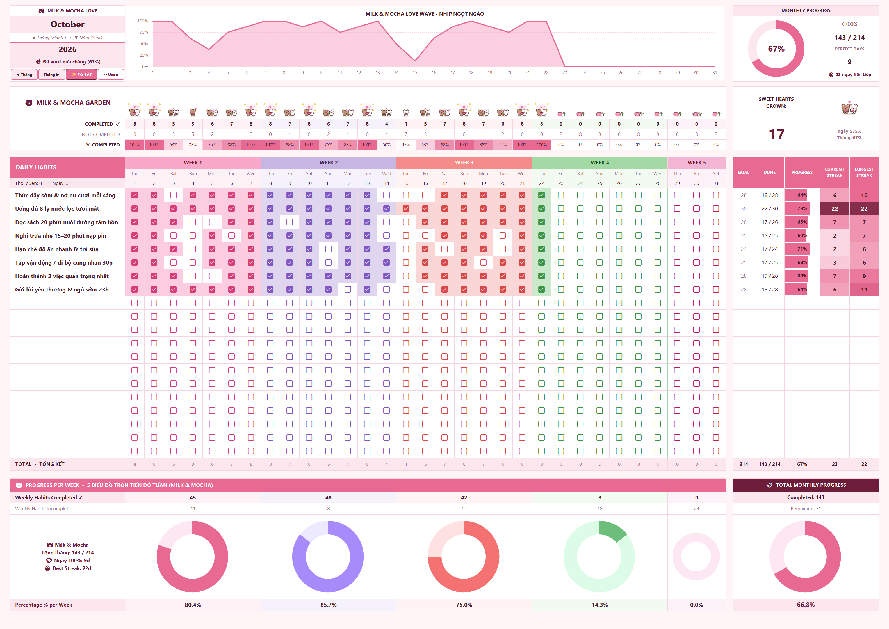
<details>
<summary>📸 Xem thêm: Nhiệm Vụ Ngày (Nút ◀ Hôm qua / Hôm nay / Ngày mai ▶), Yearly Goals & Đại Sảnh Milk & Mocha</summary>


</details>

### 33. 🐱 Peach Mochi Cat & Mood Suite — Hộp Cam + Nhật Ký 6 Cảm Xúc + Quick To-Do

<details>
<summary>📸 Xem thêm: Nhiệm Vụ Ngày & Đại Sảnh Mèo Mochi</summary>

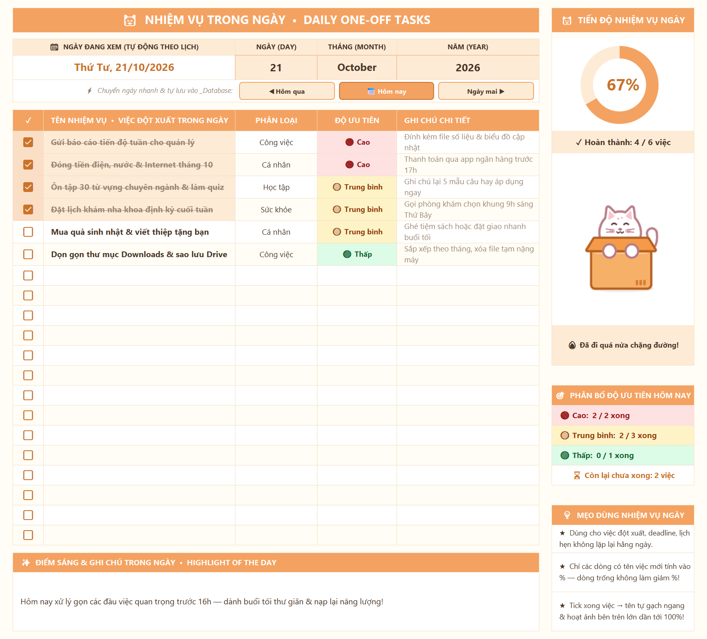


</details>

### 34. 🐰 Fluffy Bunny Sticker Pop — 5 Dải Màu Pastel & Bunny Progress Ring

<details>
<summary>📸 Xem thêm: Đại Sảnh Thỏ Bông Sticker Pop</summary>

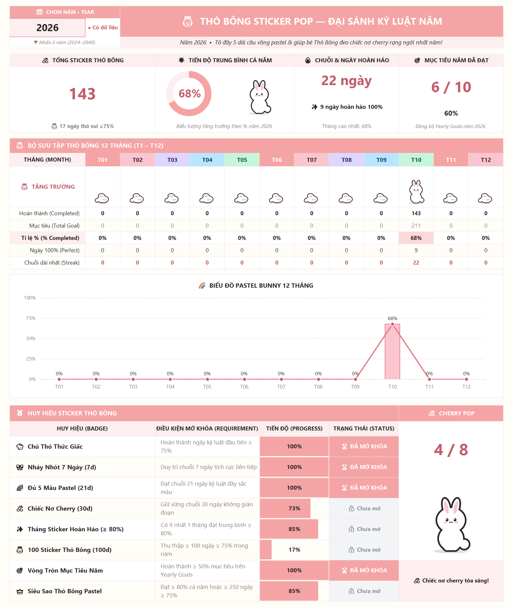

</details>

### 32. 🌸 Sakura Blossom Minimalist — Cây Hoa Anh Đào Tối Giản Tinh Khôi
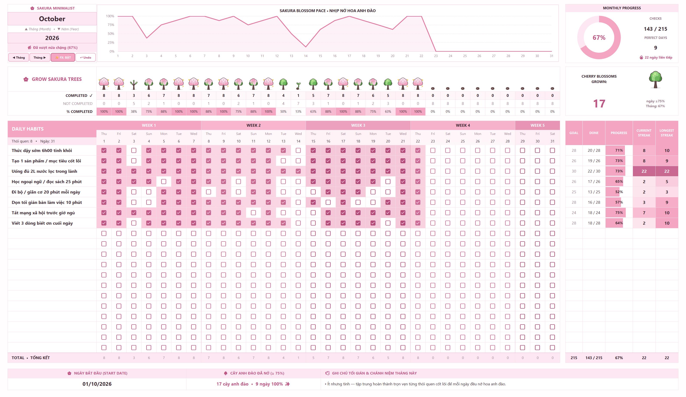
<details>
<summary>📸 Xem thêm: Đại Sảnh Rừng Anh Đào Tối Giản</summary>


</details>

---

## 📱 Xem Nhanh Bản Điện Thoại Khổ Dọc (Mobile Portrait — 0 Cuộn Ngang!)

<table>
  <tr>
    <td align="center"><br/><sub><b>🐻 Milk & Mocha Portrait</b></sub></td>
    <td align="center"><br/><sub><b>🐱 Mochi Cat Portrait</b></sub></td>
    <td align="center">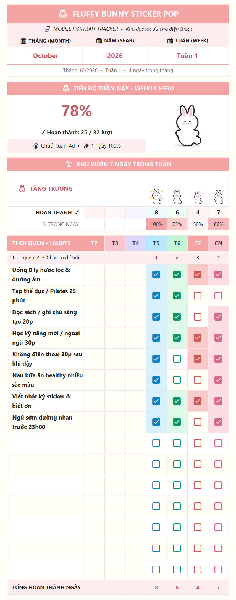<br/><sub><b>🐰 Fluffy Bunny Portrait</b></sub></td>
    <td align="center"><br/><sub><b>🌸 Sakura Min Portrait</b></sub></td>
  </tr>
</table>

<details>
<summary>📸 Xem thêm màn hình Mobile Portrait (Shiba, Akita, Alpaca, Royal Cat, Sunflower, Daily Tasks)</summary>

<table>
  <tr>
    <td align="center"><br/><sub><b>🐕 Shiba Inu</b></sub></td>
    <td align="center"><br/><sub><b>📝 Việc Hôm Nay</b></sub></td>
    <td align="center"><br/><sub><b>🦙 Cream Alpaca</b></sub></td>
    <td align="center">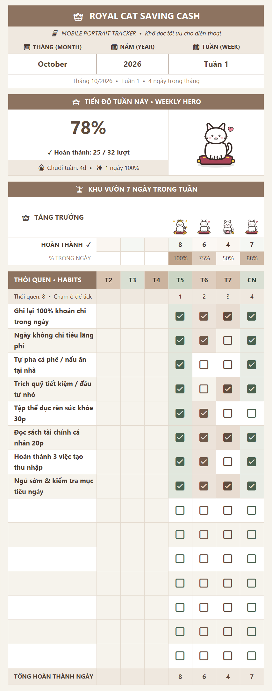<br/><sub><b>👑 Royal Cat Cash</b></sub></td>
  </tr>
</table>

</details>

---

## 📋 Bảng Tải Trực Tiếp Toàn Bộ 35 Mẫu Template (Đủ 4 Phiên Bản — 140 Tệp)

| # | Tên Mẫu & Chủ Đề | ⚡ Pro #1 (Turbo v3.6) | ✨ Excel Offline | ☁️ GSheets Desktop | 📱 Mobile Portrait |
|---|---|---|---|---|---|
| **01** | 🌻 **Sunflower Garden Blush** | [`_Pro.xlsm`](templates/pro_macro/01_Sunflower_Garden_Blush_Pro.xlsm) | [`.xlsx`](templates/excel_universal_offline/01_Sunflower_Garden_Blush.xlsx) | [Desktop](templates/google_sheets_edition/01_Sunflower_Garden_Blush.xlsx) | [📱 Mobile](templates/mobile_portrait_sheets/01_Sunflower_Garden_Blush_Mobile.xlsx) |
| **02** | 🌵 **Cactus Bloom Pastel Weeks** | [`_Pro.xlsm`](templates/pro_macro/02_Cactus_Bloom_Pastel_Weeks_Pro.xlsm) | [`.xlsx`](templates/excel_universal_offline/02_Cactus_Bloom_Pastel_Weeks.xlsx) | [Desktop](templates/google_sheets_edition/02_Cactus_Bloom_Pastel_Weeks.xlsx) | [📱 Mobile](templates/mobile_portrait_sheets/02_Cactus_Bloom_Pastel_Weeks_Mobile.xlsx) |
| **03** | 🌈 **Rainbow Executive Donuts** | [`_Pro.xlsm`](templates/pro_macro/03_Rainbow_Executive_Donuts_Pro.xlsm) | [`.xlsx`](templates/excel_universal_offline/03_Rainbow_Executive_Donuts.xlsx) | [Desktop](templates/google_sheets_edition/03_Rainbow_Executive_Donuts.xlsx) | [📱 Mobile](templates/mobile_portrait_sheets/03_Rainbow_Executive_Donuts_Mobile.xlsx) |
| **04** | 🌿 **Sage Botanical Habit & Budget** | [`_Pro.xlsm`](templates/pro_macro/04_Sage_Botanical_Habit_And_Budget_Pro.xlsm) | [`.xlsx`](templates/excel_universal_offline/04_Sage_Botanical_Habit_And_Budget.xlsx) | [Desktop](templates/google_sheets_edition/04_Sage_Botanical_Habit_And_Budget.xlsx) | [📱 Mobile](templates/mobile_portrait_sheets/04_Sage_Botanical_Habit_And_Budget_Mobile.xlsx) |
| **05** | 🌙 **Lavender Dream Wellness & Mood** | [`_Pro.xlsm`](templates/pro_macro/05_Lavender_Dream_Wellness_Mood_Pro.xlsm) | [`.xlsx`](templates/excel_universal_offline/05_Lavender_Dream_Wellness_Mood.xlsx) | [Desktop](templates/google_sheets_edition/05_Lavender_Dream_Wellness_Mood.xlsx) | [📱 Mobile](templates/mobile_portrait_sheets/05_Lavender_Dream_Wellness_Mood_Mobile.xlsx) |
| **06** | 🚀 **Midnight Navy Blush Focus XP** | [`_Pro.xlsm`](templates/pro_macro/06_Midnight_Navy_Blush_Focus_Pro.xlsm) | [`.xlsx`](templates/excel_universal_offline/06_Midnight_Navy_Blush_Focus.xlsx) | [Desktop](templates/google_sheets_edition/06_Midnight_Navy_Blush_Focus.xlsx) | [📱 Mobile](templates/mobile_portrait_sheets/06_Midnight_Navy_Blush_Focus_Mobile.xlsx) |
| **07** | 🌸 **Sakura Zen Study Planner** | [`_Pro.xlsm`](templates/pro_macro/07_Sakura_Zen_Study_Planner_Pro.xlsm) | [`.xlsx`](templates/excel_universal_offline/07_Sakura_Zen_Study_Planner.xlsx) | [Desktop](templates/google_sheets_edition/07_Sakura_Zen_Study_Planner.xlsx) | [📱 Mobile](templates/mobile_portrait_sheets/07_Sakura_Zen_Study_Planner_Mobile.xlsx) |
| **08** | 🪸 **Ocean Coral Fitness & Energy** | [`_Pro.xlsm`](templates/pro_macro/08_Ocean_Coral_Fitness_Energy_Pro.xlsm) | [`.xlsx`](templates/excel_universal_offline/08_Ocean_Coral_Fitness_Energy.xlsx) | [Desktop](templates/google_sheets_edition/08_Ocean_Coral_Fitness_Energy.xlsx) | [📱 Mobile](templates/mobile_portrait_sheets/08_Ocean_Coral_Fitness_Energy_Mobile.xlsx) |
| **09** | 🍵 **Matcha Cafe Daily Routine** | [`_Pro.xlsm`](templates/pro_macro/09_Matcha_Cafe_Daily_Routine_Pro.xlsm) | [`.xlsx`](templates/excel_universal_offline/09_Matcha_Cafe_Daily_Routine.xlsx) | [Desktop](templates/google_sheets_edition/09_Matcha_Cafe_Daily_Routine.xlsx) | [📱 Mobile](templates/mobile_portrait_sheets/09_Matcha_Cafe_Daily_Routine_Mobile.xlsx) |
| **10** | 🌌 **Aurora Glow RPG Quest Tracker** | [`_Pro.xlsm`](templates/pro_macro/10_Aurora_Glow_RPG_Quest_Tracker_Pro.xlsm) | [`.xlsx`](templates/excel_universal_offline/10_Aurora_Glow_RPG_Quest_Tracker.xlsx) | [Desktop](templates/google_sheets_edition/10_Aurora_Glow_RPG_Quest_Tracker.xlsx) | [📱 Mobile](templates/mobile_portrait_sheets/10_Aurora_Glow_RPG_Quest_Tracker_Mobile.xlsx) |
| **11** | 🌹 **Velvet Rose Garden** | [`_Pro.xlsm`](templates/pro_macro/11_Velvet_Rose_Garden_Pro.xlsm) | [`.xlsx`](templates/excel_universal_offline/11_Velvet_Rose_Garden.xlsx) | [Desktop](templates/google_sheets_edition/11_Velvet_Rose_Garden.xlsx) | [📱 Mobile](templates/mobile_portrait_sheets/11_Velvet_Rose_Garden_Mobile.xlsx) |
| **12** | 🌷 **Blue Tulip Mint Breeze** | [`_Pro.xlsm`](templates/pro_macro/12_Blue_Tulip_Mint_Breeze_Pro.xlsm) | [`.xlsx`](templates/excel_universal_offline/12_Blue_Tulip_Mint_Breeze.xlsx) | [Desktop](templates/google_sheets_edition/12_Blue_Tulip_Mint_Breeze.xlsx) | [📱 Mobile](templates/mobile_portrait_sheets/12_Blue_Tulip_Mint_Breeze_Mobile.xlsx) |
| **13** | 🌸 **Buttercream Blossom Bars** | [`_Pro.xlsm`](templates/pro_macro/13_Buttercream_Blossom_Bars_Pro.xlsm) | [`.xlsx`](templates/excel_universal_offline/13_Buttercream_Blossom_Bars.xlsx) | [Desktop](templates/google_sheets_edition/13_Buttercream_Blossom_Bars.xlsx) | [📱 Mobile](templates/mobile_portrait_sheets/13_Buttercream_Blossom_Bars_Mobile.xlsx) |
| **14** | 🌳 **Emerald Forest Gold Stars** | [`_Pro.xlsm`](templates/pro_macro/14_Emerald_Forest_Gold_Stars_Pro.xlsm) | [`.xlsx`](templates/excel_universal_offline/14_Emerald_Forest_Gold_Stars.xlsx) | [Desktop](templates/google_sheets_edition/14_Emerald_Forest_Gold_Stars.xlsx) | [📱 Mobile](templates/mobile_portrait_sheets/14_Emerald_Forest_Gold_Stars_Mobile.xlsx) |
| **15** | 🌻 **Mocha Rose Terracotta Sunflower** | [`_Pro.xlsm`](templates/pro_macro/15_Mocha_Rose_Terracotta_Sunflower_Pro.xlsm) | [`.xlsx`](templates/excel_universal_offline/15_Mocha_Rose_Terracotta_Sunflower.xlsx) | [Desktop](templates/google_sheets_edition/15_Mocha_Rose_Terracotta_Sunflower.xlsx) | [📱 Mobile](templates/mobile_portrait_sheets/15_Mocha_Rose_Terracotta_Sunflower_Mobile.xlsx) |
| **16** | 🏡 **Dream Home Architect Builder** | [`_Pro.xlsm`](templates/pro_macro/16_Dream_Home_Architect_Builder_Pro.xlsm) | [`.xlsx`](templates/excel_universal_offline/16_Dream_Home_Architect_Builder.xlsx) | [Desktop](templates/google_sheets_edition/16_Dream_Home_Architect_Builder.xlsx) | [📱 Mobile](templates/mobile_portrait_sheets/16_Dream_Home_Architect_Builder_Mobile.xlsx) |
| **17** | 🌺 **Wildflower Bloom & Daily Mood** | [`_Pro.xlsm`](templates/pro_macro/17_Wildflower_Bloom_Daily_Mood_Pro.xlsm) | [`.xlsx`](templates/excel_universal_offline/17_Wildflower_Bloom_Daily_Mood.xlsx) | [Desktop](templates/google_sheets_edition/17_Wildflower_Bloom_Daily_Mood.xlsx) | [📱 Mobile](templates/mobile_portrait_sheets/17_Wildflower_Bloom_Daily_Mood_Mobile.xlsx) |
| **18** | 🌳 **Plum Oak Master Suite** | [`_Pro.xlsm`](templates/pro_macro/18_Plum_Oak_Master_Suite_Pro.xlsm) | [`.xlsx`](templates/excel_universal_offline/18_Plum_Oak_Master_Suite.xlsx) | [Desktop](templates/google_sheets_edition/18_Plum_Oak_Master_Suite.xlsx) | [📱 Mobile](templates/mobile_portrait_sheets/18_Plum_Oak_Master_Suite_Mobile.xlsx) |
| **19** | 🌻 **Meadow Emerald Sunflower** | [`_Pro.xlsm`](templates/pro_macro/19_Meadow_Emerald_Sunflower_Pro.xlsm) | [`.xlsx`](templates/excel_universal_offline/19_Meadow_Emerald_Sunflower.xlsx) | [Desktop](templates/google_sheets_edition/19_Meadow_Emerald_Sunflower.xlsx) | [📱 Mobile](templates/mobile_portrait_sheets/19_Meadow_Emerald_Sunflower_Mobile.xlsx) |
| **20** | 🦙 **Cream Alpaca Cozy Budget** *(Cozy Cafe: Khăn Len, Mũ Nồi & Latte)* | [`_Pro.xlsm`](templates/pro_macro/20_Cream_Alpaca_Cozy_Budget_Pro.xlsm) | [`.xlsx`](templates/excel_universal_offline/20_Cream_Alpaca_Cozy_Budget.xlsx) | [Desktop](templates/google_sheets_edition/20_Cream_Alpaca_Cozy_Budget.xlsx) | [📱 Mobile](templates/mobile_portrait_sheets/20_Cream_Alpaca_Cozy_Budget_Mobile.xlsx) |
| **21** | 🌸 **Blush Alpaca Flower Crown** *(Vườn Cổ Tích: Giỏ Hoa & Vòng Hoa Hồng)* | [`_Pro.xlsm`](templates/pro_macro/21_Blush_Alpaca_Flower_Crown_Pro.xlsm) | [`.xlsx`](templates/excel_universal_offline/21_Blush_Alpaca_Flower_Crown.xlsx) | [Desktop](templates/google_sheets_edition/21_Blush_Alpaca_Flower_Crown.xlsx) | [📱 Mobile](templates/mobile_portrait_sheets/21_Blush_Alpaca_Flower_Crown_Mobile.xlsx) |
| **22** | 🍵 **Matcha Alpaca Meadow** *(Picnic Thám Hiểm: Khăn Caro, Yên Thêu & Mũ Cói)* | [`_Pro.xlsm`](templates/pro_macro/22_Matcha_Alpaca_Meadow_Pro.xlsm) | [`.xlsx`](templates/excel_universal_offline/22_Matcha_Alpaca_Meadow.xlsx) | [Desktop](templates/google_sheets_edition/22_Matcha_Alpaca_Meadow.xlsx) | [📱 Mobile](templates/mobile_portrait_sheets/22_Matcha_Alpaca_Meadow_Mobile.xlsx) |
| **23** | 🐼 **Bamboo Panda Zen Garden** *(Gấu Trúc Mochi Tròn Xoe: Onigiri & Khăn Đỏ)* | [`_Pro.xlsm`](templates/pro_macro/23_Bamboo_Panda_Zen_Garden_Pro.xlsm) | [`.xlsx`](templates/excel_universal_offline/23_Bamboo_Panda_Zen_Garden.xlsx) | [Desktop](templates/google_sheets_edition/23_Bamboo_Panda_Zen_Garden.xlsx) | [📱 Mobile](templates/mobile_portrait_sheets/23_Bamboo_Panda_Zen_Garden_Mobile.xlsx) |
| **24** | 👑 **Royal Cat Saving Cash** | [`_Pro.xlsm`](templates/pro_macro/24_Royal_Cat_Saving_Cash_Pro.xlsm) | [`.xlsx`](templates/excel_universal_offline/24_Royal_Cat_Saving_Cash.xlsx) | [Desktop](templates/google_sheets_edition/24_Royal_Cat_Saving_Cash.xlsx) | [📱 Mobile](templates/mobile_portrait_sheets/24_Royal_Cat_Saving_Cash_Mobile.xlsx) |
| **25** | 🐱 **Ginger Kitten Basket Routine** | [`_Pro.xlsm`](templates/pro_macro/25_Ginger_Kitten_Basket_Routine_Pro.xlsm) | [`.xlsx`](templates/excel_universal_offline/25_Ginger_Kitten_Basket_Routine.xlsx) | [Desktop](templates/google_sheets_edition/25_Ginger_Kitten_Basket_Routine.xlsx) | [📱 Mobile](templates/mobile_portrait_sheets/25_Ginger_Kitten_Basket_Routine_Mobile.xlsx) |
| **26** | 🌙 **Pastel Purple Starlight Cat** *(Trăng Khuyết & Mũ Nồi Sao)* | [`_Pro.xlsm`](templates/pro_macro/26_Pastel_Purple_Royal_Cat_Pro.xlsm) | [`.xlsx`](templates/excel_universal_offline/26_Pastel_Purple_Royal_Cat.xlsx) | [Desktop](templates/google_sheets_edition/26_Pastel_Purple_Royal_Cat.xlsx) | [📱 Mobile](templates/mobile_portrait_sheets/26_Pastel_Purple_Royal_Cat_Mobile.xlsx) |
| **27** | 🐣 **Hatching Chick Icon Studio** | [`_Pro.xlsm`](templates/pro_macro/27_Hatching_Chick_Icon_Studio_Pro.xlsm) | [`.xlsx`](templates/excel_universal_offline/27_Hatching_Chick_Icon_Studio.xlsx) | [Desktop](templates/google_sheets_edition/27_Hatching_Chick_Icon_Studio.xlsx) | [📱 Mobile](templates/mobile_portrait_sheets/27_Hatching_Chick_Icon_Studio_Mobile.xlsx) |
| **28** | 🍬 **Cotton Candy Jar Sweet** | [`_Pro.xlsm`](templates/pro_macro/28_Cotton_Candy_Jar_Sweet_Pro.xlsm) | [`.xlsx`](templates/excel_universal_offline/28_Cotton_Candy_Jar_Sweet.xlsx) | [Desktop](templates/google_sheets_edition/28_Cotton_Candy_Jar_Sweet.xlsx) | [📱 Mobile](templates/mobile_portrait_sheets/28_Cotton_Candy_Jar_Sweet_Mobile.xlsx) |
| **29** | 🌹 **Watercolor Rose Bouquet** | [`_Pro.xlsm`](templates/pro_macro/29_Watercolor_Rose_Bouquet_Pro.xlsm) | [`.xlsx`](templates/excel_universal_offline/29_Watercolor_Rose_Bouquet.xlsx) | [Desktop](templates/google_sheets_edition/29_Watercolor_Rose_Bouquet.xlsx) | [📱 Mobile](templates/mobile_portrait_sheets/29_Watercolor_Rose_Bouquet_Mobile.xlsx) |
| **30** | 🐕 **Shiba Inu Happy Bork** *(Khăn Đỏ Karakusa & Xương Vàng)* | [`_Pro.xlsm`](templates/pro_macro/30_Shiba_Inu_Happy_Bork_Pro.xlsm) | [`.xlsx`](templates/excel_universal_offline/30_Shiba_Inu_Happy_Bork.xlsx) | [Desktop](templates/google_sheets_edition/30_Shiba_Inu_Happy_Bork.xlsx) | [📱 Mobile](templates/mobile_portrait_sheets/30_Shiba_Inu_Happy_Bork_Mobile.xlsx) |
| **31** | ❄️ **Akita Inu Snow Loyal** *(Tuyết Trắng & Vòng Chuông Shimenawa)* | [`_Pro.xlsm`](templates/pro_macro/31_Akita_Inu_Snow_Loyal_Pro.xlsm) | [`.xlsx`](templates/excel_universal_offline/31_Akita_Inu_Snow_Loyal.xlsx) | [Desktop](templates/google_sheets_edition/31_Akita_Inu_Snow_Loyal.xlsx) | [📱 Mobile](templates/mobile_portrait_sheets/31_Akita_Inu_Snow_Loyal_Mobile.xlsx) |
| **32** | 🌸 **Sakura Blossom Minimalist** *(Signature)* | [`_Pro.xlsm`](templates/pro_macro/32_Sakura_Blossom_Minimalist_Pro.xlsm) | [`.xlsx`](templates/excel_universal_offline/32_Sakura_Blossom_Minimalist.xlsx) | [Desktop](templates/google_sheets_edition/32_Sakura_Blossom_Minimalist.xlsx) | [📱 Mobile](templates/mobile_portrait_sheets/32_Sakura_Blossom_Minimalist_Mobile.xlsx) |
| **33** | 🐱 **Peach Mochi Cat Mood Suite** *(Bánh Nếp, Quýt Mikan & Taiyaki)* | [`_Pro.xlsm`](templates/pro_macro/33_Peach_Mochi_Cat_Mood_Suite_Pro.xlsm) | [`.xlsx`](templates/excel_universal_offline/33_Peach_Mochi_Cat_Mood_Suite.xlsx) | [Desktop](templates/google_sheets_edition/33_Peach_Mochi_Cat_Mood_Suite.xlsx) | [📱 Mobile](templates/mobile_portrait_sheets/33_Peach_Mochi_Cat_Mood_Suite_Mobile.xlsx) |
| **34** | 🐰 **Fluffy Bunny Sticker Pop** *(Signature)* | [`_Pro.xlsm`](templates/pro_macro/34_Fluffy_Bunny_Sticker_Pop_Pro.xlsm) | [`.xlsx`](templates/excel_universal_offline/34_Fluffy_Bunny_Sticker_Pop.xlsx) | [Desktop](templates/google_sheets_edition/34_Fluffy_Bunny_Sticker_Pop.xlsx) | [📱 Mobile](templates/mobile_portrait_sheets/34_Fluffy_Bunny_Sticker_Pop_Mobile.xlsx) |
| **35** | 🐻 **Milk & Mocha Bear Sweet Love** *(Signature)* | [`_Pro.xlsm`](templates/pro_macro/35_Milk_Mocha_Bear_Sweet_Love_Pro.xlsm) | [`.xlsx`](templates/excel_universal_offline/35_Milk_Mocha_Bear_Sweet_Love.xlsx) | [Desktop](templates/google_sheets_edition/35_Milk_Mocha_Bear_Sweet_Love.xlsx) | [📱 Mobile](templates/mobile_portrait_sheets/35_Milk_Mocha_Bear_Sweet_Love_Mobile.xlsx) |

---

## 🎨 Giao Diện Pro v3.6 Thực Tế (`01_Sunflower` + Bộ Sưu Tập `#01`–`#31`)


<details>
<summary>🌻 Mở rộng xem ảnh chụp 31 mẫu cổ điển & linh vật (#02 – #31)</summary>

| Mẫu | Preview |
|---|---|
| **02. 🌵 Cactus Bloom Pastel Weeks** |  |
| **03. 🌈 Rainbow Executive Donuts** |  |
| **04. 🌿 Sage Botanical Living** |  |
| **05. 🌙 Lavender Dream Wellness** |  |
| **06. 🚀 Midnight Navy Focus XP** |  |
| **07. 🌸 Sakura Zen Study Planner** |  |
| **08. 🪸 Ocean Coral Fitness** |  |
| **09. 🍵 Matcha Cafe Routine** |  |
| **10. 🌌 Aurora Glow RPG Quest** | 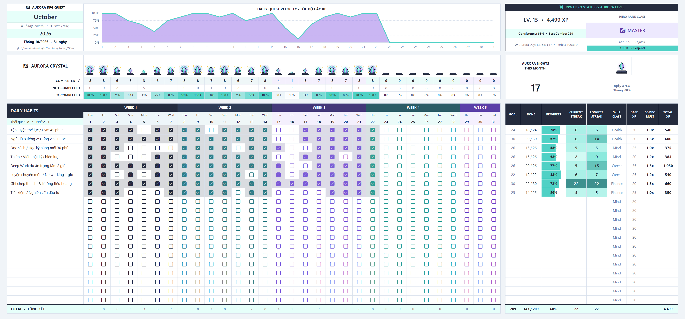 |
| **11. 🌹 Velvet Rose Garden** | 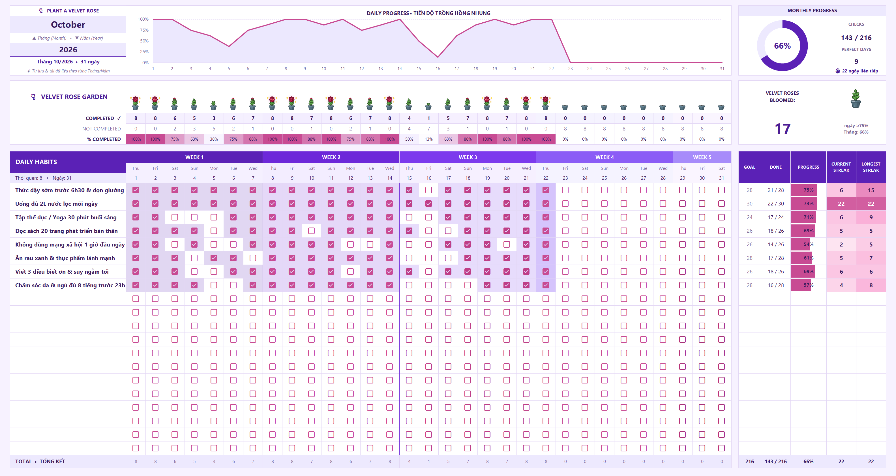 |
| **12. 🌷 Blue Tulip Mint Breeze** |  |
| **13. 🌸 Buttercream Blossom Bars** |  |
| **14. 🌳 Emerald Forest Gold Stars** |  |
| **15. 🌻 Mocha Rose Terracotta** |  |
| **16. 🏡 Dream Home Architect** |  |
| **17. 🌺 Wildflower Bloom & Mood** | 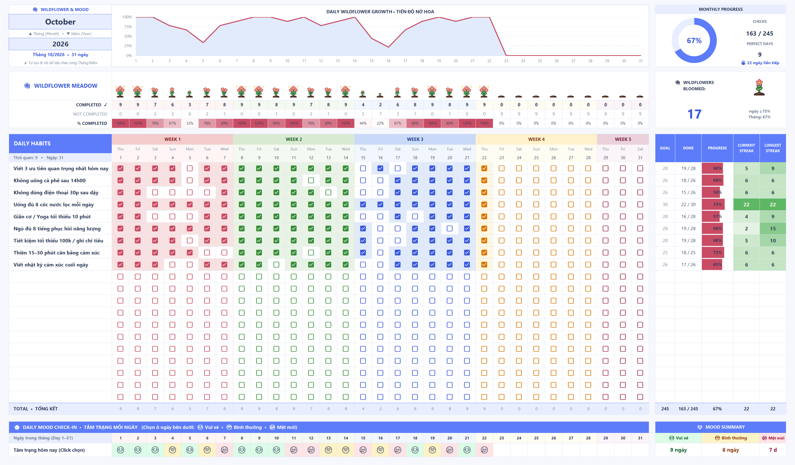 |
| **18. 🌳 Plum Oak Master Suite** |  |
| **19. 🌻 Meadow Emerald Sunflower** |  |
| **20. 🦙 Cream Alpaca Cozy Cafe & Budget** |  |
| **21. 🌸 Blush Alpaca Fairy Flower Crown** |  |
| **22. 🍵 Matcha Alpaca Picnic Explorer** | 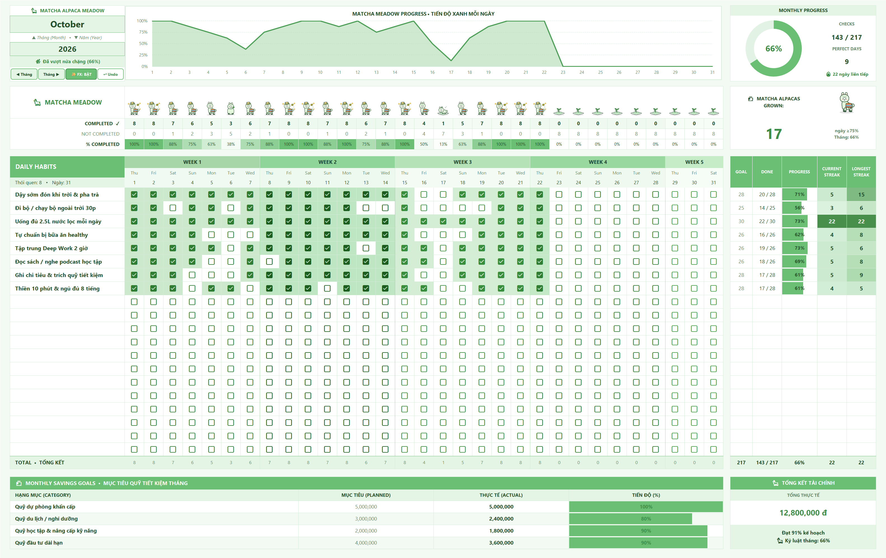 |
| **23. 🐼 Bamboo Panda Round Zen Garden** |  |
| **24. 👑 Royal Cat Saving Cash** |  |
| **25. 🐱 Ginger Kitten Basket** |  |
| **26. 🌙 Pastel Purple Starlight Cat** |  |
| **27. 🐣 Hatching Chick Studio** |  |
| **28. 🍬 Cotton Candy Jar Sweet** |  |
| **29. 🌹 Watercolor Rose Bouquet** |  |
| **30. 🐕 Shiba Inu Happy Bork** |  |
| **31. ❄️ Akita Inu Snow Loyal** |  |

</details>

---

## 🎭 Bộ 210 Ảnh Hoạt Ảnh 6 Giai Đoạn (`assets/` — 35 Chủ Đề, v3.6 Vector Kawaii)

### Bộ 4 Alpaca & Gấu Trúc Mochi Vẽ Lại Độc Bản (`#20`, `#21`, `#22`, `#23` — 24 Sprites)


### Bộ 6 Thú Cưng Vẽ Lại Chuẩn Kawaii Vector Bézier (`#24`, `#25`, `#26`, `#30`, `#31`, `#33` — 36 Sprites)


### Batch 4 (Chủ đề `#32`–`#35` — 24 Sprites Signature)
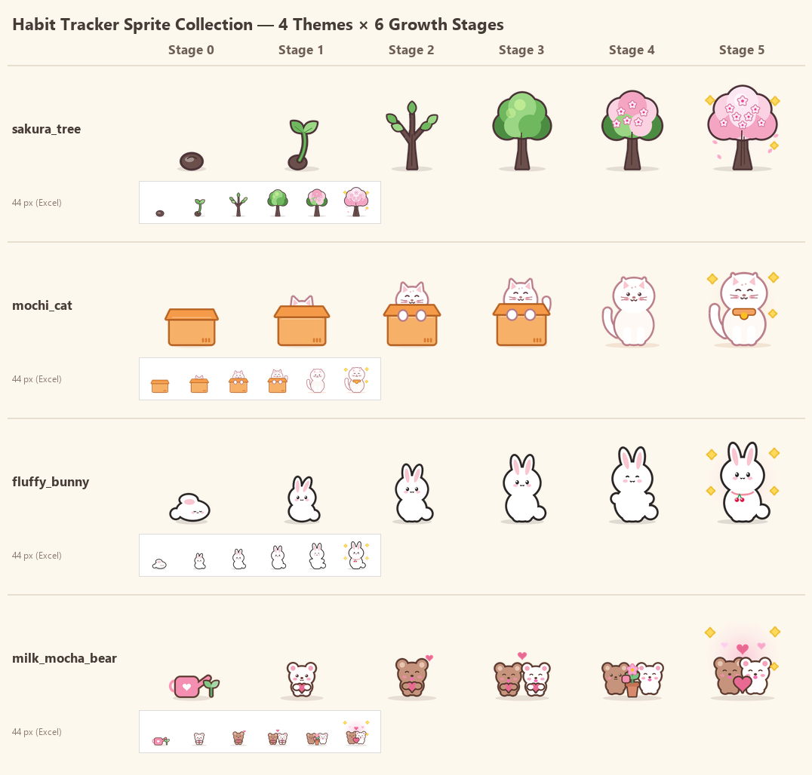

<details>
<summary>🎨 Xem Batch 1 (#01–#10), Batch 2 (#11–#19) & Batch 3 (#20–#31) Sprites</summary>

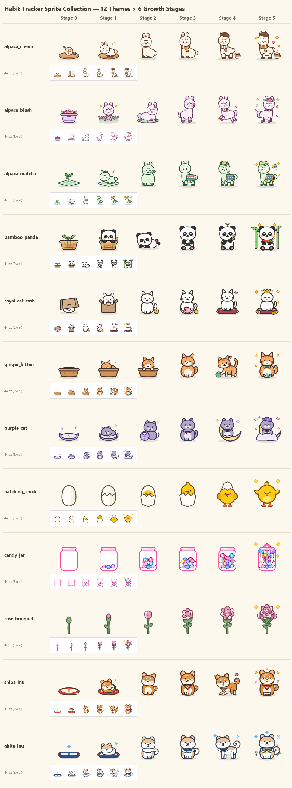


</details>

---

## ☁️ Kích Hoạt Google Sheets Trong 10 Giây (1-Click Setup v3.6)

1. Tải mẫu từ [`templates/google_sheets_edition/`](templates/google_sheets_edition/) hoặc [`templates/mobile_portrait_sheets/`](templates/mobile_portrait_sheets/) lên Google Drive → **Mở bằng Google Sheets** → **Tệp → Lưu dưới dạng Google Trang tính**.
2. Chọn **Tiện ích mở rộng (Extensions) → Apps Script** → dán toàn bộ code trong [`scripts/google_sheets_1click_setup.gs`](scripts/google_sheets_1click_setup.gs) → **Lưu (`Ctrl+S`)** → bấm **Run `setupHabitTracker`**.

Xem thêm hướng dẫn tại [`docs/GOOGLE_SHEETS_GUIDE.md`](docs/GOOGLE_SHEETS_GUIDE.md) và [`docs/CUSTOMIZATION_GUIDE.md`](docs/CUSTOMIZATION_GUIDE.md).

---

## 🛠️ Dành Cho Developer (Build & QA v3.6)

```powershell
# Build Pro Interactive (.xlsm) theo lô với Turbo Engine v3.6 (tự recycle Excel COM mỗi 5 file):
python scripts/excel_com_enhancer.py pro --start 1 --end 5

# Đo benchmark tốc độ thực tế Excel COM trên bản Pro v3.6:
python scripts/benchmark_pro_speed.py

# Chạy bộ QA tự động v3.6 trên toàn bộ 35 file Pro (tĩnh + live COM + Ctrl+Z Undo & Protection):
python scripts/qa_verify_v36.py
```

---

💛 **Created with care by Dyu** · *Chúc bạn gieo từng thói quen nhỏ, tận hưởng niềm vui pháo hoa mỗi ngày 100% và gặt hái cả khu vườn kỷ luật rực rỡ!*
