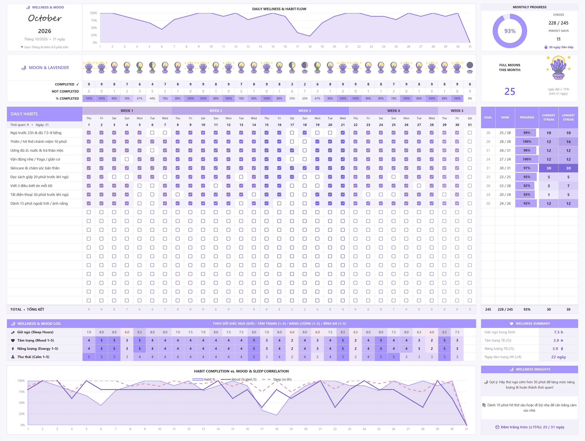
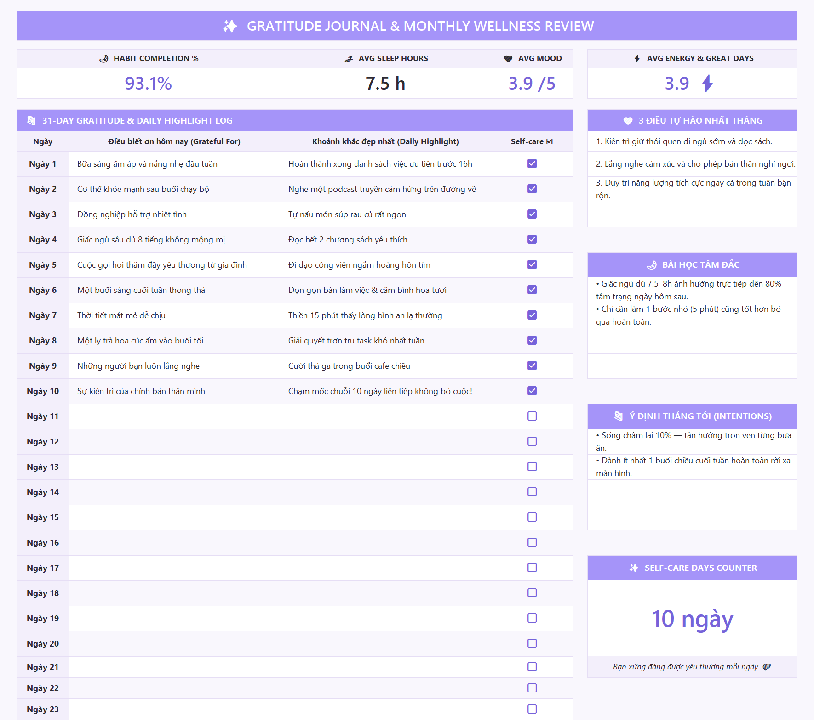
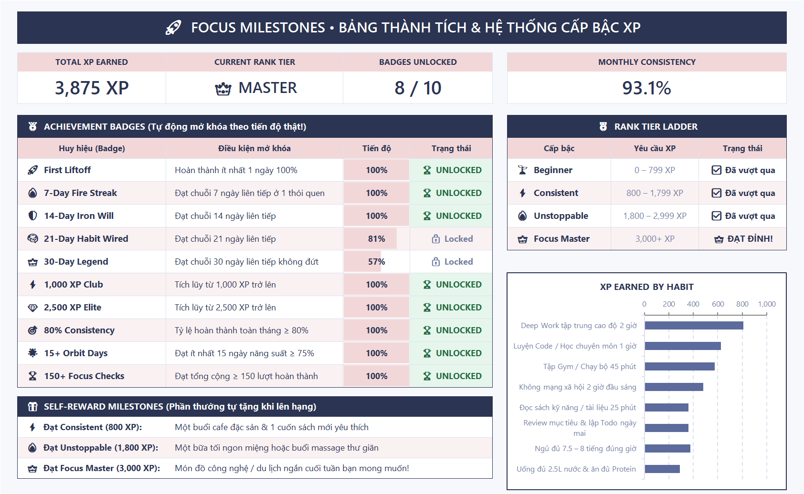

# 🌸 Habit Tracker Collection for Everyone — by Dyu

> **Bộ sưu tập 6 mẫu Excel / Google Sheets Habit Tracker thẩm mỹ chuẩn Digital Planner** với **hoạt ảnh tăng trưởng 6 giai đoạn theo thời gian thực**, bảng điều khiển biểu đồ tương tác, lịch động tự cập nhật tháng/năm, bản **Offline Pro nhúng ảnh sẵn**, và tab **`📖 Hướng Dẫn`** tiếng Việt tích hợp trong từng file.

-217346?style=for-the-badge&logo=microsoftexcel&logoColor=white)


---

## ✨ Điểm Nổi Bật (Key Features)

- 🌱 **Hoạt ảnh tăng trưởng 6 giai đoạn (`0% → 100%`):** Mỗi ngày hoàn thành thói quen sẽ tự động biến đổi minh họa phía trên cột ngày (từ đất trống / hạt mầm → chồi non → nụ hoa → nở rộ phát sáng rực rỡ ✨) bằng hàm `=IMAGE(...)` (Excel 365 & Google Sheets) hoặc ảnh nhúng 100% Offline trong `templates/pro_macro/`.
- 📅 **Lịch động thông minh (Dynamic Calendar Engine):** Đổi dropdown **Tháng / Năm** → tự tính chuẩn 28 / 29 (năm nhuận) / 30 / 31 ngày, tự đổi thứ (`Mon–Sun`), tự ẩn sạch ngày thừa cuối tháng!
- 📊 **Dashboard & Biểu đồ thời gian thực:** Biểu đồ miền mượt (`Daily Progress`), biểu đồ Donut tổng tháng & 5 tuần, thanh tiến độ Data Bar cho từng thói quen, và **Streak Heatmap** xanh ngọc tự động chuyển sắc theo độ dài chuỗi ngày.
- 🧩 **20 dòng thói quen nối sẵn công thức:** Chỉ cần gõ thêm tên thói quen vào dòng trống và tick — mọi biểu đồ, tổng kết và streak tự động mở rộng mà **không bao giờ hỏng công thức**.
- 📖 **Tự chứa hướng dẫn chi tiết (`📖 Hướng Dẫn`):** Tab đầu tiên trong mọi file hướng dẫn đầy đủ bằng tiếng Việt + bảng cấu hình trực tiếp đường dẫn ảnh (`CFG_IMG_BASE`) & ngưỡng phần trăm (`CFG_THR_1..3`).

---

## 🎨 Bộ Sưu Tập 6 Mẫu Template Độc Đáo

### 1. 🌻 Sunflower Garden Blush (`01_Sunflower_Garden_Blush.xlsx`)
- **Bảng màu:** Dusty Rose (`#D8A7A7`) · Warm Blush (`#F5E6E6`) · Cream (`#FFFDFB`) · Emerald Streak (`#4E9F76`)
- **Hoạt ảnh:** Hoa hướng dương lớn dần từ chậu đất → mầm xanh → nụ vàng → bông hướng dương tỏa nắng
- **Các sheet:** `📖 Hướng Dẫn` · `🌻 Monthly Tracker` · `🎯 Yearly Goals & Habits` (kèm bộ đếm *You Have Planted*) · `📊 Annual Overview` (tổng kết 12 tháng & biểu đồ năm)
- **Tải về:** [Universal (Excel 365 & Google Sheets)](templates/01_Sunflower_Garden_Blush.xlsx) · [Offline Pro (Excel 365 không cần mạng)](templates/pro_macro/01_Sunflower_Garden_Blush_Offline_Pro.xlsx)


<details>
<summary>📸 Xem thêm các tab phụ: Hướng Dẫn, Yearly Goals & Annual Overview</summary>


</details>

---

### 2. 🌵 Cactus Bloom Pastel Weeks (`02_Cactus_Bloom_Pastel_Weeks.xlsx`)
- **Bảng màu 5 tuần pastel:** W1 Hồng phấn (`#F8D7E8`) · W2 Tím oải hương (`#E2D7F8`) · W3 Xanh trời (`#D7EAF8`) · W4 Xanh bạc hà (`#D7F8E5`) · W5 Vàng bơ (`#FAF2CC`)
- **Hoạt ảnh:** Chậu xương rồng đất nung dễ thương mọc nhánh & nở hoa hồng trên đỉnh
- **Các sheet:** `📖 Hướng Dẫn` · `🌵 Monthly Tracker` (biểu đồ *Daily Productivity* xanh có điểm đánh dấu + dải tổng kết 5 tuần pastel + Side Stats) · `📝 Reflection & Notes`
- **Tải về:** [Universal](templates/02_Cactus_Bloom_Pastel_Weeks.xlsx) · [Offline Pro](templates/pro_macro/02_Cactus_Bloom_Pastel_Weeks_Offline_Pro.xlsx)


<details>
<summary>📸 Xem tab Reflection & Notes</summary>


</details>

---

### 3. 🌈 Rainbow Executive Donuts (`03_Rainbow_Executive_Donuts.xlsx`)
- **Bảng màu:** Cầu vồng pastel (Ice Blue · Sage Mint · Rose Pink · Peach Apricot · Soft Olive) trên thẻ trắng sắc nét
- **Hoạt ảnh:** Lọ thủy tinh gom sao phát sáng & nở hoa sen hồng trên nắp khi đạt 100%
- **Các sheet:** `📖 Hướng Dẫn` · `🌈 Habit Dashboard` (Area Chart + Overall Donut + **5 Weekly Progress Donut Charts** + Weekly Habits Checklist + Notes Card) · `📈 Analytics` (Leaderboard & phân tích hiệu suất Thứ 2–Chủ nhật)
- **Tải về:** [Universal](templates/03_Rainbow_Executive_Donuts.xlsx) · [Offline Pro](templates/pro_macro/03_Rainbow_Executive_Donuts_Offline_Pro.xlsx)


<details>
<summary>📸 Xem tab Analytics (Habit Leaderboard & Day-of-Week Breakdown)</summary>


</details>

---

### 4. 🌿 Sage Botanical Habit & Budget (`04_Sage_Botanical_Habit_And_Budget.xlsx`)
- **Bảng màu:** Sage Green (`#9FB8AD`) · Warm Sand (`#E8D5B7`) · Dusty Coral (`#E0A899`) · Ivory (`#FAF9F6`)
- **Hoạt ảnh:** Chậu cây Monstera xanh mướt nở hoa san hô rực rỡ
- **Các sheet:** `📖 Hướng Dẫn` · `🌿 Daily Habits` · `💰 Monthly Budget` (Cash Flow Donut, Budget vs Actual Bar Chart, Savings Goals Progress Bar, Bills Checklist & Transaction Log tự động tính `SUMIF`) · `🔗 Life Overview` (kết hợp **Habit % + Savings Rate %**)
- **Tải về:** [Universal](templates/04_Sage_Botanical_Habit_And_Budget.xlsx) · [Offline Pro](templates/pro_macro/04_Sage_Botanical_Habit_And_Budget_Offline_Pro.xlsx)


<details>
<summary>📸 Xem tab Monthly Budget & Life Overview</summary>


</details>

---

### 5. 🌙 Lavender Dream Wellness & Mood (`05_Lavender_Dream_Wellness_Mood.xlsx`)
- **Bảng màu:** Soft Lilac (`#C8B6E2`) · Periwinkle (`#A594F9`) · Mist Lavender (`#F3EFFB`) · Charcoal Ink (`#2D2A32`)
- **Hoạt ảnh:** Chu kỳ mặt trăng (Trăng non → Trăng tròn phát sáng) cùng nhánh hoa oải hương nở rộ
- **Các sheet:** `📖 Hướng Dẫn` · `🌙 Habit & Wellness` (Thói quen + Nhật ký Giờ ngủ / Tâm trạng 1–5 / Năng lượng 1–5 / Thư thái + Biểu đồ tương quan Habit vs Mood & Sleep) · `✨ Gratitude & Review` (Nhật ký 31 ngày biết ơn & bộ đếm Self-care)
- **Tải về:** [Universal](templates/05_Lavender_Dream_Wellness_Mood.xlsx) · [Offline Pro](templates/pro_macro/05_Lavender_Dream_Wellness_Mood_Offline_Pro.xlsx)



<details>
<summary>📸 Xem tab Gratitude & Review</summary>



</details>

---

### 6. 🚀 Midnight Navy Blush Focus (`06_Midnight_Navy_Blush_Focus.xlsx`)
- **Bảng màu:** Deep Navy (`#2B3452`) · Soft Blush (`#F2D7D9`) · Slate Blue (`#5C6B9C`) · Crisp White (`#FFFFFF`)
- **Hoạt ảnh:** Tên lửa phóng lên quỹ đạo vũ trụ với vầng hào quang & hành tinh mini
- **Các sheet:** `📖 Hướng Dẫn` · `🚀 Focus Tracker` (hệ thống **Gamification XP/Day & Total XP**, thẻ xếp hạng tự động: `🌱 Beginner → ⚡ Consistent → 🔥 Unstoppable → 👑 Master`) · `🏆 Milestones` (10 Huy hiệu thành tích tự động mở khóa `🏆 UNLOCKED` & biểu đồ đóng góp XP)
- **Tải về:** [Universal](templates/06_Midnight_Navy_Blush_Focus.xlsx) · [Offline Pro](templates/pro_macro/06_Midnight_Navy_Blush_Focus_Offline_Pro.xlsx)


<details>
<summary>📸 Xem tab Milestones & Rank Ladder</summary>



</details>

---

## 🖼️ Bộ 36 Sprite Hoạt Ảnh Tăng Trưởng (256×256px Transparent PNG)

Toàn bộ 36 icon (6 chủ đề × 6 giai đoạn) đều được thiết kế bằng code vector 4× supersampling sắc nét, dễ nhìn ngay cả ở kích thước ô Excel 44px:


---

## 🚀 Hướng Dẫn Bắt Đầu Nhanh (Quick Start)

| Bạn đang dùng... | Chọn file nào? | Cách mở & sử dụng |
|---|---|---|
| **Microsoft Excel 365** (có mạng) | `templates/01..06_*.xlsx` | Mở trực tiếp → nếu hiện thanh vàng *Connected Images*, bấm **Enable / Trust**. |
| **Microsoft Excel 365** (Offline, không muốn bật mạng) | `templates/pro_macro/*_Offline_Pro.xlsx` | Mở & dùng ngay! 6 ảnh hoạt ảnh đã nhúng sẵn trong file (`_Sprites` + `INDEX`), tốc độ 0ms! |
| **Google Sheets** (miễn phí 100%) | `templates/01..06_*.xlsx` | Upload lên Google Drive → Mở bằng Google Sheets → **Tệp → Lưu dưới dạng Google Trang tính**. |
| **Excel 2016 / 2019 / 2021** | `templates/01..06_*.xlsx` + `vba_scripts/` | Nhập `TRUE` hoặc `✓` để tick; cài thêm macro trong [`vba_scripts/README_VBA.md`](vba_scripts/README_VBA.md) để bật click-toggle & đổi ảnh offline. |

Xem hướng dẫn tùy biến chuyên sâu (thêm thói quen, đổi bộ ảnh icon riêng, chỉnh ngưỡng %) tại: **[`docs/CUSTOMIZATION_GUIDE.md`](docs/CUSTOMIZATION_GUIDE.md)**.

---

## 📁 Cấu Trúc Thư Mục (Repository Structure)

```text
Habit-tracker-for-everyone-by-Dyu/
├── README.md
├── assets/                     # 36 ảnh PNG 256×256 nền trong suốt (6 chủ đề × 6 giai đoạn)
│   ├── sunflower/
│   ├── cactus/
│   ├── lotus_stars/
│   ├── botanical/
│   ├── lavender_moon/
│   └── focus_rocket/
├── templates/                  # 6 file .xlsx tương thích Excel 365 & Google Sheets
│   ├── 01_Sunflower_Garden_Blush.xlsx
│   ├── 02_Cactus_Bloom_Pastel_Weeks.xlsx
│   ├── 03_Rainbow_Executive_Donuts.xlsx
│   ├── 04_Sage_Botanical_Habit_And_Budget.xlsx
│   ├── 05_Lavender_Dream_Wellness_Mood.xlsx
│   ├── 06_Midnight_Navy_Blush_Focus.xlsx
│   └── pro_macro/              # 6 bản Offline Pro (ảnh nhúng sẵn, không cần Internet)
├── vba_scripts/                # Macro VBA cho Excel bản cũ (click-toggle, offline sprites, PDF)
├── previews/                   # Ảnh chụp thực tế từ Microsoft Excel 365 của tất cả template
├── scripts/                    # Mã nguồn Python tái tạo toàn bộ ảnh, workbook & kiểm thử Excel
│   ├── generate_assets.py
│   ├── build_all.py
│   ├── verify_and_render.py
│   └── hx/
└── docs/
    └── CUSTOMIZATION_GUIDE.md
```

---

## 🔧 Tự Sinh Lại Toàn Bộ Dự Án (Reproducible Build)

```bash
pip install openpyxl xlsxwriter pillow numpy pywin32
python scripts/generate_assets.py   # Tạo 36 ảnh PNG + contact sheet
python scripts/build_all.py         # Sinh 6 file Universal + 6 file Offline Pro
python scripts/verify_and_render.py # Kiểm tra lỗi công thức & chụp preview bằng Excel Desktop
```

---

<p align="center">Made with 💛 for everyone building better daily habits — <b>by Dyu</b></p>
