# 🍓🎀 Habit Tracker Collection for Everyone — by Dyu (v4.2 — 80 Themes × 4 Editions)


-217346?style=for-the-badge&logo=microsoftexcel&logoColor=white)
-4E9F76?style=for-the-badge)
-F59E0B?style=for-the-badge&logo=googlesheets&logoColor=white)
-9E9AD1?style=for-the-badge)

<table width="100%">
  <tr>
    <td width="74%" valign="middle">
      <p><b>Bộ sưu tập 80 mẫu Habit Tracker hoàn toàn miễn phí mãi mãi cho cộng đồng (320 tệp đủ 4 phiên bản)</b> — chuẩn Digital Planner với <b>495 ảnh hoạt ảnh</b> tự lớn lên & tiến hóa theo % thói quen mỗi ngày (<b>10 chủ đề Gấu Dâu Lotso Pastel #71–#80</b>, <b>10 chủ đề Hải Ly Loopy Pastel #61–#70</b>, <b>13 chủ đề Capybara Chill #48–#60</b>, <b>12 bộ Digimon 7–8 cấp chuẩn canon #36–#47</b>, Thú cưng Kawaii, Alpaca, Gấu trúc, Shiba/Akita & Hoa lá)!</p>
      <p><b>Cập nhật v4.2:</b> Nâng cấp toàn diện hệ thống <b>Typography 3 tầng</b> (bộ font bay bổng, thanh lịch, cá nhân hóa riêng từng chủ đề cho Tên template, Tháng, Năm, KPI nổi bật &amp; banner tiêu đề trên cả 5 sheet, chuẩn Unicode tiếng Việt 0 vỡ dấu, tự căn chỉnh cỡ chữ &amp; chiều cao dòng) và đồng bộ phiên bản + bản quyền <code>© 2026 Dyu (Thân Trọng Duy)</code> trên đủ <b>160 file Excel Desktop</b> (<code>pro_macro</code> &amp; <code>excel_universal_offline</code>); giữ nguyên 2 bản Google Sheets &amp; Mobile.</p>
      <p><b>Nền tảng v4.0–v4.1:</b> 20 chủ đề Loopy &amp; Lotso 120 sprites nối thân–tay 3 lớp liền mạch (<code>0% → 100%</code>), thông báo Toast góc trái dưới trên Pro Macro, bộ cài <code>install.ps1</code> / <code>install.sh</code> đồng bộ 80 mẫu.</p>
      <p>Dùng mượt <b>100% Offline trên Microsoft Excel (Windows & Mac)</b> — bản Pro siêu mượt (<code>&lt;150ms</code>, hiệu ứng pháo hoa, tự lưu nhiều Tháng/Ngày/Năm, <code>Ctrl+Z</code> Undo), bản Offline không Macro cho mọi đời Excel 2016–365, kèm bản thử nghiệm cho Google Sheets & Điện thoại.</p>
      <p>🌟 Nếu bộ template giúp bạn duy trì thói quen đều đặn & vui hơn mỗi ngày, hãy bấm tặng repo một nút <b>⭐ Star</b> ở góc trên bên phải để tiếp thêm động lực cho Dyu chia sẻ thêm nhiều mẫu dễ thương mới nhé!</p>
    </td>
    <td width="26%" align="center" valign="middle">
      
      <br/>
      <sub><b>☕ Mời Dyu lon monster tiếp sức</b><br/>Miễn phí 100% — ủng hộ tùy tâm 💛</sub>
    </td>
  </tr>
</table>

---

## 🧭 CHỌN ĐÚNG BẢN CHO MÁY CỦA BẠN (ĐỌC TRƯỚC KHI TẢI!)

Không cần biết kỹ thuật — chỉ cần xem máy tính của bạn đang cài **Excel đời nào** rồi chọn đúng 1 trong 4 bản dưới đây trong **10 giây**:

| Máy bạn đang dùng gì? | Chọn ngay phiên bản này | Trạng thái | Tóm tắt ngắn gọn |
|---|---|---|---|
| **Microsoft 365 (Excel 365 bản mới trên Windows & Mac)** | **⚡ `#1` Pro Interactive (`.xlsm`)** *(Khuyên dùng #1)* | **⭐ Ổn định & Xịn nhất** | Đẹp nhất, siêu mượt (`<150ms`), pháo hoa/nảy Hero, tự lưu nhiều Tháng/Ngày/Năm, có `Ctrl+Z` Undo & khóa công thức! |
| **Excel 2016 / 2019 / 2021** hoặc **máy công ty/trường học chặn Macro** | **✨ `#2` Excel Universal Offline (`.xlsx`)** | **✅ Ổn định mọi đời Excel** | 100% Offline, **KHÔNG Macro**, không cảnh báo bảo mật, không bao giờ lỗi chữ `TRUE`/`FALSE`, đủ hoạt ảnh nở hoa! |
| **Muốn dùng Online trên trình duyệt (Google Drive)** | **☁️ `#3` Google Sheets Desktop (`.xlsx` + `.gs`)** | **🧪 Đang thử nghiệm (Beta)** | Dùng trên web sau khi lưu sang Google Trang tính; có độ trễ 1–2 giây khi đổi tháng & vài chi tiết có thể lệch nhẹ. |
| **Muốn tick nhanh trên Điện thoại (App Google Trang tính)** | **📱 `#4` Mobile Portrait (`.xlsx` + `.gs`)** | **🚧 Early Beta (Còn thô sơ & còn lỗi)** | Khổ dọc 8 cột đang thử nghiệm sơ khai; **không mở bằng app Excel điện thoại** (chỉ mở thử bằng app Google Trang tính). |

### Chi tiết từng phiên bản & Lưu ý quan trọng cho người mới

#### ⚡ `#1` Pro Interactive (`.xlsm`) — ⭐ KHUYÊN DÙNG SỐ 1 (Đẹp nhất • Siêu mượt • Full Hiệu Ứng)
- **Phù hợp với:** **Microsoft 365 (Excel 365 bản mới trên Windows & Mac)**.
- **Có gì xịn nhất:**
  - Hoạt ảnh 6–8 giai đoạn siêu mượt (**25–54 ms** khi đổi tháng, **4–26 ms** khi đổi ngày), không giật lag!
  - Đầy đủ hiệu ứng **Hero Bounce** (linh vật nảy vui), **Sparkle/Heart Burst** (bắn pháo hoa khi đạt 100% hoặc chuỗi 7/14/21/30 ngày), **Toast Banner** (thông báo nổi tiếng Việt **góc trái dưới** gọn gàng gần bảng tick, bật/tắt 1 chạm).
  - Nút **`◀ Tháng` / `Tháng ▶`**, **`◀ Hôm qua` / `Hôm nay` / `Ngày mai ▶`** 1 chạm — **tự động lưu lịch sử từng Tháng / Năm / Ngày** ngay trong file (100% Offline!).
  - Hỗ trợ **`Ctrl+Z` / nút `↩ Undo`** thực thụ & tự động khóa bảo vệ dòng công thức `TOTAL` chống kéo đè, dấu tick ô vuông màu pastel chuẩn từng theme!
- **⚠️ Lưu ý quan trọng cho người mới tải `.xlsm`:**
  - Nếu bạn mở bản Pro này trên **Excel 2016 / 2019 / 2021**: hiệu ứng & tự lưu vẫn chạy, **NHƯNG ô tick có thể hiện chữ `TRUE`/`FALSE`** (vì Checkbox màu là tính năng mới của Excel 365) → **hãy tải bản `#2` Excel Universal Offline bên dưới để dùng đẹp chuẩn 100%!**
  - **2 bước bật Macro an toàn (chỉ làm 1 lần đầu duy nhất):**
    1. **Nếu Excel hiện thanh đỏ** (*"SECURITY RISK: Microsoft has blocked macros from running"*): **Đóng file lại** → Chuột phải vào file `.xlsm` → chọn **Properties (Thuộc tính)** → ở dòng cuối cùng tick ô **☑ Unblock (Bỏ chặn)** → bấm **OK** → Mở lại file!
    2. **Nếu Excel hiện thanh vàng** (*"Security Warning: Macros have been disabled"*): Bấm nút **Enable Content (Bật nội dung)** 1 lần duy nhất là dùng mượt mãi mãi!

#### ✨ `#2` Excel Universal Offline (`.xlsx`) — Ổn Định Cho Mọi Đời Excel Cũ & Mới
- **Phù hợp với:** **Excel 2016, 2019, 2021, 365 (Windows & Mac)**, hoặc máy công ty/trường học chặn chạy Macro.
- **Có gì:** Chạy **100% Offline**, không có Macro nên **0 cảnh báo bảo mật**, **không bao giờ hiện chữ `TRUE`/`FALSE`** trên Excel đời cũ, vẫn có đủ **54–56 hoạt ảnh** cây/thú cưng/Digimon lớn lên theo `%` hoàn thành thực tế!
- **Hạn chế nhỏ:** Vì không có VBA nên không tự lưu nhiều tháng trên cùng 1 trang — sang tháng mới bạn chỉ cần **nhân bản (Copy) file** hoặc sao chép sheet là dùng tiếp trong 2 giây.

#### ☁️ `#3` Google Sheets Desktop (`.xlsx` + `.gs`) — 🧪 ĐANG THỬ NGHIỆM (BETA • CÒN MỘT SỐ LỖI NHỎ)
- **Trạng thái:** **`🧪 Đang thử nghiệm (Beta)`** — phù hợp nếu bạn muốn dùng thử trên trình duyệt web.
- **Lưu ý trung thực:** Cần tải file `.xlsx` lên **Google Drive** → mở bằng Google Trang tính → chọn **Tệp (File) → Lưu dưới dạng Google Trang tính (Save as Google Sheets)**, sau đó bật Checkbox (bôi đen lưới → `Chèn → Hộp kiểm`) hoặc dán script [`google_sheets_1click_setup.gs`](scripts/google_sheets_1click_setup.gs). Tốc độ chuyển tháng trên Cloud có độ trễ **1–2 giây** và một số định dạng/biểu đồ có thể hơi lệch nhẹ so với bản Excel gốc.

#### 📱 `#4` Mobile Portrait (`.xlsx` + `.gs`) — 🚧 ĐANG THỬ NGHIỆM (EARLY BETA • CÒN THÔ SƠ & CÒN LỖI)
- **Trạng thái:** **`🚧 Đang thử nghiệm (Early Beta • Còn thô sơ & còn lỗi)`**.
- **Lưu ý trung thực:** Giao diện khổ dọc 8 cột hiện đang ở giai đoạn thử nghiệm ban đầu nên bố cục vẫn còn khá thô sơ và có thể phát sinh lỗi hiển thị/lưu dữ liệu trên một vài dòng máy. **⛔ Tuyệt đối không mở bằng app Microsoft Excel trên điện thoại** (app Excel di động sẽ chặn kết nối ảnh ngoài) — chỉ nên dùng thử qua ứng dụng **Google Trang tính (Google Sheets App)** sau khi đã lưu sang định dạng Google Sheets.

---

## 📥 Cách Tải Về Cho Người Không Rành GitHub (2 Cách Siêu Dễ)

> **Người dùng KHÔNG cần cài Python, KHÔNG cần đăng nhập GitHub!** Bạn chọn 1 trong 2 cách dưới đây:

### Cách 1 (Khuyên dùng — Tải tự động 1 dòng lệnh, chọn theo số `1–80` hoặc tải hết)
Trình tải tương tác sẽ hỏi bạn muốn bản nào (`[1]`–`[4]`) và mẫu số mấy (`71`, `61-70`, `71-80`, `48-60`, hoặc `A` tải toàn bộ 80 mẫu), rồi tự tải sạch đẹp vào thư mục `template/` trên máy bạn:

- **🪟 Windows:** Nhấn phím **Windows** → gõ **`PowerShell`** → mở *Windows PowerShell* → dán dòng lệnh dưới đây → nhấn **Enter**:
```powershell
irm https://raw.githubusercontent.com/Thitrongdan202/Habit-tracker-for-everyone-by-Dyu/main/install.ps1 | iex
```
- **🍎 macOS / 🐧 Linux:** Mở ứng dụng **Terminal** → dán dòng lệnh dưới đây → nhấn **Enter**:
```bash
curl -fsSL https://raw.githubusercontent.com/Thitrongdan202/Habit-tracker-for-everyone-by-Dyu/main/install.sh | bash
```

### Cách 2 (Tải thủ công trực tiếp trên web GitHub — Không cần gõ lệnh!)
Nếu bạn không quen mở PowerShell/Terminal, tải trực tiếp ngay trên trình duyệt chỉ với **3 bước**:
1. Kéo xuống **[Bảng Tải Trực Tiếp 80 Mẫu Template](#-bảng-tải-trực-tiếp-toàn-bộ-80-mẫu-template-đủ-4-phiên-bản--320-tệp)** bên dưới và **bấm vào link phiên bản bạn muốn** (vd: `_Pro.xlsm` cho Excel 365 hoặc `.xlsx` cho Excel 2016–2021).
2. Ở trang file vừa mở ra, bấm nút **Download raw file** *(biểu tượng **mũi tên tải xuống `⬇`** ở góc trên bên phải khung xem file)*.
3. Mở file vừa tải về bằng Microsoft Excel *(nếu là bản Pro `.xlsm`, nhớ làm theo **2 bước Unblock + Enable Content** ở mục trên)* và bắt đầu tick ngay!

---

## 🎭 Xem Trước 495 Hoạt Ảnh Tiến Hóa (10 Gấu Dâu Lotso • 10 Hải Ly Loopy • 13 Capybara Chill • 12 Digimon 7–8 Cấp • Thú Cưng • Hoa Lá!)

Mỗi ngày bạn tick hoàn thành thói quen từ `0% → 100%`, linh vật / Gấu Dâu Lotso / Hải Ly Loopy / Capybara / cây hoa / Digimon của ngày đó sẽ tự động lớn lên hoặc tiến hóa ngay trước mắt bạn!

### 🍓🐻 MỚI v4.0 — Batch 9: 10 Chủ Đề Gấu Dâu Lotso Pastel Collection (`#71`–`#80` — 60 Sprites Đồng Nhất 0% → 100%)
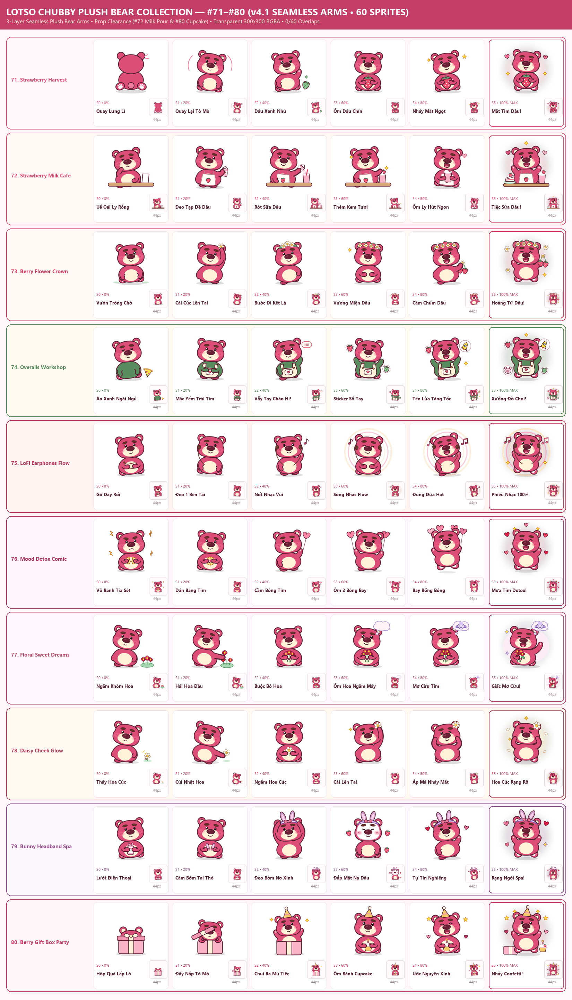

### 🎀🦫 MỚI v4.0 — Batch 8: 10 Chủ Đề Hải Ly Loopy Pastel Collection (`#61`–`#70` — 60 Sprites Đồng Nhất 0% → 100%)
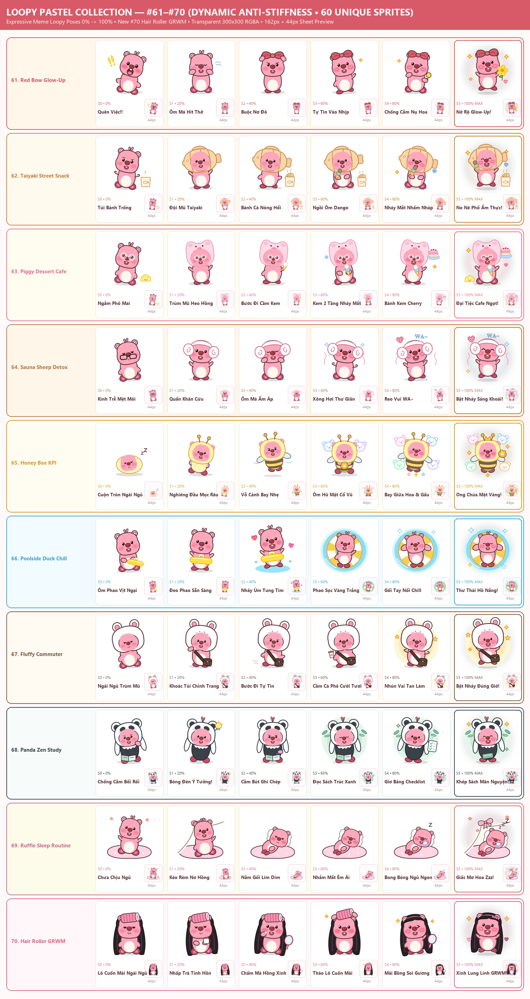

### 🥑🍊 Batch 7 — 13 Chủ Đề Capybara Chill Collection (`#48`–`#60` — 78 Sprites Độc Bản Từ Bé Capybara 0% → 100% Đỉnh Cao!)
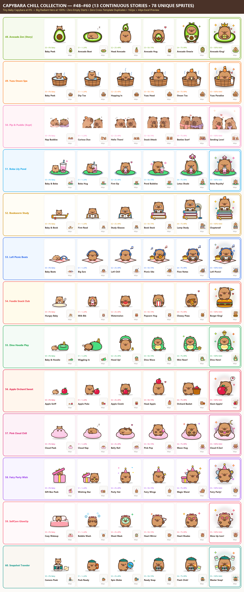

### ⚡ Batch 6 — 7 Chủ Đề Digimon 7 & 8 Cấp Tiến Hóa (`#41`–`#47` — 52 Sprites Chuẩn Canon)
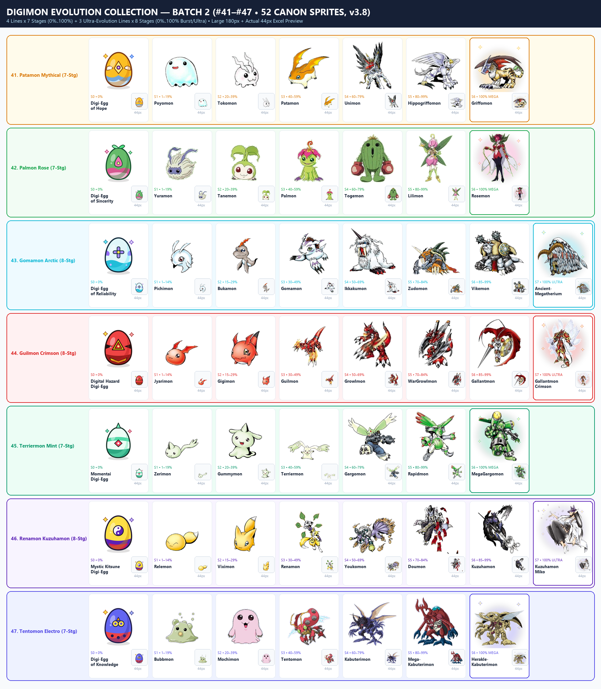

### ⚡ Batch 5 — 5 Chủ Đề Digimon 7 Cấp Tiến Hóa (`#36`–`#40` — 35 Sprites Chuẩn Canon)
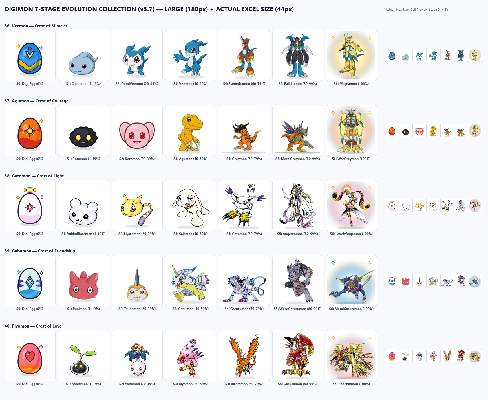

### 🦙🐼 Bộ 4 Alpaca & Gấu Trúc Mochi Vẽ Độc Bản (`#20`, `#21`, `#22`, `#23` — 24 Sprites)
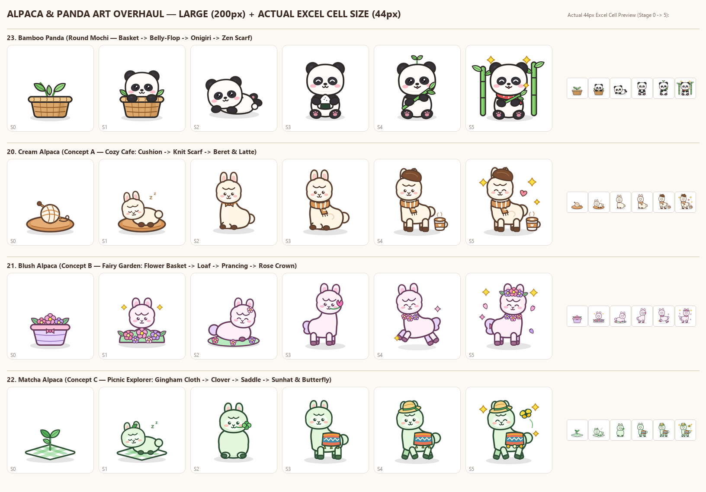

### 🐕🐱 Bộ 6 Thú Cưng Kawaii Vector Bézier (`#24`, `#25`, `#26`, `#30`, `#31`, `#33` — 36 Sprites)


### 🐻🐰🌸 Batch 4 — 4 Chủ Đề Signature (`#32`–`#35` — 24 Sprites)


<details>
<summary>🎨 Mở rộng xem thêm 186 Sprites của Batch 1 (#01–#10), Batch 2 (#11–#19) & Batch 3 (#20–#31)</summary>


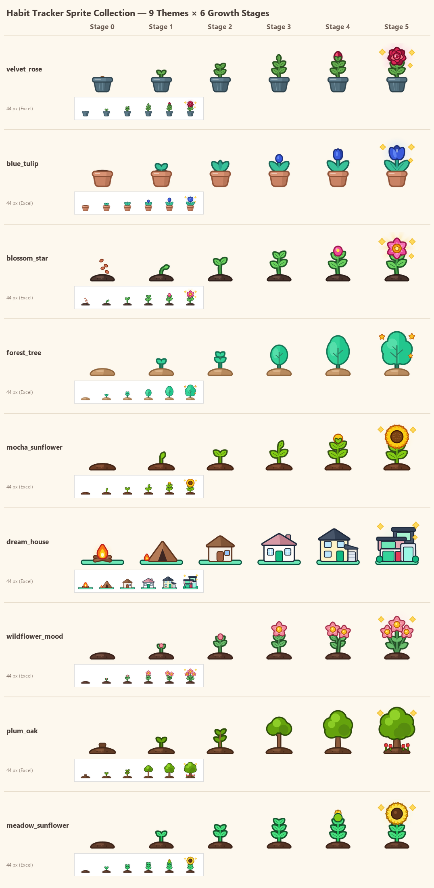

</details>

---

## 🍓🐻 MỚI v4.0 — Showcase Bộ Sưu Tập 10 Chủ Đề Gấu Dâu Lotso (`#71` – `#80`)

<table width="100%">
  <tr>
    <td width="50%" align="center" valign="top">
      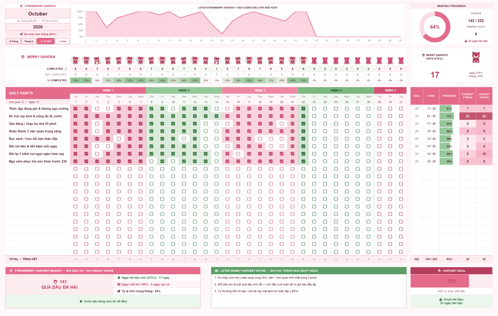<br/>
      <b>71. 🍓 Lotso Strawberry Harvest</b><br/>
      <sub>Quay Lưng Lì Lợm → Dâu Xanh → Ôm Dâu Đỏ → Nháy Mắt → Mắt Tim Thu Hoạch!</sub>
    </td>
    <td width="50%" align="center" valign="top">
      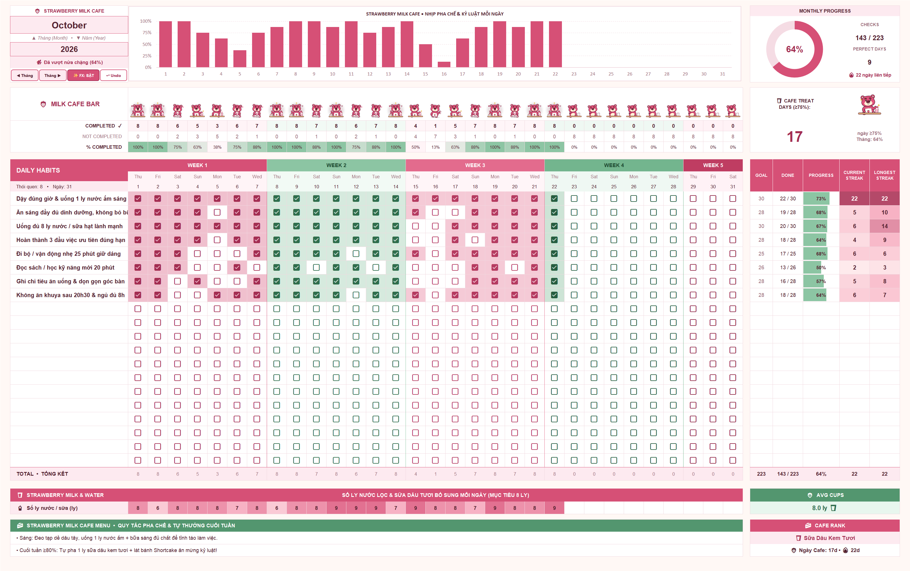<br/>
      <b>72. 🍓 Lotso Strawberry Milk Cafe</b><br/>
      <sub>Ly Rỗng → Tạp Dề Dâu → Rót Sữa Dâu → Kem Tươi → Tiệc Sữa Dâu Shortcake!</sub>
    </td>
  </tr>
  <tr>
    <td width="50%" align="center" valign="top">
      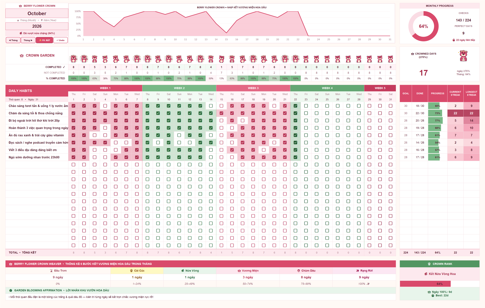<br/>
      <b>73. 👑 Lotso Berry Flower Crown</b><br/>
      <sub>Vườn Trống → Cài Cúc Tai → Nửa Vòng Lá → Vương Miện Dâu → Hoàng Tử Vườn Dâu!</sub>
    </td>
    <td width="50%" align="center" valign="top">
      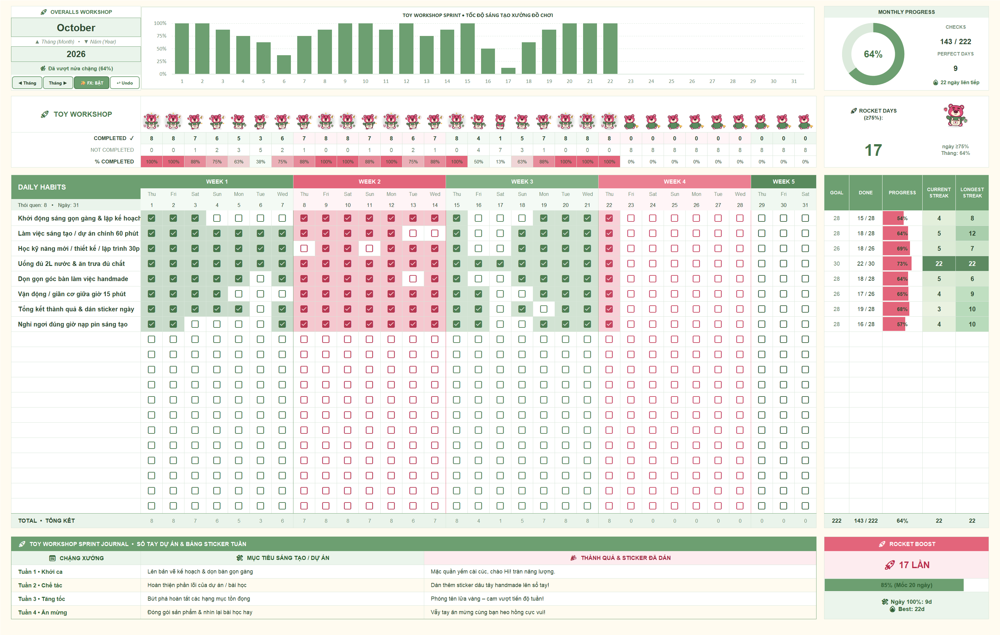<br/>
      <b>74. 🚀 Lotso Overalls Toy Workshop</b><br/>
      <sub>Áo Xanh → Yếm Trái Tim → Chào Hi! → Sticker Sổ Tay → Tên Lửa Xưởng Đồ Chơi!</sub>
    </td>
  </tr>
  <tr>
    <td width="50%" align="center" valign="top">
      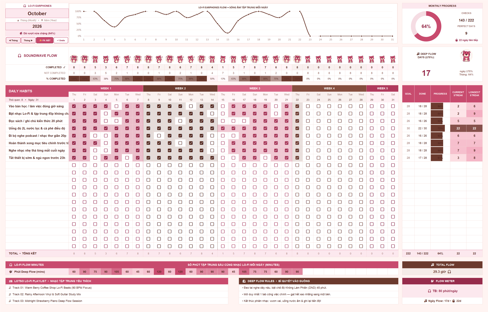<br/>
      <b>75. 🎧 Lotso Lo-Fi Earphones Flow</b><br/>
      <sub>Dây Rối → Đeo 1 Bên → Nốt Nhạc → Sóng Nhạc Deep Flow → Phiêu Nhạc 100%!</sub>
    </td>
    <td width="50%" align="center" valign="top">
      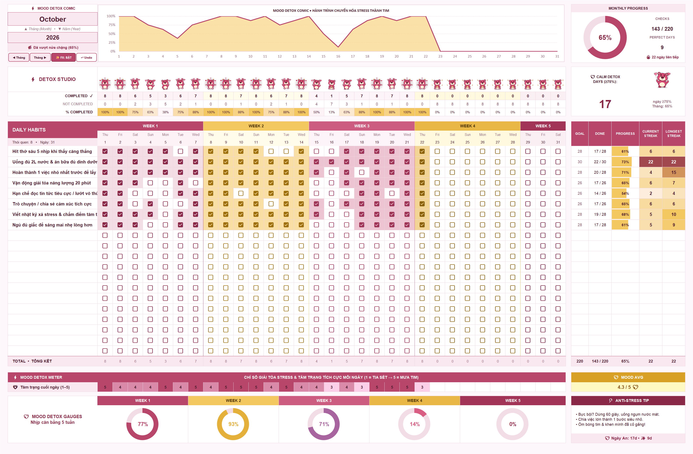<br/>
      <b>76. ⚡ Lotso Mood Detox Comic</b><br/>
      <sub>Vỡ Bánh Tia Sét → Dán Băng Trái Tim → Bóng Bay Tim → Bay Bổng → Mưa Tim Detox 100%!</sub>
    </td>
  </tr>
  <tr>
    <td width="50%" align="center" valign="top">
      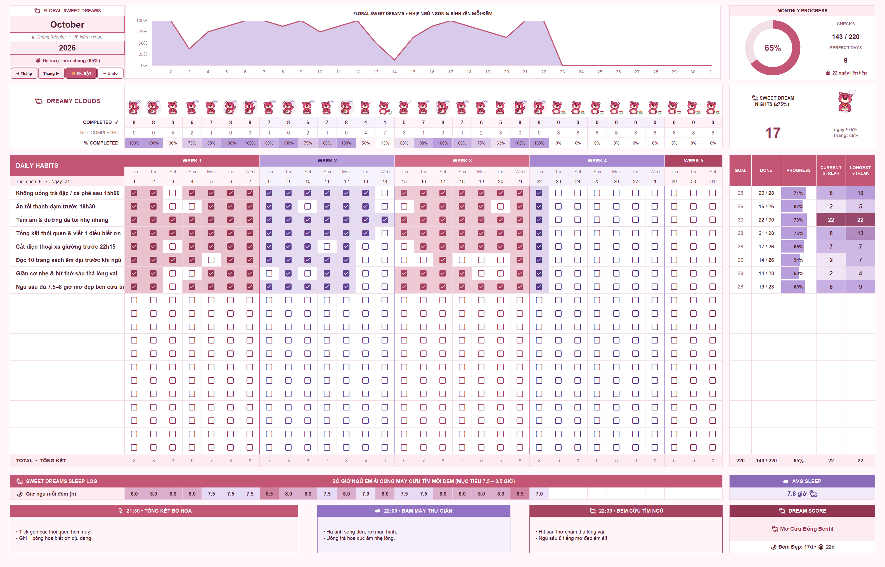<br/>
      <b>77. 🐑 Lotso Floral Sweet Dreams</b><br/>
      <sub>Ngắm Khóm Hoa → Hái Hoa Đầu → Buộc Bó Hoa → Ôm Hoa Ngắm Mây → Mơ Cừu Tím → Giấc Mơ Cừu!</sub>
    </td>
    <td width="50%" align="center" valign="top">
      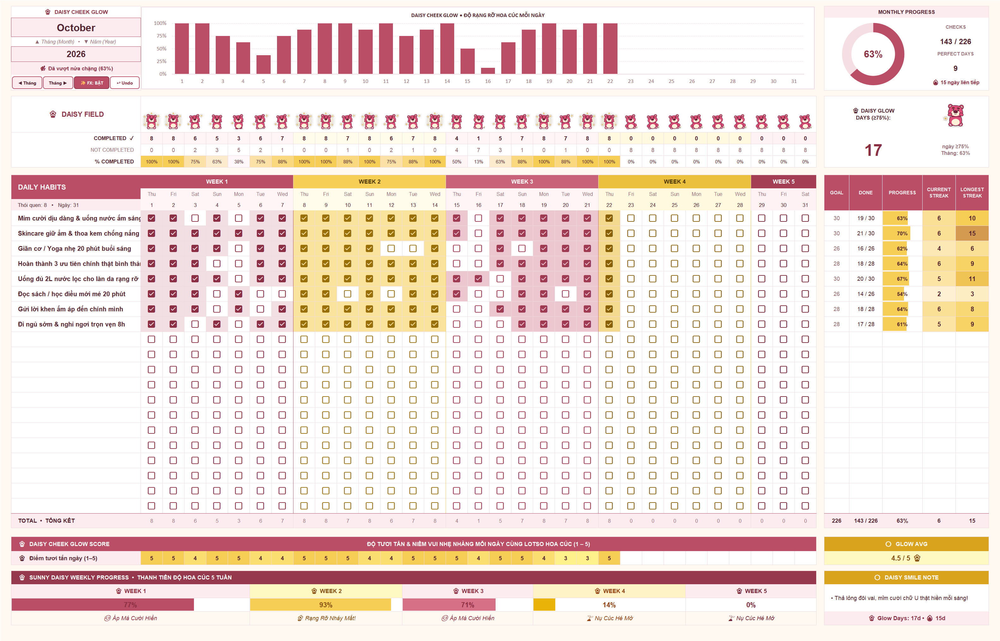<br/>
      <b>78. 🌼 Lotso Daisy Cheek Glow</b><br/>
      <sub>Thấy Hoa Cúc → Cúi Nhặt Hoa → Ngắm Hoa Cúc → Cài Lên Tai → Áp Má Nháy Mắt → Hoa Cúc Rạng Rỡ!</sub>
    </td>
  </tr>
  <tr>
    <td width="50%" align="center" valign="top">
      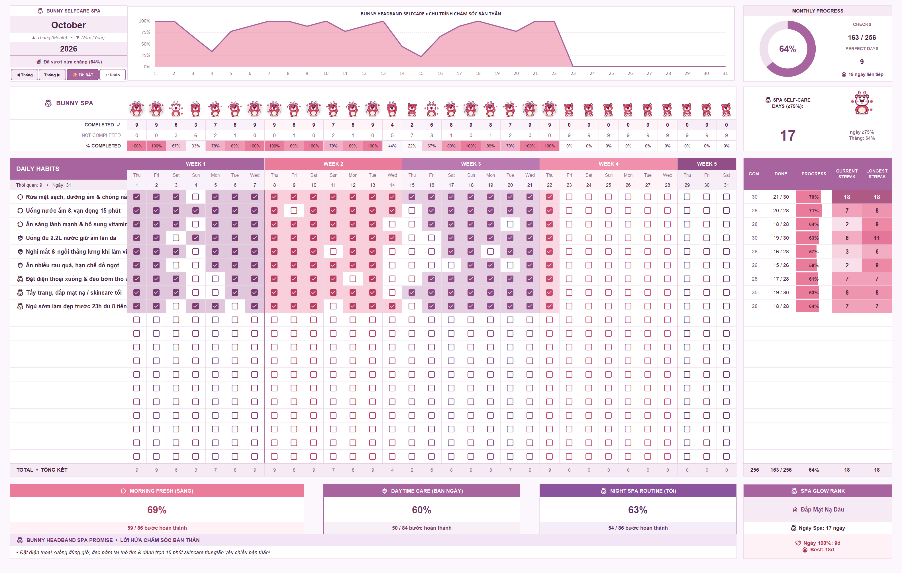<br/>
      <b>79. 🐰 Lotso Bunny Headband Selfcare</b><br/>
      <sub>Điện Thoại Thỏ → Cầm Bờm → Đeo Bờm → Mặt Nạ Dâu → Rạng Ngời Self-Care!</sub>
    </td>
    <td width="50%" align="center" valign="top">
      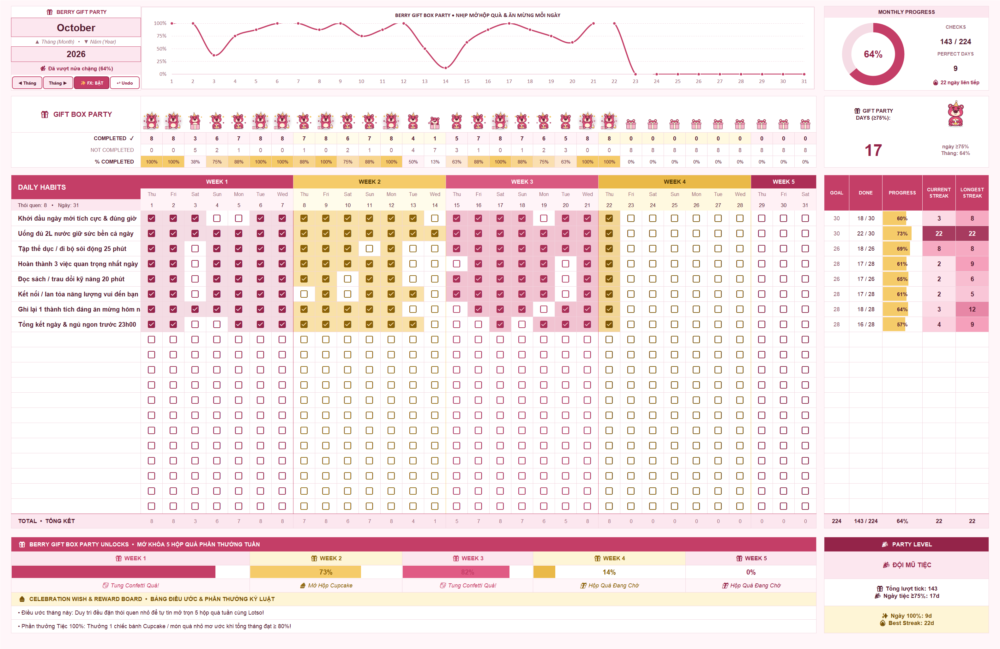<br/>
      <b>80. 🎁 Lotso Berry Gift Box Party</b><br/>
      <sub>Hộp Quà Lấp Ló → Đẩy Nắp → Mũ Tiệc → Bánh Cupcake → Nhảy Mừng Confetti!</sub>
    </td>
  </tr>
</table>

<details>
<summary>🏆 Xem giao diện Tổng Kết & Thành Tựu Năm (Excel PC Pro) của Gấu Dâu Lotso (`#71`–`#80`)</summary>

<table width="100%">
  <tr>
    <td width="50%" align="center" valign="top">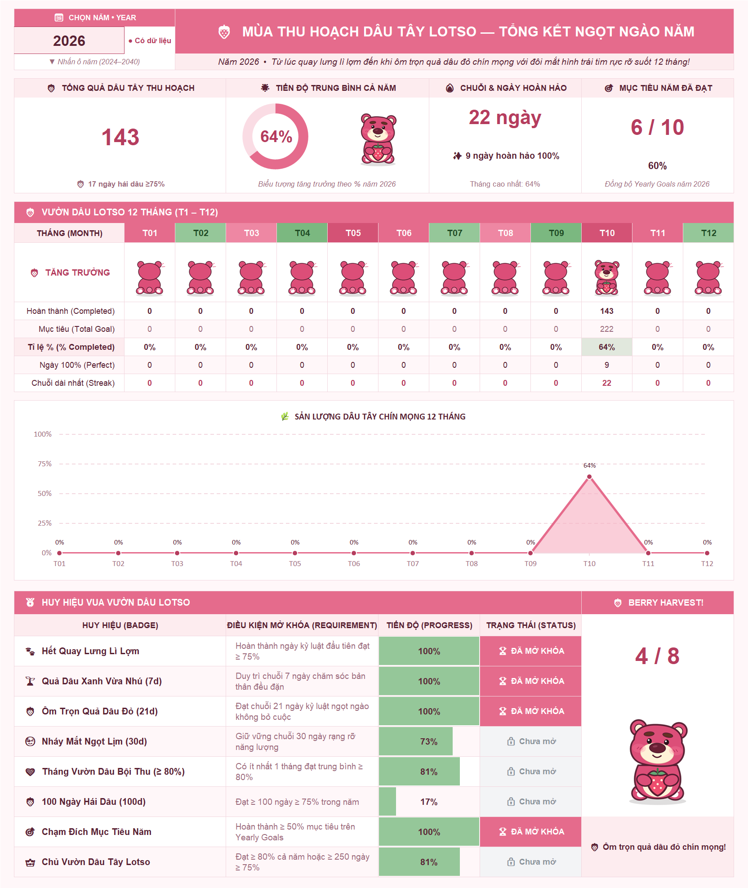<br/><sub><b>71. 🍓 Mùa Thu Hoạch Dâu Tây Lotso (Tổng Kết 12 Tháng)</b></sub></td>
    <td width="50%" align="center" valign="top">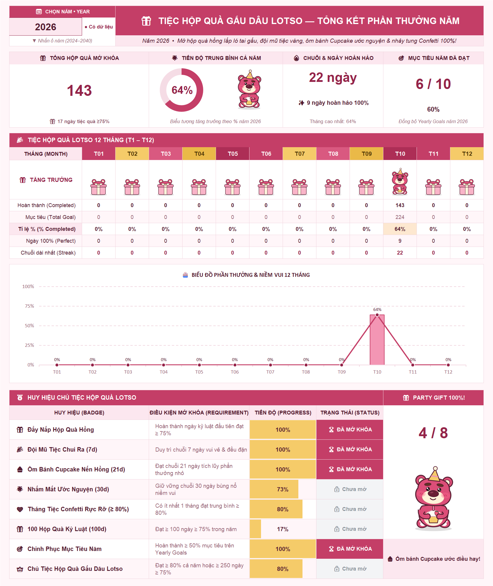<br/><sub><b>80. 🎁 Tiệc Hộp Quà Gấu Dâu Lotso (Tổng Kết 12 Tháng)</b></sub></td>
  </tr>
</table>

</details>

<details>
<summary>📱 Xem màn hình Mobile Portrait Gấu Dâu Lotso (`#71`–`#80`)</summary>

<table>
  <tr>
    <td align="center">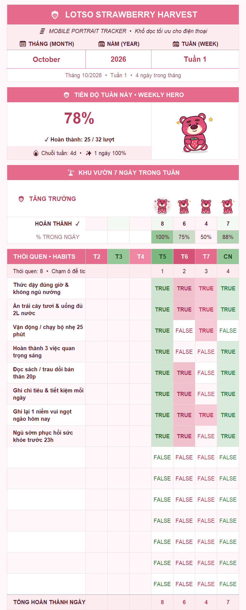<br/><sub><b>🍓 Strawberry</b></sub></td>
    <td align="center">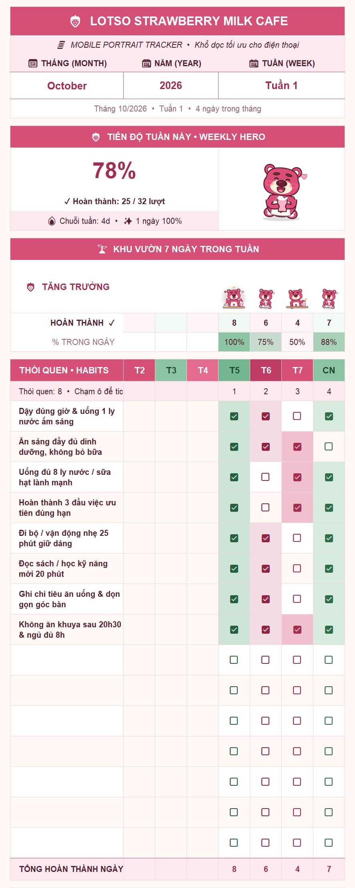<br/><sub><b>🍓 Milk Cafe</b></sub></td>
    <td align="center">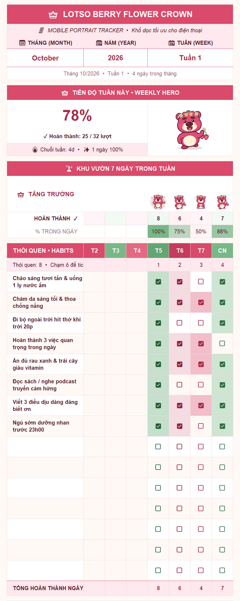<br/><sub><b>👑 Flower Crown</b></sub></td>
    <td align="center">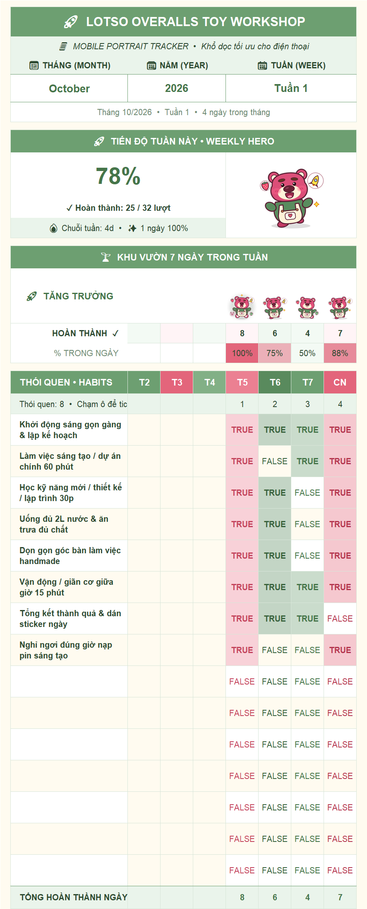<br/><sub><b>🚀 Overalls</b></sub></td>
    <td align="center">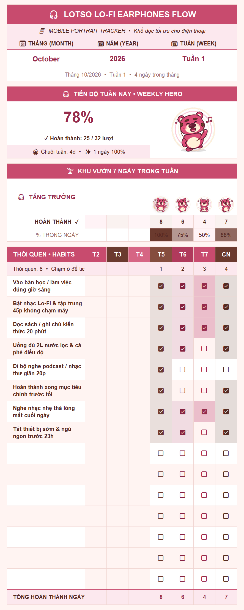<br/><sub><b>🎧 Lo-Fi Flow</b></sub></td>
  </tr>
  <tr>
    <td align="center">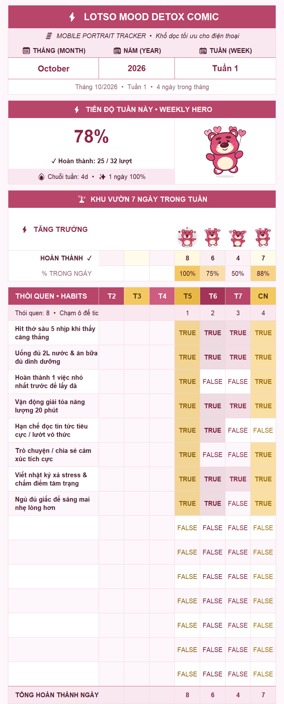<br/><sub><b>⚡ Mood Detox</b></sub></td>
    <td align="center">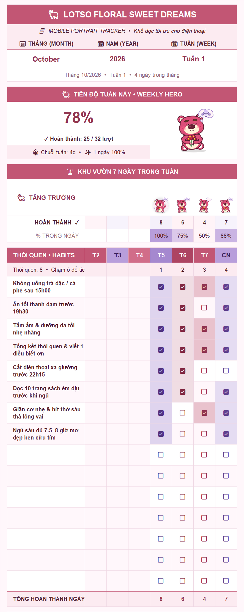<br/><sub><b>🐑 Sweet Dreams</b></sub></td>
    <td align="center">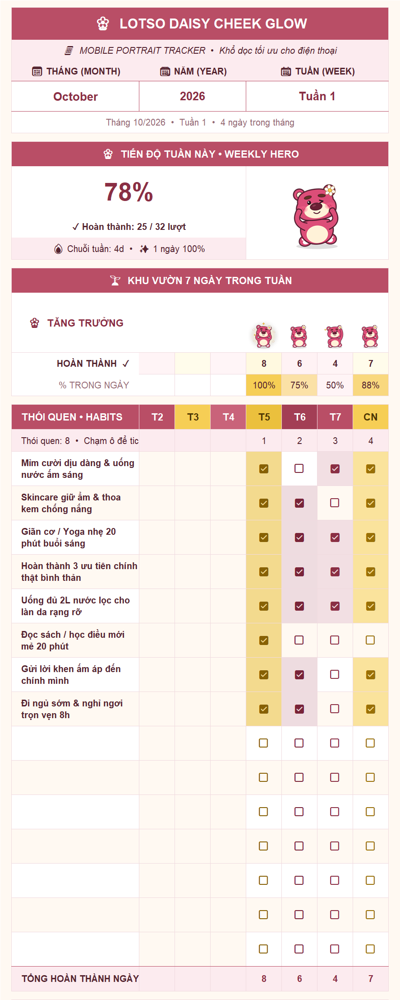<br/><sub><b>🌼 Daisy Glow</b></sub></td>
    <td align="center">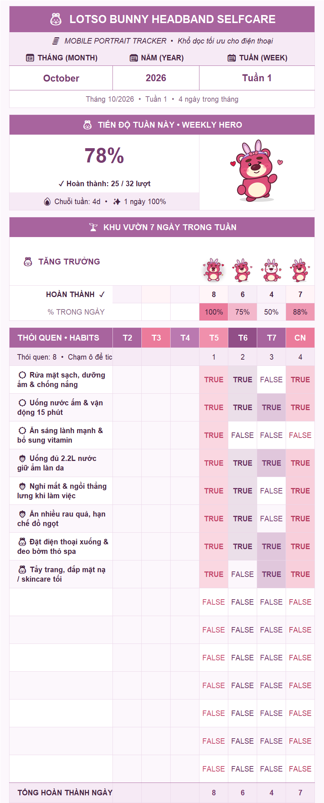<br/><sub><b>🐰 Bunny Spa</b></sub></td>
    <td align="center">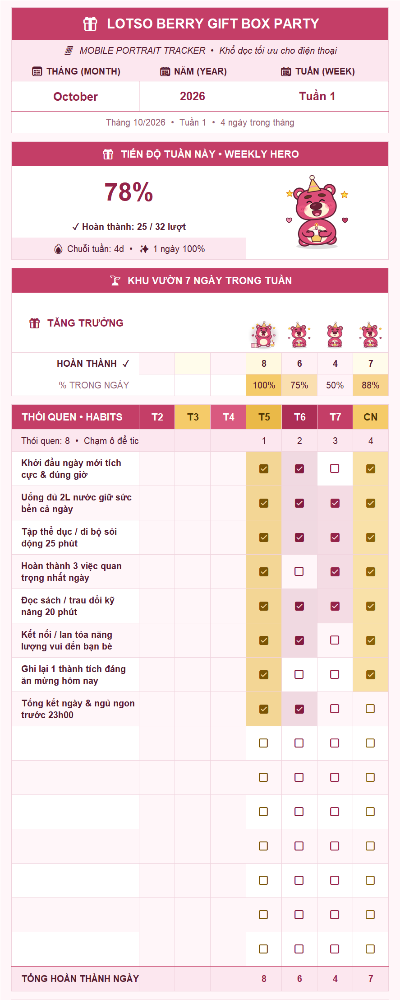<br/><sub><b>🎁 Gift Party</b></sub></td>
  </tr>
</table>

</details>

---

## 🎀🦫 MỚI v4.0 — Showcase Bộ Sưu Tập 10 Chủ Đề Hải Ly Loopy Pastel (`#61` – `#70`)

<table width="100%">
  <tr>
    <td width="50%" align="center" valign="top">
      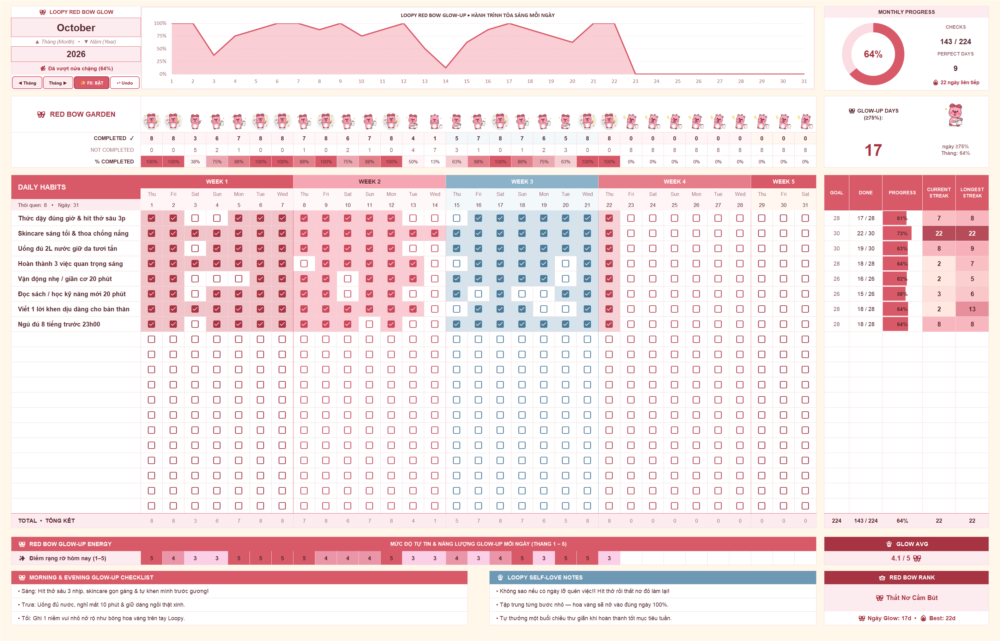<br/>
      <b>61. 🎀 Loopy Red Bow Glow-Up</b><br/>
      <sub>Quên Việc!! → Ôm Má Bình Tĩnh → Thắt Nơ Cầm Bút → Chăm Chú Tick → Gần Kín Bảng → Hoàn Thành 100%!</sub>
    </td>
    <td width="50%" align="center" valign="top">
      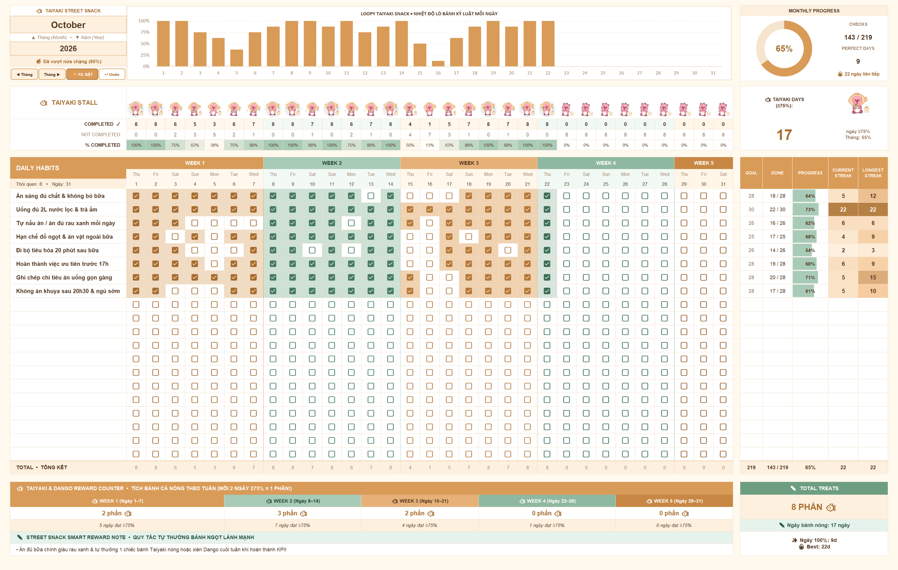<br/>
      <b>62. 🐟 Loopy Taiyaki Street Snack</b><br/>
      <sub>Túi Giấy Trống → Đội Mũ Taiyaki → Bánh Cá Nóng → Thêm Xiên Dango → Cắn Xiên Dango → No Nê Ẩm Thực!</sub>
    </td>
  </tr>
  <tr>
    <td width="50%" align="center" valign="top">
      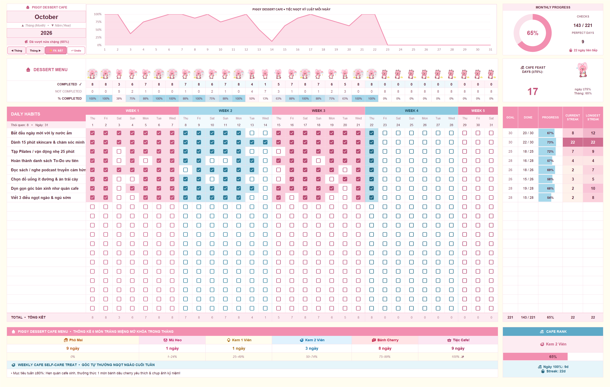<br/>
      <b>63. 🧁 Loopy Piggy Dessert Cafe</b><br/>
      <sub>Phô Mai → Mũ Heo Hồng → Kem 1–2 Viên → Bánh Cherry → Đại Tiệc Cafe!</sub>
    </td>
    <td width="50%" align="center" valign="top">
      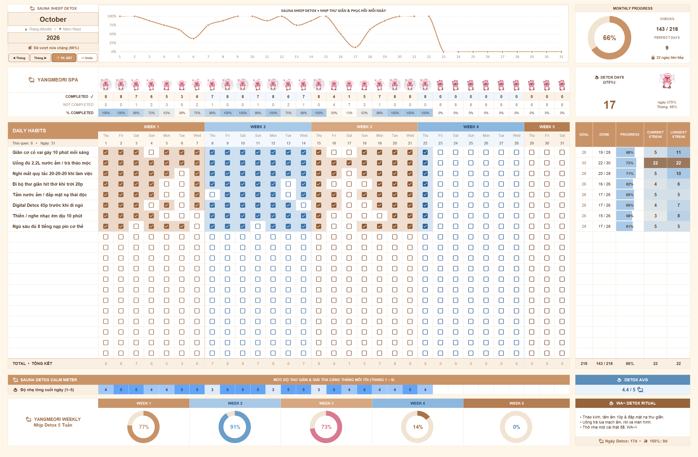<br/>
      <b>64. 🐑 Loopy Sauna Sheep Detox</b><br/>
      <sub>Kính Trễ → Khăn Cừu Yangmeori → Xông Hơi → Reo Vui WA~ → Sảng Khoái!</sub>
    </td>
  </tr>
  <tr>
    <td width="50%" align="center" valign="top">
      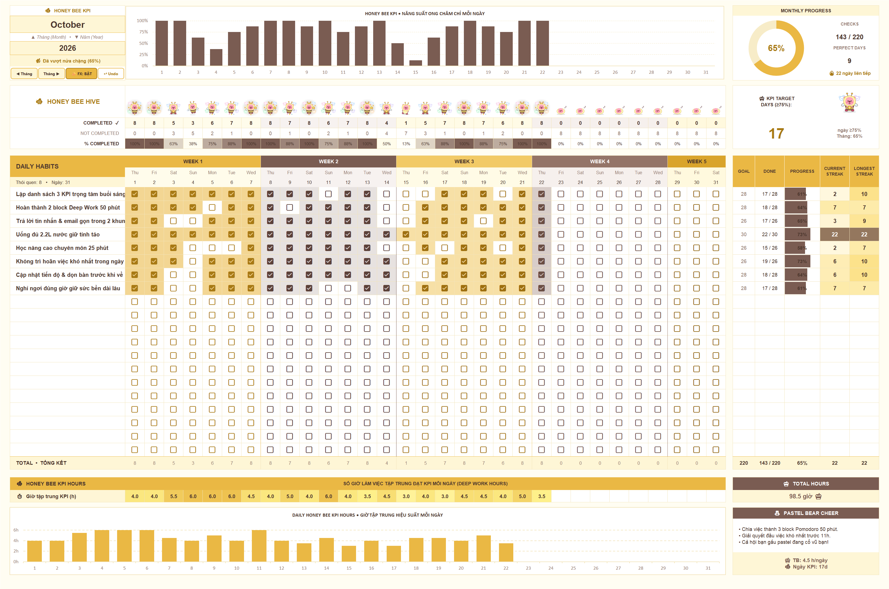<br/>
      <b>65. 🐝 Loopy Honey Bee KPI</b><br/>
      <sub>Cuộn Tròn Ngủ → Mọc Râu → Vỗ Cánh Bay → Ôm Hũ Mật → Ong Chúa Mật Vàng!</sub>
    </td>
    <td width="50%" align="center" valign="top">
      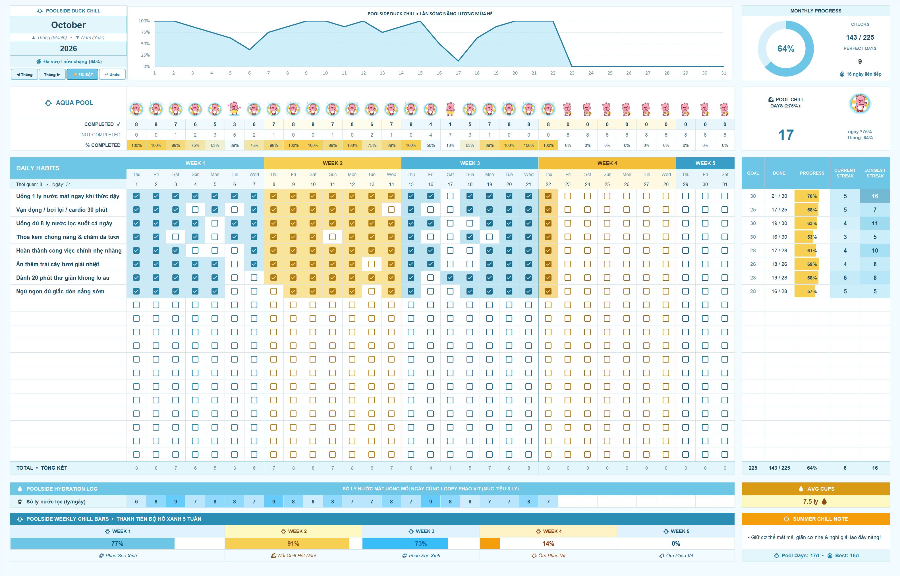<br/>
      <b>66. 🐥 Loopy Poolside Duck Chill</b><br/>
      <sub>Ôm Phao Vịt → Nhảy Hồ Tung Tim → Phao Sọc → Thư Thái Hồ Xanh!</sub>
    </td>
  </tr>
  <tr>
    <td width="50%" align="center" valign="top">
      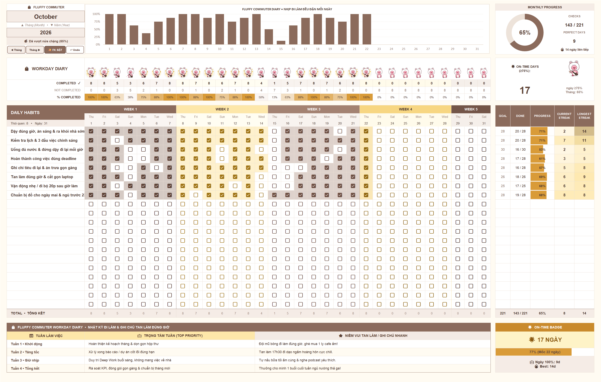<br/>
      <b>67. 🎒 Loopy Fluffy Commuter Diary</b><br/>
      <sub>Ngái Ngủ Trùm Mũ → Khoác Túi → Bước Đi Tự Tin → Cầm Cà Phê → Bật Nhảy Đúng Giờ!</sub>
    </td>
    <td width="50%" align="center" valign="top">
      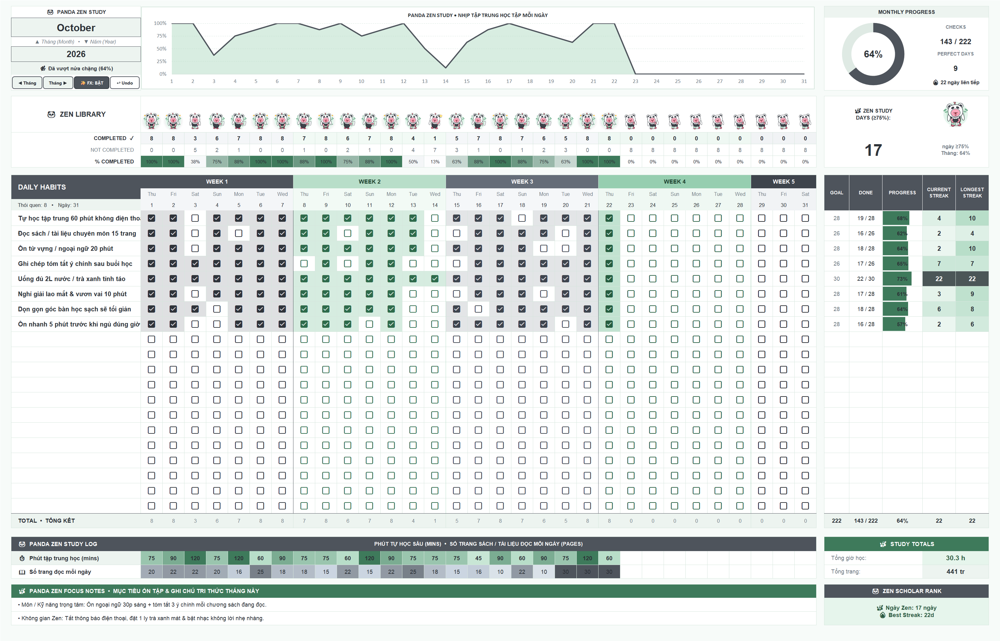<br/>
      <b>68. 🐼 Loopy Panda Zen Study</b><br/>
      <sub>Chống Cằm → Bóng Đèn Ý Tưởng → Ghi Chép → Đọc Sách Trúc Xanh → Khép Sách Mãn Nguyện!</sub>
    </td>
  </tr>
  <tr>
    <td width="50%" align="center" valign="top">
      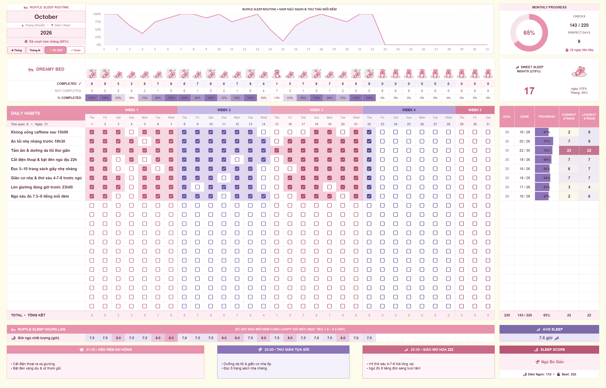<br/>
      <b>69. 🛏️ Loopy Ruffle Sleep Routine</b><br/>
      <sub>Chưa Chịu Ngủ → Kéo Rèm Nơ Hồng → Tựa Gối Bèo → Giấc Mơ Hoa Zzz!</sub>
    </td>
    <td width="50%" align="center" valign="top">
      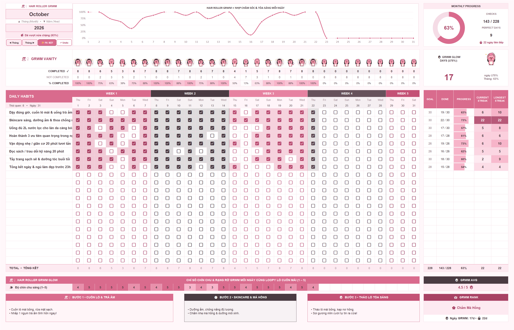<br/>
      <b>70. 💇‍♀️ Loopy Hair Roller GRWM</b><br/>
      <sub>Cuốn Lô Ngái Ngủ → Nhấp Trà Tỉnh → Chấm Má Hồng → Tháo Lô Mái → Mái Bồng Gương → Tỏa Sáng GRWM!</sub>
    </td>
  </tr>
</table>

<details>
<summary>🏆 Xem giao diện Tổng Kết & Thành Tựu Năm (Excel PC Pro) của Hải Ly Loopy (`#61`–`#70`)</summary>

<table width="100%">
  <tr>
    <td width="50%" align="center" valign="top">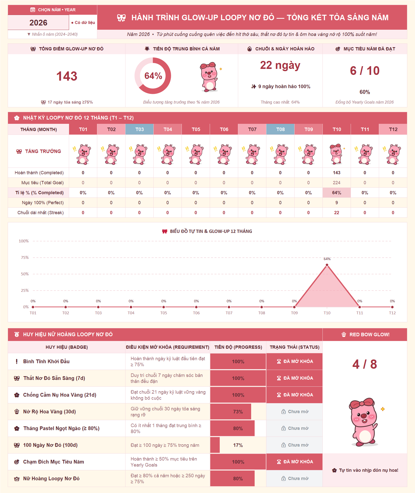<br/><sub><b>61. 🎀 Hành Trình Glow-Up Loopy Nơ Đỏ (Tổng Kết 12 Tháng)</b></sub></td>
    <td width="50%" align="center" valign="top">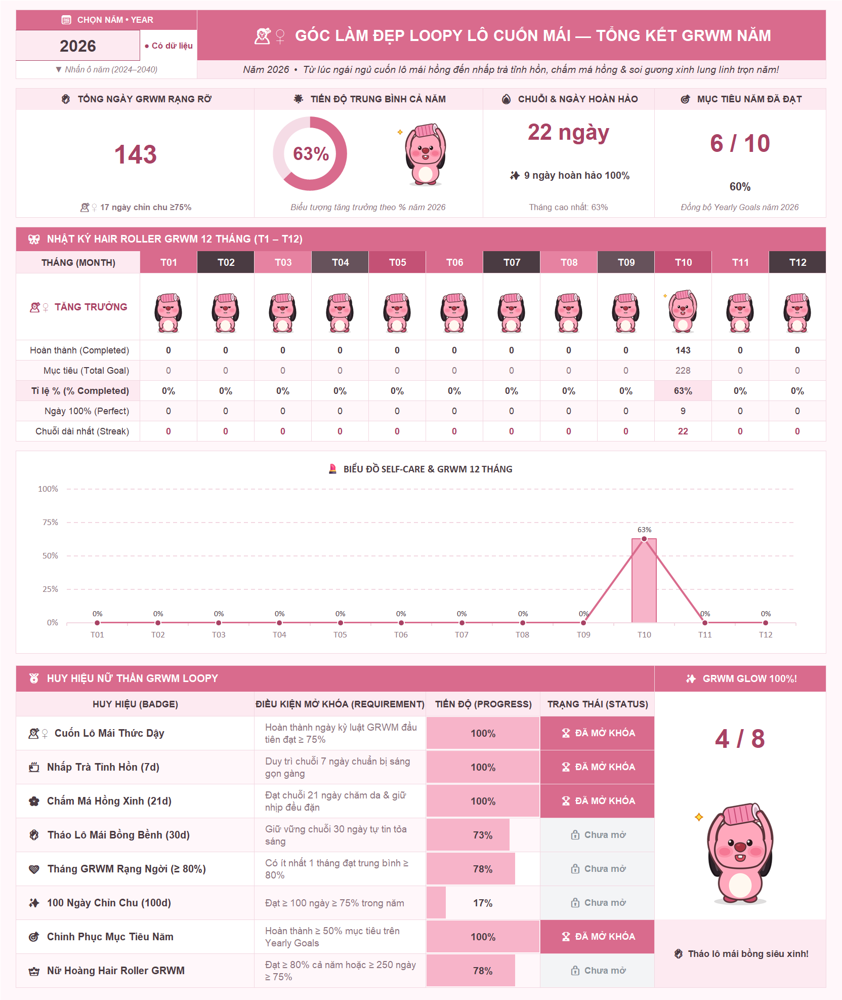<br/><sub><b>70. 💇‍♀️ Góc Làm Đẹp Loopy Lô Cuốn Mái (Tổng Kết 12 Tháng)</b></sub></td>
  </tr>
</table>

</details>

<details>
<summary>📱 Xem màn hình Mobile Portrait Hải Ly Loopy (`#61`–`#70`)</summary>

<table>
  <tr>
    <td align="center">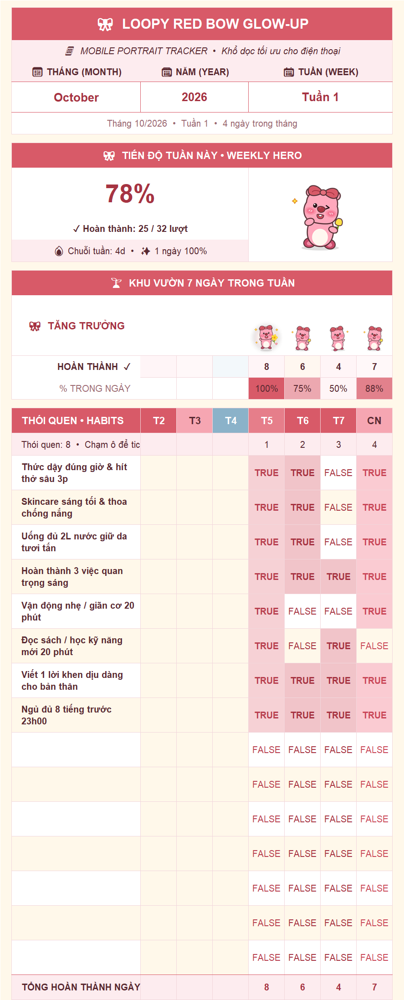<br/><sub><b>🎀 Red Bow</b></sub></td>
    <td align="center">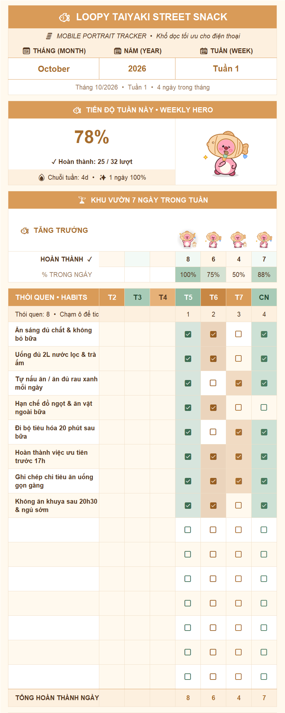<br/><sub><b>🐟 Taiyaki</b></sub></td>
    <td align="center">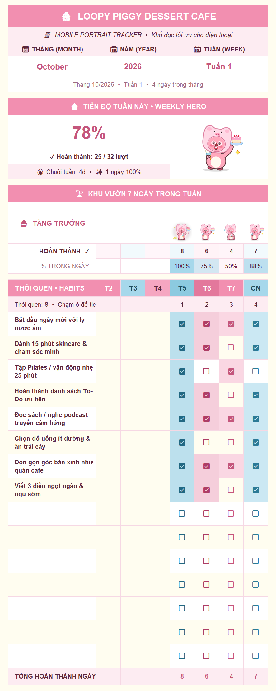<br/><sub><b>🧁 Piggy Cafe</b></sub></td>
    <td align="center">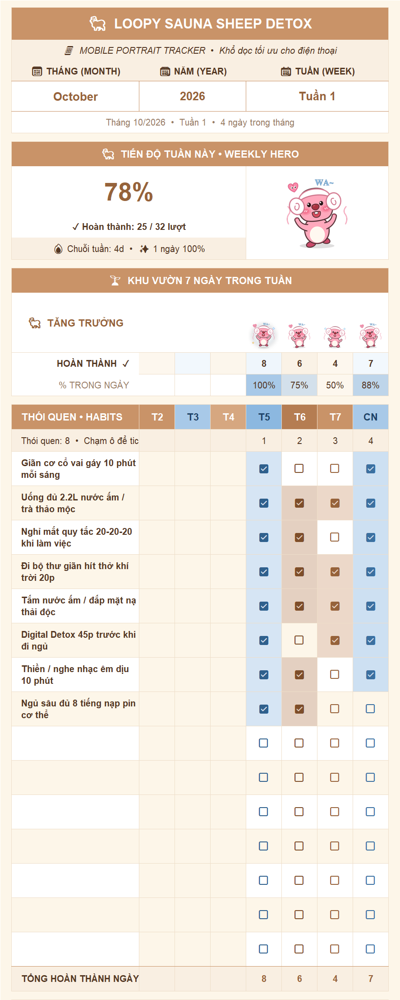<br/><sub><b>🐑 Sauna Sheep</b></sub></td>
    <td align="center">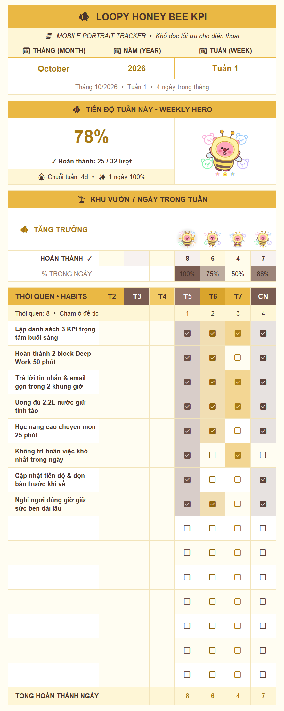<br/><sub><b>🐝 Honey Bee</b></sub></td>
  </tr>
  <tr>
    <td align="center">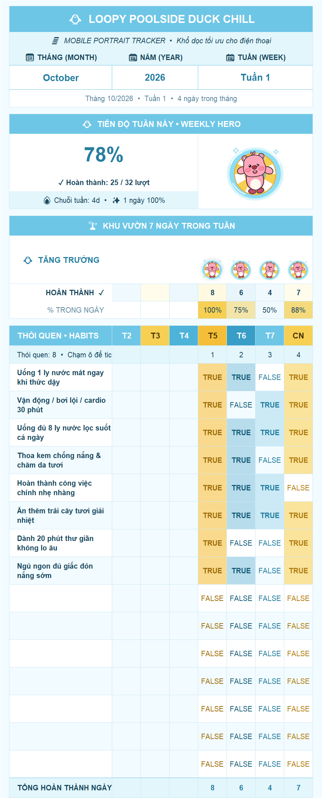<br/><sub><b>🐥 Poolside</b></sub></td>
    <td align="center">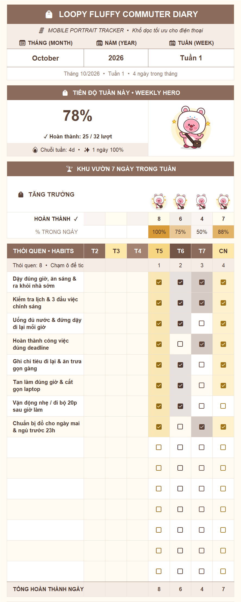<br/><sub><b>🎒 Commuter</b></sub></td>
    <td align="center">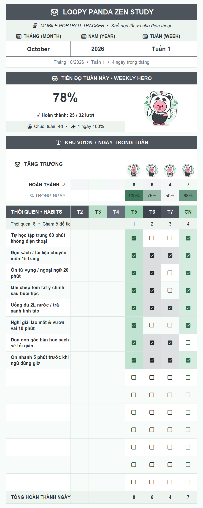<br/><sub><b>🐼 Panda Zen</b></sub></td>
    <td align="center">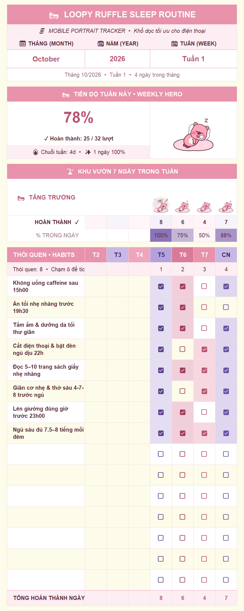<br/><sub><b>🛏️ Ruffle Sleep</b></sub></td>
    <td align="center"><br/><sub><b>💇‍♀️ Hair Roller</b></sub></td>
  </tr>
</table>

</details>

---

## 🥑🍊 Showcase Bộ Sưu Tập 13 Chủ Đề Capybara Chill Collection (`#48` – `#60`)

Mỗi một trong **13 mẫu Capybara** đều được thiết kế **độc bản hoàn toàn (Zero Clones!)** — khác biệt từ bảng màu, kiểu biểu đồ (`Area` / `Column` / `Line`), bảng tính năng phụ riêng biệt bên dưới (Nhật ký Nước & Bữa Bơ, 5 Donut Suối Nóng, Bộ đếm Ly Boba, Giờ Học & Trang Sách, Playlist Lofi, Bảng Mở Khóa Món Ngon, Đếm Táo Thu Hoạch, 5 Điều Ước Sao, Phân Nhóm Sáng/Chiều/Tối Glow-Up, Nhật Ký Ảnh Polaroid…) cho đến **13 bộ Huy Hiệu Thành Tựu Năm** riêng biệt!

<table width="100%">
  <tr>
    <td width="50%" align="center" valign="top">
      <br/>
      <b>48. 🥑 Capybara Avocado Zen</b> <i>(User Special Vẽ Tay!)</i><br/>
      <sub>Bé Bơ Ló Mặt → Thuyền Bơ → Đội Bơ → Ôm Bơ → Áo Choàng Bơ → Vua Bơ Zen!</sub>
    </td>
    <td width="50%" align="center" valign="top">
      <br/>
      <b>50. 💕 Capybara Pip & Puddle Besties</b> <i>(Dual-Tone Pink & Lavender)</i><br/>
      <sub>Ngủ Gối Đôi → Tò Mò → Chào Ngày Mới → Bánh Quy → Khăn Ấm → Yêu Thương!</sub>
    </td>
  </tr>
  <tr>
    <td width="50%" align="center" valign="top">
      <br/>
      <b>49. 🍊 Capybara Yuzu Onsen Spa</b><br/>
      <sub>5 Đồng Hồ Donut Thư Giãn & Góc Wind-Down Buổi Tối</sub>
    </td>
    <td width="50%" align="center" valign="top">
      <br/>
      <b>51. 🧋 Capybara Boba Lily Pond</b><br/>
      <sub>Bộ Đếm Tự Động Tích Ly Trà Sữa Dâu Theo Tuần</sub>
    </td>
  </tr>
  <tr>
    <td width="50%" align="center" valign="top">
      <br/>
      <b>52. 📚 Capybara Bookworm Study</b> <i>(Capy & Chaptered)</i><br/>
      <sub>Giờ Học, Số Trang Sách & Biểu Đồ Cột Tập Trung</sub>
    </td>
    <td width="50%" align="center" valign="top">
      <br/>
      <b>53. 🎧 Capybara Lofi Picnic Beats</b><br/>
      <sub>Đếm Phút Deep Flow & Bảng Playlist Lofi Yêu Thích</sub>
    </td>
  </tr>
</table>

<details>
<summary>📸 Xem thêm các tab chi tiết của #48 Avocado Zen & #50 Pip & Puddle (Hướng Dẫn, Tổng Kết Năm, Nhiệm Vụ Ngày & Yearly Goals)</summary>

<table width="100%">
  <tr>
    <td width="50%" align="center" valign="top"><br/><sub><b>48. Hướng Dẫn 6 Cấp Capybara Bơ Xanh</b></sub></td>
    <td width="50%" align="center" valign="top"><br/><sub><b>48. Thung Lũng Bơ Xanh Cả Năm</b></sub></td>
  </tr>
  <tr>
    <td width="50%" align="center" valign="top"><br/><sub><b>48. Nhiệm Vụ Ngày (Avocado Zen)</b></sub></td>
    <td width="50%" align="center" valign="top"><br/><sub><b>48. Yearly Goals & Habits (Avocado Zen)</b></sub></td>
  </tr>
  <tr>
    <td width="50%" align="center" valign="top"><br/><sub><b>50. Hướng Dẫn Pip & Puddle</b></sub></td>
    <td width="50%" align="center" valign="top"><br/><sub><b>50. Đại Sảnh Đôi Bạn Thân Pip & Puddle</b></sub></td>
  </tr>
  <tr>
    <td colspan="2" align="center" valign="top"><br/><sub><b>50. Nhiệm Vụ Ngày (Pip & Puddle)</b></sub></td>
  </tr>
</table>

</details>

<details>
<summary>🍊 Mở rộng xem thêm 7 mẫu Capybara Chill cực xinh (#54 – #60: Foodie, Dino Hoodie, Apple Orchard, Pink Cloud, Fairy Party, SelfCare GlowUp, Snapshot Traveler)</summary>

<table width="100%">
  <tr>
    <td width="50%" align="center" valign="top"><br/><sub><b>54. 🍔 Capybara Foodie Snack Club</b> (6 Mốc Mở Khóa Món Ngon)</sub></td>
    <td width="50%" align="center" valign="top"><br/><sub><b>55. 🦕 Capybara Dino Hoodie Play</b> (Điểm Niềm Vui & 5 Thanh Pastel)</sub></td>
  </tr>
  <tr>
    <td width="50%" align="center" valign="top"><br/><sub><b>56. 🍎 Capybara Apple Orchard Sweet</b> (Đếm Táo Thu Hoạch & Biết Ơn)</sub></td>
    <td width="50%" align="center" valign="top"><br/><sub><b>57. ☁️ Capybara Pink Cloud Chill</b> (Tối Giản Mây Hồng Êm Ái)</sub></td>
  </tr>
  <tr>
    <td width="50%" align="center" valign="top"><br/><sub><b>58. 🧚 Capybara Fairy Party Wish</b> (5 Điều Ước Ngôi Sao Tự Thắp Sáng)</sub></td>
    <td width="50%" align="center" valign="top"><br/><sub><b>59. 🪞 Capybara SelfCare GlowUp</b> (3 Thẻ Sáng · Chiều · Tối Glow-Up)</sub></td>
  </tr>
  <tr>
    <td colspan="2" align="center" valign="top"><br/><sub><b>60. 📸 Capybara Snapshot Traveler</b> (Nhật Ký Polaroid & Dấu Hộ Chiếu)</sub></td>
  </tr>
</table>

</details>

<details>
<summary>📱 Xem màn hình thử nghiệm Mobile Portrait Capybara (`#48`–`#60` — Early Beta)</summary>

<table>
  <tr>
    <td align="center"><br/><sub><b>🥑 Avocado Zen</b></sub></td>
    <td align="center"><br/><sub><b>🍊 Yuzu Onsen</b></sub></td>
    <td align="center"><br/><sub><b>💕 Pip & Puddle</b></sub></td>
    <td align="center"><br/><sub><b>🧋 Boba Pond</b></sub></td>
    <td align="center"><br/><sub><b>📚 Bookworm</b></sub></td>
    <td align="center"><br/><sub><b>🎧 Lofi Picnic</b></sub></td>
  </tr>
  <tr>
    <td align="center"><br/><sub><b>🍔 Foodie Club</b></sub></td>
    <td align="center"><br/><sub><b>🦕 Dino Hoodie</b></sub></td>
    <td align="center"><br/><sub><b>🍎 Apple Orchard</b></sub></td>
    <td align="center"><br/><sub><b>🧚 Fairy Party</b></sub></td>
    <td align="center"><br/><sub><b>🪞 SelfCare Glow</b></sub></td>
    <td align="center"><br/><sub><b>📸 Traveler</b></sub></td>
  </tr>
</table>

</details>

---

## ⚡ Showcase Bộ Sưu Tập 12 Chủ Đề Digimon 7–8 Cấp Tiến Hóa (`#36` – `#47`)

Tiến hóa nhân vật Digimon chuẩn canon qua **7 giai đoạn** (`0% Digi-Egg → 1–19% → 20–39% → 40–59% → 60–79% → 80–99% → 100% Mega ✨`) hoặc **8 giai đoạn Ultra/Burst** (`0% Digi-Egg → 1–14% → 15–29% → 30–49% → 50–69% → 70–84% → 85–99% Mega → 100% Ultra/Burst ✨`) — kèm bảng **Crest Digivice Breakdown** thống kê số ngày đạt từng dạng & thẻ **Current Form Power Meter**!

<table width="100%">
  <tr>
    <td width="50%" align="center" valign="top"><br/><b>44. ⚔️ Digimon Guilmon Crimson</b> <i>(8 Cấp Ultra)</i><br/><sub>Guilmon → Growlmon → WarGrowlmon → Gallantmon → Crimson</sub></td>
    <td width="50%" align="center" valign="top"><br/><b>46. ⛩️ Digimon Renamon Kuzuhamon</b> <i>(8 Cấp Ultra)</i><br/><sub>Renamon → Youkomon → Doumon → Kuzuhamon → Miko</sub></td>
  </tr>
  <tr>
    <td width="50%" align="center" valign="top"><br/><b>41. 🪽 Digimon Patamon Mythical</b> <i>(7 Cấp)</i><br/><sub>Poyomon → Tokomon → Patamon → Unimon → Hippogriffomon → Griffomon</sub></td>
    <td width="50%" align="center" valign="top"><br/><b>42. 🌹 Digimon Palmon Rose</b> <i>(7 Cấp)</i><br/><sub>Yuramon → Tanemon → Palmon → Togemon → Lilimon → Rosemon</sub></td>
  </tr>
  <tr>
    <td width="50%" align="center" valign="top"><br/><b>43. 🧊 Digimon Gomamon Arctic</b> <i>(8 Cấp Ultra)</i><br/><sub>Gomamon → Ikkakumon → Zudomon → Vikemon → AncientMegatheriummon</sub></td>
    <td width="50%" align="center" valign="top"><br/><b>45. 🌿 Digimon Terriermon Mint</b> <i>(7 Cấp)</i><br/><sub>Zerimon → Gummymon → Terriermon → Gargomon → Rapidmon → MegaGargomon</sub></td>
  </tr>
  <tr>
    <td width="50%" align="center" valign="top"><br/><b>47. ⚡ Digimon Tentomon Electro</b> <i>(7 Cấp)</i><br/><sub>Bubbmon → Mochimon → Tentomon → Kabuterimon → MegaKabuterimon → Herakle</sub></td>
    <td width="50%" align="center" valign="top"><br/><b>36. ⚡ Digimon Veemon Miracle</b> <i>(7 Cấp)</i><br/><sub>Chibomon → DemiVeemon → Veemon → Flamedramon → Paildramon → Magnamon</sub></td>
  </tr>
  <tr>
    <td width="50%" align="center" valign="top"><br/><b>37. 🔥 Digimon Agumon Courage</b> <i>(7 Cấp)</i><br/><sub>Botamon → Koromon → Agumon → Greymon → MetalGreymon → WarGreymon</sub></td>
    <td width="50%" align="center" valign="top"><br/><b>38. ✨ Digimon Gatomon Light</b> <i>(7 Cấp)</i><br/><sub>YukimiBotamon → Nyaromon → Salamon → Gatomon → Angewomon → LovelyAngemon</sub></td>
  </tr>
  <tr>
    <td width="50%" align="center" valign="top"><br/><b>39. ❄️ Digimon Gabumon Friendship</b> <i>(7 Cấp)</i><br/><sub>Punimon → Tsunomon → Gabumon → Garurumon → WereGarurumon → MetalGarurumon</sub></td>
    <td width="50%" align="center" valign="top"><br/><b>40. ❤️ Digimon Piyomon Love</b> <i>(7 Cấp)</i><br/><sub>Nyokimon → Yokomon → Biyomon → Birdramon → Garudamon → Phoenixmon</sub></td>
  </tr>
</table>

<details>
<summary>📸 Xem thêm các tab Hướng Dẫn 7–8 Cấp, Đại Sảnh Thành Tựu, Nhiệm Vụ Ngày & Yearly Goals của Digimon</summary>

<table width="100%">
  <tr>
    <td width="50%" align="center" valign="top"><br/><sub><b>44. Guilmon 8-Stage Guide</b></sub></td>
    <td width="50%" align="center" valign="top"><br/><sub><b>44. Guilmon Annual Achievements</b></sub></td>
  </tr>
  <tr>
    <td width="50%" align="center" valign="top"><br/><sub><b>44. Guilmon Daily Tasks</b></sub></td>
    <td width="50%" align="center" valign="top"><br/><sub><b>44. Guilmon Yearly Goals</b></sub></td>
  </tr>
  <tr>
    <td width="50%" align="center" valign="top"><br/><sub><b>46. Renamon Annual Achievements</b></sub></td>
    <td width="50%" align="center" valign="top"><br/><sub><b>46. Renamon Daily Tasks</b></sub></td>
  </tr>
  <tr>
    <td width="50%" align="center" valign="top"><br/><sub><b>41. Patamon 7-Stage Guide</b></sub></td>
    <td width="50%" align="center" valign="top"><br/><sub><b>41. Patamon Annual Achievements</b></sub></td>
  </tr>
  <tr>
    <td width="50%" align="center" valign="top"><br/><sub><b>36. Veemon 7-Stage Guide</b></sub></td>
    <td width="50%" align="center" valign="top"><br/><sub><b>36. Veemon Annual Achievements</b></sub></td>
  </tr>
  <tr>
    <td width="50%" align="center" valign="top"><br/><sub><b>36. Veemon Daily Tasks</b></sub></td>
    <td width="50%" align="center" valign="top"><br/><sub><b>36. Veemon Yearly Goals</b></sub></td>
  </tr>
  <tr>
    <td width="50%" align="center" valign="top"><br/><sub><b>37. Agumon Annual Achievements</b></sub></td>
    <td width="50%" align="center" valign="top"><br/><sub><b>37. Agumon Daily Tasks</b></sub></td>
  </tr>
</table>

</details>

<details>
<summary>📱 Xem 12 màn hình thử nghiệm Mobile Portrait Digimon (`#36`–`#47` — Early Beta)</summary>

<table>
  <tr>
    <td align="center"><br/><sub><b>🪽 Patamon</b></sub></td>
    <td align="center"><br/><sub><b>🌹 Palmon</b></sub></td>
    <td align="center"><br/><sub><b>🧊 Gomamon 8</b></sub></td>
    <td align="center"><br/><sub><b>⚔️ Guilmon 8</b></sub></td>
    <td align="center"><br/><sub><b>🌿 Terriermon</b></sub></td>
    <td align="center"><br/><sub><b>⛩️ Renamon 8</b></sub></td>
  </tr>
  <tr>
    <td align="center"><br/><sub><b>⚡ Tentomon</b></sub></td>
    <td align="center"><br/><sub><b>⚡ Veemon</b></sub></td>
    <td align="center"><br/><sub><b>🔥 Agumon</b></sub></td>
    <td align="center"><br/><sub><b>✨ Gatomon</b></sub></td>
    <td align="center"><br/><sub><b>❄️ Gabumon</b></sub></td>
    <td align="center"><br/><sub><b>❤️ Piyomon</b></sub></td>
  </tr>
</table>

</details>

---

## 🎀 Showcase 4 Mẫu Signature (`#32` – `#35`)

<table width="100%">
  <tr>
    <td width="50%" align="center" valign="top"><br/><b>35. 🐻 Milk & Mocha Bear Sweet Love</b><br/><sub>5 Biểu Đồ Tròn Tuần + 1 Tổng Tháng</sub></td>
    <td width="50%" align="center" valign="top"><br/><b>33. 🐱 Peach Mochi Cat & Mood Suite</b><br/><sub>Hộp Cam + Nhật Ký 6 Cảm Xúc + Quick To-Do</sub></td>
  </tr>
  <tr>
    <td width="50%" align="center" valign="top"><br/><b>34. 🐰 Fluffy Bunny Sticker Pop</b><br/><sub>5 Dải Màu Pastel & Bunny Progress Ring</sub></td>
    <td width="50%" align="center" valign="top"><br/><b>32. 🌸 Sakura Blossom Minimalist</b><br/><sub>Cây Hoa Anh Đào Tối Giản Tinh Khôi</sub></td>
  </tr>
</table>

<details>
<summary>📸 Xem thêm: Nhiệm Vụ Ngày, Yearly Goals & Đại Sảnh Thành Tựu 4 Mẫu Signature (#32 – #35)</summary>

<table width="100%">
  <tr>
    <td width="50%" align="center" valign="top"><br/><sub><b>35. Milk & Mocha Daily Tasks</b></sub></td>
    <td width="50%" align="center" valign="top"><br/><sub><b>35. Milk & Mocha Yearly Goals</b></sub></td>
  </tr>
  <tr>
    <td width="50%" align="center" valign="top"><br/><sub><b>35. Đại Sảnh Milk & Mocha</b></sub></td>
    <td width="50%" align="center" valign="top"><br/><sub><b>33. Mochi Cat Daily Tasks</b></sub></td>
  </tr>
  <tr>
    <td width="50%" align="center" valign="top"><br/><sub><b>33. Đại Sảnh Mèo Mochi</b></sub></td>
    <td width="50%" align="center" valign="top"><br/><sub><b>34. Đại Sảnh Thỏ Bông Sticker Pop</b></sub></td>
  </tr>
  <tr>
    <td colspan="2" align="center" valign="top"><br/><sub><b>32. Đại Sảnh Rừng Anh Đào Tối Giản</b></sub></td>
  </tr>
</table>

</details>

---

## 🎨 Giao Diện Thực Tế `01_Sunflower` & Bộ Sưu Tập Cổ Điển + Linh Vật (`#01` – `#31`)

<table width="100%">
  <tr>
    <td width="50%" align="center" valign="top"><br/><sub><b>01. 🌻 Sunflower Pro Tracker</b></sub></td>
    <td width="50%" align="center" valign="top"><br/><sub><b>01. 🌻 Sunflower Pro Guide</b></sub></td>
  </tr>
</table>

<details>
<summary>🌻 Mở rộng xem toàn bộ ảnh chụp 30 mẫu cổ điển & thú cưng (#02 – #31)</summary>

<table width="100%">
  <tr>
    <td width="50%" align="center" valign="top"><br/><sub><b>02. 🌵 Cactus Bloom Pastel Weeks</b></sub></td>
    <td width="50%" align="center" valign="top"><br/><sub><b>03. 🌈 Rainbow Executive Donuts</b></sub></td>
  </tr>
  <tr>
    <td width="50%" align="center" valign="top"><br/><sub><b>04. 🌿 Sage Botanical Living</b></sub></td>
    <td width="50%" align="center" valign="top"><br/><sub><b>05. 🌙 Lavender Dream Wellness</b></sub></td>
  </tr>
  <tr>
    <td width="50%" align="center" valign="top"><br/><sub><b>06. 🚀 Midnight Navy Focus XP</b></sub></td>
    <td width="50%" align="center" valign="top"><br/><sub><b>07. 🌸 Sakura Zen Study Planner</b></sub></td>
  </tr>
  <tr>
    <td width="50%" align="center" valign="top"><br/><sub><b>08. 🪸 Ocean Coral Fitness</b></sub></td>
    <td width="50%" align="center" valign="top"><br/><sub><b>09. 🍵 Matcha Cafe Routine</b></sub></td>
  </tr>
  <tr>
    <td width="50%" align="center" valign="top"><br/><sub><b>10. 🌌 Aurora Glow RPG Quest</b></sub></td>
    <td width="50%" align="center" valign="top"><br/><sub><b>11. 🌹 Velvet Rose Garden</b></sub></td>
  </tr>
  <tr>
    <td width="50%" align="center" valign="top"><br/><sub><b>12. 🌷 Blue Tulip Mint Breeze</b></sub></td>
    <td width="50%" align="center" valign="top"><br/><sub><b>13. 🌸 Buttercream Blossom Bars</b></sub></td>
  </tr>
  <tr>
    <td width="50%" align="center" valign="top"><br/><sub><b>14. 🌳 Emerald Forest Gold Stars</b></sub></td>
    <td width="50%" align="center" valign="top"><br/><sub><b>15. 🌻 Mocha Rose Terracotta</b></sub></td>
  </tr>
  <tr>
    <td width="50%" align="center" valign="top"><br/><sub><b>16. 🏡 Dream Home Architect</b></sub></td>
    <td width="50%" align="center" valign="top"><br/><sub><b>17. 🌺 Wildflower Bloom & Mood</b></sub></td>
  </tr>
  <tr>
    <td width="50%" align="center" valign="top"><br/><sub><b>18. 🌳 Plum Oak Master Suite</b></sub></td>
    <td width="50%" align="center" valign="top"><br/><sub><b>19. 🌻 Meadow Emerald Sunflower</b></sub></td>
  </tr>
  <tr>
    <td width="50%" align="center" valign="top"><br/><sub><b>20. 🦙 Cream Alpaca Cozy Cafe & Budget</b></sub></td>
    <td width="50%" align="center" valign="top"><br/><sub><b>21. 🌸 Blush Alpaca Fairy Flower Crown</b></sub></td>
  </tr>
  <tr>
    <td width="50%" align="center" valign="top"><br/><sub><b>22. 🍵 Matcha Alpaca Picnic Explorer</b></sub></td>
    <td width="50%" align="center" valign="top"><br/><sub><b>23. 🐼 Bamboo Panda Round Zen Garden</b></sub></td>
  </tr>
  <tr>
    <td width="50%" align="center" valign="top"><br/><sub><b>24. 👑 Royal Cat Saving Cash</b></sub></td>
    <td width="50%" align="center" valign="top"><br/><sub><b>25. 🐱 Ginger Kitten Basket</b></sub></td>
  </tr>
  <tr>
    <td width="50%" align="center" valign="top"><br/><sub><b>26. 🌙 Pastel Purple Starlight Cat</b></sub></td>
    <td width="50%" align="center" valign="top"><br/><sub><b>27. 🐣 Hatching Chick Studio</b></sub></td>
  </tr>
  <tr>
    <td width="50%" align="center" valign="top"><br/><sub><b>28. 🍬 Cotton Candy Jar Sweet</b></sub></td>
    <td width="50%" align="center" valign="top"><br/><sub><b>29. 🌹 Watercolor Rose Bouquet</b></sub></td>
  </tr>
  <tr>
    <td width="50%" align="center" valign="top"><br/><sub><b>30. 🐕 Shiba Inu Happy Bork</b></sub></td>
    <td width="50%" align="center" valign="top"><br/><sub><b>31. ❄️ Akita Inu Snow Loyal</b></sub></td>
  </tr>
</table>

</details>

---

## 📱 Xem Nhanh Bản Điện Thoại Khổ Dọc (`🚧 Early Beta` — Đang Thử Nghiệm)

> **Lưu ý:** Bản Mobile Portrait vẫn đang ở giai đoạn thử nghiệm sớm (**Early Beta**, còn thô sơ & còn lỗi nhỏ trên một số dòng máy). Chỉ mở thử bằng ứng dụng **Google Trang tính** sau khi lưu sang định dạng Google Sheets — không mở bằng app Excel trên điện thoại.

<table>
  <tr>
    <td align="center"><br/><sub><b>🐻 Milk & Mocha Portrait</b></sub></td>
    <td align="center"><br/><sub><b>🐱 Mochi Cat Portrait</b></sub></td>
    <td align="center"><br/><sub><b>🐰 Fluffy Bunny Portrait</b></sub></td>
    <td align="center"><br/><sub><b>🌸 Sakura Min Portrait</b></sub></td>
  </tr>
</table>

<details>
<summary>📸 Xem thêm màn hình Mobile Portrait (Shiba, Akita, Alpaca, Royal Cat, Việc Hôm Nay)</summary>

<table>
  <tr>
    <td align="center"><br/><sub><b>🐕 Shiba Inu</b></sub></td>
    <td align="center"><br/><sub><b>📝 Việc Hôm Nay</b></sub></td>
    <td align="center"><br/><sub><b>🦙 Cream Alpaca</b></sub></td>
    <td align="center"><br/><sub><b>👑 Royal Cat Cash</b></sub></td>
  </tr>
</table>

</details>

---

## 📋 Bảng Tải Trực Tiếp Toàn Bộ 80 Mẫu Template (Đủ 4 Phiên Bản — 320 Tệp)

> 💡 **Mẹo tải nhanh không cần gõ lệnh:** Bấm vào link bạn chọn bên dưới → bấm biểu tượng **mũi tên tải xuống (`⬇ Download raw file`)** ở góc trên bên phải!

| # | Tên Mẫu & Chủ Đề | ⚡ `#1` Pro *(Excel 365)* | ✨ `#2` Offline *(Excel 2016–365)* | ☁️ `#3` GSheets *(Beta)* | 📱 `#4` Mobile *(Early Beta)* |
|---|---|---|---|---|---|
| **01** | 🌻 **Sunflower Garden Blush** | [`_Pro.xlsm`](templates/pro_macro/01_Sunflower_Garden_Blush_Pro.xlsm) | [`.xlsx`](templates/excel_universal_offline/01_Sunflower_Garden_Blush.xlsx) | [Desktop](templates/google_sheets_edition/01_Sunflower_Garden_Blush.xlsx) | [📱 Mobile](templates/mobile_portrait_sheets/01_Sunflower_Garden_Blush_Mobile.xlsx) |
| **02** | 🌵 **Cactus Bloom Pastel Weeks** | [`_Pro.xlsm`](templates/pro_macro/02_Cactus_Bloom_Pastel_Weeks_Pro.xlsm) | [`.xlsx`](templates/excel_universal_offline/02_Cactus_Bloom_Pastel_Weeks.xlsx) | [Desktop](templates/google_sheets_edition/02_Cactus_Bloom_Pastel_Weeks.xlsx) | [📱 Mobile](templates/mobile_portrait_sheets/02_Cactus_Bloom_Pastel_Weeks_Mobile.xlsx) |
| **03** | 🌈 **Rainbow Executive Donuts** | [`_Pro.xlsm`](templates/pro_macro/03_Rainbow_Executive_Donuts_Pro.xlsm) | [`.xlsx`](templates/excel_universal_offline/03_Rainbow_Executive_Donuts.xlsx) | [Desktop](templates/google_sheets_edition/03_Rainbow_Executive_Donuts.xlsx) | [📱 Mobile](templates/mobile_portrait_sheets/03_Rainbow_Executive_Donuts_Mobile.xlsx) |
| **04** | 🌿 **Sage Botanical Habit & Budget** | [`_Pro.xlsm`](templates/pro_macro/04_Sage_Botanical_Habit_And_Budget_Pro.xlsm) | [`.xlsx`](templates/excel_universal_offline/04_Sage_Botanical_Habit_And_Budget.xlsx) | [Desktop](templates/google_sheets_edition/04_Sage_Botanical_Habit_And_Budget.xlsx) | [📱 Mobile](templates/mobile_portrait_sheets/04_Sage_Botanical_Habit_And_Budget_Mobile.xlsx) |
| **05** | 🌙 **Lavender Dream Wellness & Mood** | [`_Pro.xlsm`](templates/pro_macro/05_Lavender_Dream_Wellness_Mood_Pro.xlsm) | [`.xlsx`](templates/excel_universal_offline/05_Lavender_Dream_Wellness_Mood.xlsx) | [Desktop](templates/google_sheets_edition/05_Lavender_Dream_Wellness_Mood.xlsx) | [📱 Mobile](templates/mobile_portrait_sheets/05_Lavender_Dream_Wellness_Mood_Mobile.xlsx) |
| **06** | 🚀 **Midnight Navy Blush Focus XP** | [`_Pro.xlsm`](templates/pro_macro/06_Midnight_Navy_Blush_Focus_Pro.xlsm) | [`.xlsx`](templates/excel_universal_offline/06_Midnight_Navy_Blush_Focus.xlsx) | [Desktop](templates/google_sheets_edition/06_Midnight_Navy_Blush_Focus.xlsx) | [📱 Mobile](templates/mobile_portrait_sheets/06_Midnight_Navy_Blush_Focus_Mobile.xlsx) |
| **07** | 🌸 **Sakura Zen Study Planner** | [`_Pro.xlsm`](templates/pro_macro/07_Sakura_Zen_Study_Planner_Pro.xlsm) | [`.xlsx`](templates/excel_universal_offline/07_Sakura_Zen_Study_Planner.xlsx) | [Desktop](templates/google_sheets_edition/07_Sakura_Zen_Study_Planner.xlsx) | [📱 Mobile](templates/mobile_portrait_sheets/07_Sakura_Zen_Study_Planner_Mobile.xlsx) |
| **08** | 🪸 **Ocean Coral Fitness & Energy** | [`_Pro.xlsm`](templates/pro_macro/08_Ocean_Coral_Fitness_Energy_Pro.xlsm) | [`.xlsx`](templates/excel_universal_offline/08_Ocean_Coral_Fitness_Energy.xlsx) | [Desktop](templates/google_sheets_edition/08_Ocean_Coral_Fitness_Energy.xlsx) | [📱 Mobile](templates/mobile_portrait_sheets/08_Ocean_Coral_Fitness_Energy_Mobile.xlsx) |
| **09** | 🍵 **Matcha Cafe Daily Routine** | [`_Pro.xlsm`](templates/pro_macro/09_Matcha_Cafe_Daily_Routine_Pro.xlsm) | [`.xlsx`](templates/excel_universal_offline/09_Matcha_Cafe_Daily_Routine.xlsx) | [Desktop](templates/google_sheets_edition/09_Matcha_Cafe_Daily_Routine.xlsx) | [📱 Mobile](templates/mobile_portrait_sheets/09_Matcha_Cafe_Daily_Routine_Mobile.xlsx) |
| **10** | 🌌 **Aurora Glow RPG Quest Tracker** | [`_Pro.xlsm`](templates/pro_macro/10_Aurora_Glow_RPG_Quest_Tracker_Pro.xlsm) | [`.xlsx`](templates/excel_universal_offline/10_Aurora_Glow_RPG_Quest_Tracker.xlsx) | [Desktop](templates/google_sheets_edition/10_Aurora_Glow_RPG_Quest_Tracker.xlsx) | [📱 Mobile](templates/mobile_portrait_sheets/10_Aurora_Glow_RPG_Quest_Tracker_Mobile.xlsx) |
| **11** | 🌹 **Velvet Rose Garden** | [`_Pro.xlsm`](templates/pro_macro/11_Velvet_Rose_Garden_Pro.xlsm) | [`.xlsx`](templates/excel_universal_offline/11_Velvet_Rose_Garden.xlsx) | [Desktop](templates/google_sheets_edition/11_Velvet_Rose_Garden.xlsx) | [📱 Mobile](templates/mobile_portrait_sheets/11_Velvet_Rose_Garden_Mobile.xlsx) |
| **12** | 🌷 **Blue Tulip Mint Breeze** | [`_Pro.xlsm`](templates/pro_macro/12_Blue_Tulip_Mint_Breeze_Pro.xlsm) | [`.xlsx`](templates/excel_universal_offline/12_Blue_Tulip_Mint_Breeze.xlsx) | [Desktop](templates/google_sheets_edition/12_Blue_Tulip_Mint_Breeze.xlsx) | [📱 Mobile](templates/mobile_portrait_sheets/12_Blue_Tulip_Mint_Breeze_Mobile.xlsx) |
| **13** | 🌸 **Buttercream Blossom Bars** | [`_Pro.xlsm`](templates/pro_macro/13_Buttercream_Blossom_Bars_Pro.xlsm) | [`.xlsx`](templates/excel_universal_offline/13_Buttercream_Blossom_Bars.xlsx) | [Desktop](templates/google_sheets_edition/13_Buttercream_Blossom_Bars.xlsx) | [📱 Mobile](templates/mobile_portrait_sheets/13_Buttercream_Blossom_Bars_Mobile.xlsx) |
| **14** | 🌳 **Emerald Forest Gold Stars** | [`_Pro.xlsm`](templates/pro_macro/14_Emerald_Forest_Gold_Stars_Pro.xlsm) | [`.xlsx`](templates/excel_universal_offline/14_Emerald_Forest_Gold_Stars.xlsx) | [Desktop](templates/google_sheets_edition/14_Emerald_Forest_Gold_Stars.xlsx) | [📱 Mobile](templates/mobile_portrait_sheets/14_Emerald_Forest_Gold_Stars_Mobile.xlsx) |
| **15** | 🌻 **Mocha Rose Terracotta Sunflower** | [`_Pro.xlsm`](templates/pro_macro/15_Mocha_Rose_Terracotta_Sunflower_Pro.xlsm) | [`.xlsx`](templates/excel_universal_offline/15_Mocha_Rose_Terracotta_Sunflower.xlsx) | [Desktop](templates/google_sheets_edition/15_Mocha_Rose_Terracotta_Sunflower.xlsx) | [📱 Mobile](templates/mobile_portrait_sheets/15_Mocha_Rose_Terracotta_Sunflower_Mobile.xlsx) |
| **16** | 🏡 **Dream Home Architect Builder** | [`_Pro.xlsm`](templates/pro_macro/16_Dream_Home_Architect_Builder_Pro.xlsm) | [`.xlsx`](templates/excel_universal_offline/16_Dream_Home_Architect_Builder.xlsx) | [Desktop](templates/google_sheets_edition/16_Dream_Home_Architect_Builder.xlsx) | [📱 Mobile](templates/mobile_portrait_sheets/16_Dream_Home_Architect_Builder_Mobile.xlsx) |
| **17** | 🌺 **Wildflower Bloom & Daily Mood** | [`_Pro.xlsm`](templates/pro_macro/17_Wildflower_Bloom_Daily_Mood_Pro.xlsm) | [`.xlsx`](templates/excel_universal_offline/17_Wildflower_Bloom_Daily_Mood.xlsx) | [Desktop](templates/google_sheets_edition/17_Wildflower_Bloom_Daily_Mood.xlsx) | [📱 Mobile](templates/mobile_portrait_sheets/17_Wildflower_Bloom_Daily_Mood_Mobile.xlsx) |
| **18** | 🌳 **Plum Oak Master Suite** | [`_Pro.xlsm`](templates/pro_macro/18_Plum_Oak_Master_Suite_Pro.xlsm) | [`.xlsx`](templates/excel_universal_offline/18_Plum_Oak_Master_Suite.xlsx) | [Desktop](templates/google_sheets_edition/18_Plum_Oak_Master_Suite.xlsx) | [📱 Mobile](templates/mobile_portrait_sheets/18_Plum_Oak_Master_Suite_Mobile.xlsx) |
| **19** | 🌻 **Meadow Emerald Sunflower** | [`_Pro.xlsm`](templates/pro_macro/19_Meadow_Emerald_Sunflower_Pro.xlsm) | [`.xlsx`](templates/excel_universal_offline/19_Meadow_Emerald_Sunflower.xlsx) | [Desktop](templates/google_sheets_edition/19_Meadow_Emerald_Sunflower.xlsx) | [📱 Mobile](templates/mobile_portrait_sheets/19_Meadow_Emerald_Sunflower_Mobile.xlsx) |
| **20** | 🦙 **Cream Alpaca Cozy Budget** *(Cozy Cafe: Khăn Len, Mũ Nồi & Latte)* | [`_Pro.xlsm`](templates/pro_macro/20_Cream_Alpaca_Cozy_Budget_Pro.xlsm) | [`.xlsx`](templates/excel_universal_offline/20_Cream_Alpaca_Cozy_Budget.xlsx) | [Desktop](templates/google_sheets_edition/20_Cream_Alpaca_Cozy_Budget.xlsx) | [📱 Mobile](templates/mobile_portrait_sheets/20_Cream_Alpaca_Cozy_Budget_Mobile.xlsx) |
| **21** | 🌸 **Blush Alpaca Flower Crown** *(Vườn Cổ Tích: Giỏ Hoa & Vòng Hoa Hồng)* | [`_Pro.xlsm`](templates/pro_macro/21_Blush_Alpaca_Flower_Crown_Pro.xlsm) | [`.xlsx`](templates/excel_universal_offline/21_Blush_Alpaca_Flower_Crown.xlsx) | [Desktop](templates/google_sheets_edition/21_Blush_Alpaca_Flower_Crown.xlsx) | [📱 Mobile](templates/mobile_portrait_sheets/21_Blush_Alpaca_Flower_Crown_Mobile.xlsx) |
| **22** | 🍵 **Matcha Alpaca Meadow** *(Picnic Thám Hiểm: Khăn Caro, Yên Thêu & Mũ Cói)* | [`_Pro.xlsm`](templates/pro_macro/22_Matcha_Alpaca_Meadow_Pro.xlsm) | [`.xlsx`](templates/excel_universal_offline/22_Matcha_Alpaca_Meadow.xlsx) | [Desktop](templates/google_sheets_edition/22_Matcha_Alpaca_Meadow.xlsx) | [📱 Mobile](templates/mobile_portrait_sheets/22_Matcha_Alpaca_Meadow_Mobile.xlsx) |
| **23** | 🐼 **Bamboo Panda Zen Garden** *(Gấu Trúc Mochi Tròn Xoe: Onigiri & Khăn Đỏ)* | [`_Pro.xlsm`](templates/pro_macro/23_Bamboo_Panda_Zen_Garden_Pro.xlsm) | [`.xlsx`](templates/excel_universal_offline/23_Bamboo_Panda_Zen_Garden.xlsx) | [Desktop](templates/google_sheets_edition/23_Bamboo_Panda_Zen_Garden.xlsx) | [📱 Mobile](templates/mobile_portrait_sheets/23_Bamboo_Panda_Zen_Garden_Mobile.xlsx) |
| **24** | 👑 **Royal Cat Saving Cash** | [`_Pro.xlsm`](templates/pro_macro/24_Royal_Cat_Saving_Cash_Pro.xlsm) | [`.xlsx`](templates/excel_universal_offline/24_Royal_Cat_Saving_Cash.xlsx) | [Desktop](templates/google_sheets_edition/24_Royal_Cat_Saving_Cash.xlsx) | [📱 Mobile](templates/mobile_portrait_sheets/24_Royal_Cat_Saving_Cash_Mobile.xlsx) |
| **25** | 🐱 **Ginger Kitten Basket Routine** | [`_Pro.xlsm`](templates/pro_macro/25_Ginger_Kitten_Basket_Routine_Pro.xlsm) | [`.xlsx`](templates/excel_universal_offline/25_Ginger_Kitten_Basket_Routine.xlsx) | [Desktop](templates/google_sheets_edition/25_Ginger_Kitten_Basket_Routine.xlsx) | [📱 Mobile](templates/mobile_portrait_sheets/25_Ginger_Kitten_Basket_Routine_Mobile.xlsx) |
| **26** | 🌙 **Pastel Purple Starlight Cat** *(Trăng Khuyết & Mũ Nồi Sao)* | [`_Pro.xlsm`](templates/pro_macro/26_Pastel_Purple_Royal_Cat_Pro.xlsm) | [`.xlsx`](templates/excel_universal_offline/26_Pastel_Purple_Royal_Cat.xlsx) | [Desktop](templates/google_sheets_edition/26_Pastel_Purple_Royal_Cat.xlsx) | [📱 Mobile](templates/mobile_portrait_sheets/26_Pastel_Purple_Royal_Cat_Mobile.xlsx) |
| **27** | 🐣 **Hatching Chick Icon Studio** | [`_Pro.xlsm`](templates/pro_macro/27_Hatching_Chick_Icon_Studio_Pro.xlsm) | [`.xlsx`](templates/excel_universal_offline/27_Hatching_Chick_Icon_Studio.xlsx) | [Desktop](templates/google_sheets_edition/27_Hatching_Chick_Icon_Studio.xlsx) | [📱 Mobile](templates/mobile_portrait_sheets/27_Hatching_Chick_Icon_Studio_Mobile.xlsx) |
| **28** | 🍬 **Cotton Candy Jar Sweet** | [`_Pro.xlsm`](templates/pro_macro/28_Cotton_Candy_Jar_Sweet_Pro.xlsm) | [`.xlsx`](templates/excel_universal_offline/28_Cotton_Candy_Jar_Sweet.xlsx) | [Desktop](templates/google_sheets_edition/28_Cotton_Candy_Jar_Sweet.xlsx) | [📱 Mobile](templates/mobile_portrait_sheets/28_Cotton_Candy_Jar_Sweet_Mobile.xlsx) |
| **29** | 🌹 **Watercolor Rose Bouquet** | [`_Pro.xlsm`](templates/pro_macro/29_Watercolor_Rose_Bouquet_Pro.xlsm) | [`.xlsx`](templates/excel_universal_offline/29_Watercolor_Rose_Bouquet.xlsx) | [Desktop](templates/google_sheets_edition/29_Watercolor_Rose_Bouquet.xlsx) | [📱 Mobile](templates/mobile_portrait_sheets/29_Watercolor_Rose_Bouquet_Mobile.xlsx) |
| **30** | 🐕 **Shiba Inu Happy Bork** *(Khăn Đỏ Karakusa & Xương Vàng)* | [`_Pro.xlsm`](templates/pro_macro/30_Shiba_Inu_Happy_Bork_Pro.xlsm) | [`.xlsx`](templates/excel_universal_offline/30_Shiba_Inu_Happy_Bork.xlsx) | [Desktop](templates/google_sheets_edition/30_Shiba_Inu_Happy_Bork.xlsx) | [📱 Mobile](templates/mobile_portrait_sheets/30_Shiba_Inu_Happy_Bork_Mobile.xlsx) |
| **31** | ❄️ **Akita Inu Snow Loyal** *(Tuyết Trắng & Vòng Chuông Shimenawa)* | [`_Pro.xlsm`](templates/pro_macro/31_Akita_Inu_Snow_Loyal_Pro.xlsm) | [`.xlsx`](templates/excel_universal_offline/31_Akita_Inu_Snow_Loyal.xlsx) | [Desktop](templates/google_sheets_edition/31_Akita_Inu_Snow_Loyal.xlsx) | [📱 Mobile](templates/mobile_portrait_sheets/31_Akita_Inu_Snow_Loyal_Mobile.xlsx) |
| **32** | 🌸 **Sakura Blossom Minimalist** *(Signature)* | [`_Pro.xlsm`](templates/pro_macro/32_Sakura_Blossom_Minimalist_Pro.xlsm) | [`.xlsx`](templates/excel_universal_offline/32_Sakura_Blossom_Minimalist.xlsx) | [Desktop](templates/google_sheets_edition/32_Sakura_Blossom_Minimalist.xlsx) | [📱 Mobile](templates/mobile_portrait_sheets/32_Sakura_Blossom_Minimalist_Mobile.xlsx) |
| **33** | 🐱 **Peach Mochi Cat Mood Suite** *(Bánh Nếp, Quýt Mikan & Taiyaki)* | [`_Pro.xlsm`](templates/pro_macro/33_Peach_Mochi_Cat_Mood_Suite_Pro.xlsm) | [`.xlsx`](templates/excel_universal_offline/33_Peach_Mochi_Cat_Mood_Suite.xlsx) | [Desktop](templates/google_sheets_edition/33_Peach_Mochi_Cat_Mood_Suite.xlsx) | [📱 Mobile](templates/mobile_portrait_sheets/33_Peach_Mochi_Cat_Mood_Suite_Mobile.xlsx) |
| **34** | 🐰 **Fluffy Bunny Sticker Pop** *(Signature)* | [`_Pro.xlsm`](templates/pro_macro/34_Fluffy_Bunny_Sticker_Pop_Pro.xlsm) | [`.xlsx`](templates/excel_universal_offline/34_Fluffy_Bunny_Sticker_Pop.xlsx) | [Desktop](templates/google_sheets_edition/34_Fluffy_Bunny_Sticker_Pop.xlsx) | [📱 Mobile](templates/mobile_portrait_sheets/34_Fluffy_Bunny_Sticker_Pop_Mobile.xlsx) |
| **35** | 🐻 **Milk & Mocha Bear Sweet Love** *(Signature)* | [`_Pro.xlsm`](templates/pro_macro/35_Milk_Mocha_Bear_Sweet_Love_Pro.xlsm) | [`.xlsx`](templates/excel_universal_offline/35_Milk_Mocha_Bear_Sweet_Love.xlsx) | [Desktop](templates/google_sheets_edition/35_Milk_Mocha_Bear_Sweet_Love.xlsx) | [📱 Mobile](templates/mobile_portrait_sheets/35_Milk_Mocha_Bear_Sweet_Love_Mobile.xlsx) |
| **36** | ⚡ **Digimon Veemon Miracle** *(7-Stage: Veemon → Magnamon)* | [`_Pro.xlsm`](templates/pro_macro/36_Digimon_Veemon_Miracle_Pro.xlsm) | [`.xlsx`](templates/excel_universal_offline/36_Digimon_Veemon_Miracle.xlsx) | [Desktop](templates/google_sheets_edition/36_Digimon_Veemon_Miracle.xlsx) | [📱 Mobile](templates/mobile_portrait_sheets/36_Digimon_Veemon_Miracle_Mobile.xlsx) |
| **37** | 🔥 **Digimon Agumon Courage** *(7-Stage: Agumon → WarGreymon)* | [`_Pro.xlsm`](templates/pro_macro/37_Digimon_Agumon_Courage_Pro.xlsm) | [`.xlsx`](templates/excel_universal_offline/37_Digimon_Agumon_Courage.xlsx) | [Desktop](templates/google_sheets_edition/37_Digimon_Agumon_Courage.xlsx) | [📱 Mobile](templates/mobile_portrait_sheets/37_Digimon_Agumon_Courage_Mobile.xlsx) |
| **38** | ✨ **Digimon Gatomon Light** *(7-Stage: Gatomon → LovelyAngemon)* | [`_Pro.xlsm`](templates/pro_macro/38_Digimon_Gatomon_Light_Pro.xlsm) | [`.xlsx`](templates/excel_universal_offline/38_Digimon_Gatomon_Light.xlsx) | [Desktop](templates/google_sheets_edition/38_Digimon_Gatomon_Light.xlsx) | [📱 Mobile](templates/mobile_portrait_sheets/38_Digimon_Gatomon_Light_Mobile.xlsx) |
| **39** | ❄️ **Digimon Gabumon Friendship** *(7-Stage: Gabumon → MetalGarurumon)* | [`_Pro.xlsm`](templates/pro_macro/39_Digimon_Gabumon_Friendship_Pro.xlsm) | [`.xlsx`](templates/excel_universal_offline/39_Digimon_Gabumon_Friendship.xlsx) | [Desktop](templates/google_sheets_edition/39_Digimon_Gabumon_Friendship.xlsx) | [📱 Mobile](templates/mobile_portrait_sheets/39_Digimon_Gabumon_Friendship_Mobile.xlsx) |
| **40** | ❤️ **Digimon Piyomon Love** *(7-Stage: Biyomon → Phoenixmon)* | [`_Pro.xlsm`](templates/pro_macro/40_Digimon_Piyomon_Love_Pro.xlsm) | [`.xlsx`](templates/excel_universal_offline/40_Digimon_Piyomon_Love.xlsx) | [Desktop](templates/google_sheets_edition/40_Digimon_Piyomon_Love.xlsx) | [📱 Mobile](templates/mobile_portrait_sheets/40_Digimon_Piyomon_Love_Mobile.xlsx) |
| **41** | 🪽 **Digimon Patamon Mythical** *(7-Stage: Patamon → Griffomon)* | [`_Pro.xlsm`](templates/pro_macro/41_Digimon_Patamon_Mythical_Pro.xlsm) | [`.xlsx`](templates/excel_universal_offline/41_Digimon_Patamon_Mythical.xlsx) | [Desktop](templates/google_sheets_edition/41_Digimon_Patamon_Mythical.xlsx) | [📱 Mobile](templates/mobile_portrait_sheets/41_Digimon_Patamon_Mythical_Mobile.xlsx) |
| **42** | 🌹 **Digimon Palmon Rose** *(7-Stage: Palmon → Rosemon)* | [`_Pro.xlsm`](templates/pro_macro/42_Digimon_Palmon_Rose_Pro.xlsm) | [`.xlsx`](templates/excel_universal_offline/42_Digimon_Palmon_Rose.xlsx) | [Desktop](templates/google_sheets_edition/42_Digimon_Palmon_Rose.xlsx) | [📱 Mobile](templates/mobile_portrait_sheets/42_Digimon_Palmon_Rose_Mobile.xlsx) |
| **43** | 🧊 **Digimon Gomamon Arctic** *(8-Stage: Gomamon → AncientMegatheriummon)* | [`_Pro.xlsm`](templates/pro_macro/43_Digimon_Gomamon_Arctic_Pro.xlsm) | [`.xlsx`](templates/excel_universal_offline/43_Digimon_Gomamon_Arctic.xlsx) | [Desktop](templates/google_sheets_edition/43_Digimon_Gomamon_Arctic.xlsx) | [📱 Mobile](templates/mobile_portrait_sheets/43_Digimon_Gomamon_Arctic_Mobile.xlsx) |
| **44** | ⚔️ **Digimon Guilmon Crimson** *(8-Stage: Guilmon → Gallantmon Crimson)* | [`_Pro.xlsm`](templates/pro_macro/44_Digimon_Guilmon_Crimson_Pro.xlsm) | [`.xlsx`](templates/excel_universal_offline/44_Digimon_Guilmon_Crimson.xlsx) | [Desktop](templates/google_sheets_edition/44_Digimon_Guilmon_Crimson.xlsx) | [📱 Mobile](templates/mobile_portrait_sheets/44_Digimon_Guilmon_Crimson_Mobile.xlsx) |
| **45** | 🌿 **Digimon Terriermon Mint** *(7-Stage: Terriermon → MegaGargomon)* | [`_Pro.xlsm`](templates/pro_macro/45_Digimon_Terriermon_Mint_Pro.xlsm) | [`.xlsx`](templates/excel_universal_offline/45_Digimon_Terriermon_Mint.xlsx) | [Desktop](templates/google_sheets_edition/45_Digimon_Terriermon_Mint.xlsx) | [📱 Mobile](templates/mobile_portrait_sheets/45_Digimon_Terriermon_Mint_Mobile.xlsx) |
| **46** | ⛩️ **Digimon Renamon Kuzuhamon** *(8-Stage: Renamon → Kuzuhamon Miko)* | [`_Pro.xlsm`](templates/pro_macro/46_Digimon_Renamon_Kuzuhamon_Pro.xlsm) | [`.xlsx`](templates/excel_universal_offline/46_Digimon_Renamon_Kuzuhamon.xlsx) | [Desktop](templates/google_sheets_edition/46_Digimon_Renamon_Kuzuhamon.xlsx) | [📱 Mobile](templates/mobile_portrait_sheets/46_Digimon_Renamon_Kuzuhamon_Mobile.xlsx) |
| **47** | ⚡ **Digimon Tentomon Electro** *(7-Stage: Tentomon → HerakleKabuterimon)* | [`_Pro.xlsm`](templates/pro_macro/47_Digimon_Tentomon_Electro_Pro.xlsm) | [`.xlsx`](templates/excel_universal_offline/47_Digimon_Tentomon_Electro.xlsx) | [Desktop](templates/google_sheets_edition/47_Digimon_Tentomon_Electro.xlsx) | [📱 Mobile](templates/mobile_portrait_sheets/47_Digimon_Tentomon_Electro_Mobile.xlsx) |
| **48** | 🥑 **Capybara Avocado Zen** *(User Special Vẽ Tay — Nước & Bữa Bơ Zen)* | [`_Pro.xlsm`](templates/pro_macro/48_Capybara_Avocado_Zen_Pro.xlsm) | [`.xlsx`](templates/excel_universal_offline/48_Capybara_Avocado_Zen.xlsx) | [Desktop](templates/google_sheets_edition/48_Capybara_Avocado_Zen.xlsx) | [📱 Mobile](templates/mobile_portrait_sheets/48_Capybara_Avocado_Zen_Mobile.xlsx) |
| **49** | 🍊 **Capybara Yuzu Onsen Spa** *(5 Donut Suối Nóng & Thư Giãn Tối)* | [`_Pro.xlsm`](templates/pro_macro/49_Capybara_Yuzu_Onsen_Spa_Pro.xlsm) | [`.xlsx`](templates/excel_universal_offline/49_Capybara_Yuzu_Onsen_Spa.xlsx) | [Desktop](templates/google_sheets_edition/49_Capybara_Yuzu_Onsen_Spa.xlsx) | [📱 Mobile](templates/mobile_portrait_sheets/49_Capybara_Yuzu_Onsen_Spa_Mobile.xlsx) |
| **50** | 💕 **Capybara Pip & Puddle Besties** *(Dual-Tone Pink/Lavender Bestie Bond)* | [`_Pro.xlsm`](templates/pro_macro/50_Capybara_Pip_Puddle_Besties_Pro.xlsm) | [`.xlsx`](templates/excel_universal_offline/50_Capybara_Pip_Puddle_Besties.xlsx) | [Desktop](templates/google_sheets_edition/50_Capybara_Pip_Puddle_Besties.xlsx) | [📱 Mobile](templates/mobile_portrait_sheets/50_Capybara_Pip_Puddle_Besties_Mobile.xlsx) |
| **51** | 🧋 **Capybara Boba Lily Pond** *(Đếm Ly Trà Sữa Dâu Thưởng Tuần)* | [`_Pro.xlsm`](templates/pro_macro/51_Capybara_Boba_Lily_Pond_Pro.xlsm) | [`.xlsx`](templates/excel_universal_offline/51_Capybara_Boba_Lily_Pond.xlsx) | [Desktop](templates/google_sheets_edition/51_Capybara_Boba_Lily_Pond.xlsx) | [📱 Mobile](templates/mobile_portrait_sheets/51_Capybara_Boba_Lily_Pond_Mobile.xlsx) |
| **52** | 📚 **Capybara Bookworm Study** *(Capy & Chaptered — Giờ Học & Trang Sách)* | [`_Pro.xlsm`](templates/pro_macro/52_Capybara_Bookworm_Study_Pro.xlsm) | [`.xlsx`](templates/excel_universal_offline/52_Capybara_Bookworm_Study.xlsx) | [Desktop](templates/google_sheets_edition/52_Capybara_Bookworm_Study.xlsx) | [📱 Mobile](templates/mobile_portrait_sheets/52_Capybara_Bookworm_Study_Mobile.xlsx) |
| **53** | 🎧 **Capybara Lofi Picnic Beats** *(Đếm Phút Flow & Playlist Lofi)* | [`_Pro.xlsm`](templates/pro_macro/53_Capybara_Lofi_Picnic_Beats_Pro.xlsm) | [`.xlsx`](templates/excel_universal_offline/53_Capybara_Lofi_Picnic_Beats.xlsx) | [Desktop](templates/google_sheets_edition/53_Capybara_Lofi_Picnic_Beats.xlsx) | [📱 Mobile](templates/mobile_portrait_sheets/53_Capybara_Lofi_Picnic_Beats_Mobile.xlsx) |
| **54** | 🍔 **Capybara Foodie Snack Club** *(6 Mốc Mở Khóa Món Ngon)* | [`_Pro.xlsm`](templates/pro_macro/54_Capybara_Foodie_Snack_Club_Pro.xlsm) | [`.xlsx`](templates/excel_universal_offline/54_Capybara_Foodie_Snack_Club.xlsx) | [Desktop](templates/google_sheets_edition/54_Capybara_Foodie_Snack_Club.xlsx) | [📱 Mobile](templates/mobile_portrait_sheets/54_Capybara_Foodie_Snack_Club_Mobile.xlsx) |
| **55** | 🦕 **Capybara Dino Hoodie Play** *(Điểm Niềm Vui & 5 Thanh Pastel)* | [`_Pro.xlsm`](templates/pro_macro/55_Capybara_Dino_Hoodie_Play_Pro.xlsm) | [`.xlsx`](templates/excel_universal_offline/55_Capybara_Dino_Hoodie_Play.xlsx) | [Desktop](templates/google_sheets_edition/55_Capybara_Dino_Hoodie_Play.xlsx) | [📱 Mobile](templates/mobile_portrait_sheets/55_Capybara_Dino_Hoodie_Play_Mobile.xlsx) |
| **56** | 🍎 **Capybara Apple Orchard Sweet** *(Đếm Táo Thu Hoạch & 3 Điều Biết Ơn)* | [`_Pro.xlsm`](templates/pro_macro/56_Capybara_Apple_Orchard_Sweet_Pro.xlsm) | [`.xlsx`](templates/excel_universal_offline/56_Capybara_Apple_Orchard_Sweet.xlsx) | [Desktop](templates/google_sheets_edition/56_Capybara_Apple_Orchard_Sweet.xlsx) | [📱 Mobile](templates/mobile_portrait_sheets/56_Capybara_Apple_Orchard_Sweet_Mobile.xlsx) |
| **57** | ☁️ **Capybara Pink Cloud Chill** *(Tối Giản Mây Hồng Êm Ái)* | [`_Pro.xlsm`](templates/pro_macro/57_Capybara_Pink_Cloud_Chill_Pro.xlsm) | [`.xlsx`](templates/excel_universal_offline/57_Capybara_Pink_Cloud_Chill.xlsx) | [Desktop](templates/google_sheets_edition/57_Capybara_Pink_Cloud_Chill.xlsx) | [📱 Mobile](templates/mobile_portrait_sheets/57_Capybara_Pink_Cloud_Chill_Mobile.xlsx) |
| **58** | 🧚 **Capybara Fairy Party Wish** *(5 Điều Ước Ngôi Sao Tự Thắp Sáng)* | [`_Pro.xlsm`](templates/pro_macro/58_Capybara_Fairy_Party_Wish_Pro.xlsm) | [`.xlsx`](templates/excel_universal_offline/58_Capybara_Fairy_Party_Wish.xlsx) | [Desktop](templates/google_sheets_edition/58_Capybara_Fairy_Party_Wish.xlsx) | [📱 Mobile](templates/mobile_portrait_sheets/58_Capybara_Fairy_Party_Wish_Mobile.xlsx) |
| **59** | 🪞 **Capybara SelfCare GlowUp** *(3 Thẻ Sáng · Chiều · Tối Glow-Up)* | [`_Pro.xlsm`](templates/pro_macro/59_Capybara_SelfCare_GlowUp_Pro.xlsm) | [`.xlsx`](templates/excel_universal_offline/59_Capybara_SelfCare_GlowUp.xlsx) | [Desktop](templates/google_sheets_edition/59_Capybara_SelfCare_GlowUp.xlsx) | [📱 Mobile](templates/mobile_portrait_sheets/59_Capybara_SelfCare_GlowUp_Mobile.xlsx) |
| **60** | 📸 **Capybara Snapshot Traveler** *(Nhật Ký Ảnh Polaroid & Dấu Hộ Chiếu)* | [`_Pro.xlsm`](templates/pro_macro/60_Capybara_Snapshot_Traveler_Pro.xlsm) | [`.xlsx`](templates/excel_universal_offline/60_Capybara_Snapshot_Traveler.xlsx) | [Desktop](templates/google_sheets_edition/60_Capybara_Snapshot_Traveler.xlsx) | [📱 Mobile](templates/mobile_portrait_sheets/60_Capybara_Snapshot_Traveler_Mobile.xlsx) |
| **61** | 🎀 **Loopy Red Bow Glow-Up** *(Checklist 0→100% & Thắt Nơ Đỏ Tự Tin)* | [`_Pro.xlsm`](templates/pro_macro/61_Loopy_Red_Bow_Glow_Up_Pro.xlsm) | [`.xlsx`](templates/excel_universal_offline/61_Loopy_Red_Bow_Glow_Up.xlsx) | [Desktop](templates/google_sheets_edition/61_Loopy_Red_Bow_Glow_Up.xlsx) | [📱 Mobile](templates/mobile_portrait_sheets/61_Loopy_Red_Bow_Glow_Up_Mobile.xlsx) |
| **62** | 🐟 **Loopy Taiyaki Street Snack** *(Mũ Bánh Cá Taiyaki & Xiên Dango 3 Màu)* | [`_Pro.xlsm`](templates/pro_macro/62_Loopy_Taiyaki_Street_Snack_Pro.xlsm) | [`.xlsx`](templates/excel_universal_offline/62_Loopy_Taiyaki_Street_Snack.xlsx) | [Desktop](templates/google_sheets_edition/62_Loopy_Taiyaki_Street_Snack.xlsx) | [📱 Mobile](templates/mobile_portrait_sheets/62_Loopy_Taiyaki_Street_Snack_Mobile.xlsx) |
| **63** | 🧁 **Loopy Piggy Dessert Cafe** *(Mũ Heo Hồng, Kem 2 Viên & Bánh Cherry)* | [`_Pro.xlsm`](templates/pro_macro/63_Loopy_Piggy_Dessert_Cafe_Pro.xlsm) | [`.xlsx`](templates/excel_universal_offline/63_Loopy_Piggy_Dessert_Cafe.xlsx) | [Desktop](templates/google_sheets_edition/63_Loopy_Piggy_Dessert_Cafe.xlsx) | [📱 Mobile](templates/mobile_portrait_sheets/63_Loopy_Piggy_Dessert_Cafe_Mobile.xlsx) |
| **64** | 🐑 **Loopy Sauna Sheep Detox** *(Khăn Cừu Yangmeori & 5 Donut Detox)* | [`_Pro.xlsm`](templates/pro_macro/64_Loopy_Sauna_Sheep_Detox_Pro.xlsm) | [`.xlsx`](templates/excel_universal_offline/64_Loopy_Sauna_Sheep_Detox.xlsx) | [Desktop](templates/google_sheets_edition/64_Loopy_Sauna_Sheep_Detox.xlsx) | [📱 Mobile](templates/mobile_portrait_sheets/64_Loopy_Sauna_Sheep_Detox_Mobile.xlsx) |
| **65** | 🐝 **Loopy Honey Bee KPI** *(Chú Ong Chăm Chỉ Deep Work & Hũ Mật)* | [`_Pro.xlsm`](templates/pro_macro/65_Loopy_Honey_Bee_KPI_Pro.xlsm) | [`.xlsx`](templates/excel_universal_offline/65_Loopy_Honey_Bee_KPI.xlsx) | [Desktop](templates/google_sheets_edition/65_Loopy_Honey_Bee_KPI.xlsx) | [📱 Mobile](templates/mobile_portrait_sheets/65_Loopy_Honey_Bee_KPI_Mobile.xlsx) |
| **66** | 🐥 **Loopy Poolside Duck Chill** *(Hồ Bơi Phao Vịt Vàng & 5 Thanh Tiến Độ)* | [`_Pro.xlsm`](templates/pro_macro/66_Loopy_Poolside_Duck_Chill_Pro.xlsm) | [`.xlsx`](templates/excel_universal_offline/66_Loopy_Poolside_Duck_Chill.xlsx) | [Desktop](templates/google_sheets_edition/66_Loopy_Poolside_Duck_Chill.xlsx) | [📱 Mobile](templates/mobile_portrait_sheets/66_Loopy_Poolside_Duck_Chill_Mobile.xlsx) |
| **67** | 🎒 **Loopy Fluffy Commuter Diary** *(Mũ Bông Trắng & Nhật Ký Tan Làm Đúng Giờ)* | [`_Pro.xlsm`](templates/pro_macro/67_Loopy_Fluffy_Commuter_Diary_Pro.xlsm) | [`.xlsx`](templates/excel_universal_offline/67_Loopy_Fluffy_Commuter_Diary.xlsx) | [Desktop](templates/google_sheets_edition/67_Loopy_Fluffy_Commuter_Diary.xlsx) | [📱 Mobile](templates/mobile_portrait_sheets/67_Loopy_Fluffy_Commuter_Diary_Mobile.xlsx) |
| **68** | 🐼 **Loopy Panda Zen Study** *(Mũ Gấu Trúc Học Tập Zen & Trang Sách)* | [`_Pro.xlsm`](templates/pro_macro/68_Loopy_Panda_Zen_Study_Pro.xlsm) | [`.xlsx`](templates/excel_universal_offline/68_Loopy_Panda_Zen_Study.xlsx) | [Desktop](templates/google_sheets_edition/68_Loopy_Panda_Zen_Study.xlsx) | [📱 Mobile](templates/mobile_portrait_sheets/68_Loopy_Panda_Zen_Study_Mobile.xlsx) |
| **69** | 🛏️ **Loopy Ruffle Sleep Routine** *(Rèm Bèo Nơ Hồng & Giấc Ngủ Ngon 8 Tiếng)* | [`_Pro.xlsm`](templates/pro_macro/69_Loopy_Ruffle_Sleep_Routine_Pro.xlsm) | [`.xlsx`](templates/excel_universal_offline/69_Loopy_Ruffle_Sleep_Routine.xlsx) | [Desktop](templates/google_sheets_edition/69_Loopy_Ruffle_Sleep_Routine.xlsx) | [📱 Mobile](templates/mobile_portrait_sheets/69_Loopy_Ruffle_Sleep_Routine_Mobile.xlsx) |
| **70** | 💇‍♀️ **Loopy Hair Roller GRWM** *(Tóc Bob Cuốn Lô Mái, Trà Ấm & Soi Gương)* | [`_Pro.xlsm`](templates/pro_macro/70_Loopy_Hair_Roller_GRWM_Pro.xlsm) | [`.xlsx`](templates/excel_universal_offline/70_Loopy_Hair_Roller_GRWM.xlsx) | [Desktop](templates/google_sheets_edition/70_Loopy_Hair_Roller_GRWM.xlsx) | [📱 Mobile](templates/mobile_portrait_sheets/70_Loopy_Hair_Roller_GRWM_Mobile.xlsx) |
| **71** | 🍓 **Lotso Strawberry Harvest** *(Giỏ Dâu Tây Thu Hoạch & Mắt Trái Tim)* | [`_Pro.xlsm`](templates/pro_macro/71_Lotso_Strawberry_Harvest_Pro.xlsm) | [`.xlsx`](templates/excel_universal_offline/71_Lotso_Strawberry_Harvest.xlsx) | [Desktop](templates/google_sheets_edition/71_Lotso_Strawberry_Harvest.xlsx) | [📱 Mobile](templates/mobile_portrait_sheets/71_Lotso_Strawberry_Harvest_Mobile.xlsx) |
| **72** | 🍓 **Lotso Strawberry Milk Cafe** *(Quán Sữa Dâu Kem Tươi & Bánh Shortcake)* | [`_Pro.xlsm`](templates/pro_macro/72_Lotso_Strawberry_Milk_Cafe_Pro.xlsm) | [`.xlsx`](templates/excel_universal_offline/72_Lotso_Strawberry_Milk_Cafe.xlsx) | [Desktop](templates/google_sheets_edition/72_Lotso_Strawberry_Milk_Cafe.xlsx) | [📱 Mobile](templates/mobile_portrait_sheets/72_Lotso_Strawberry_Milk_Cafe_Mobile.xlsx) |
| **73** | 👑 **Lotso Berry Flower Crown** *(Kết Vương Miện Hoa Cúc & Chùm Dâu Đỏ)* | [`_Pro.xlsm`](templates/pro_macro/73_Lotso_Berry_Flower_Crown_Pro.xlsm) | [`.xlsx`](templates/excel_universal_offline/73_Lotso_Berry_Flower_Crown.xlsx) | [Desktop](templates/google_sheets_edition/73_Lotso_Berry_Flower_Crown.xlsx) | [📱 Mobile](templates/mobile_portrait_sheets/73_Lotso_Berry_Flower_Crown_Mobile.xlsx) |
| **74** | 🚀 **Lotso Overalls Toy Workshop** *(Quần Yếm Kem, Sticker & Tên Lửa Xưởng)* | [`_Pro.xlsm`](templates/pro_macro/74_Lotso_Overalls_Toy_Workshop_Pro.xlsm) | [`.xlsx`](templates/excel_universal_offline/74_Lotso_Overalls_Toy_Workshop.xlsx) | [Desktop](templates/google_sheets_edition/74_Lotso_Overalls_Toy_Workshop.xlsx) | [📱 Mobile](templates/mobile_portrait_sheets/74_Lotso_Overalls_Toy_Workshop_Mobile.xlsx) |
| **75** | 🎧 **Lotso Lo-Fi Earphones Flow** *(Tai Nghe Dây Nâu, Deep Flow & Playlist)* | [`_Pro.xlsm`](templates/pro_macro/75_Lotso_LoFi_Earphones_Flow_Pro.xlsm) | [`.xlsx`](templates/excel_universal_offline/75_Lotso_LoFi_Earphones_Flow.xlsx) | [Desktop](templates/google_sheets_edition/75_Lotso_LoFi_Earphones_Flow.xlsx) | [📱 Mobile](templates/mobile_portrait_sheets/75_Lotso_LoFi_Earphones_Flow_Mobile.xlsx) |
| **76** | ⚡ **Lotso Mood Detox Comic** *(Tia Sét → Mưa Tim & 5 Đồng Hồ Donut Detox)* | [`_Pro.xlsm`](templates/pro_macro/76_Lotso_Mood_Detox_Comic_Pro.xlsm) | [`.xlsx`](templates/excel_universal_offline/76_Lotso_Mood_Detox_Comic.xlsx) | [Desktop](templates/google_sheets_edition/76_Lotso_Mood_Detox_Comic.xlsx) | [📱 Mobile](templates/mobile_portrait_sheets/76_Lotso_Mood_Detox_Comic_Mobile.xlsx) |
| **77** | 🐑 **Lotso Floral Sweet Dreams** *(Hái Hoa Hồng Đỏ & Giấc Mơ Cừu Tím Pastel)* | [`_Pro.xlsm`](templates/pro_macro/77_Lotso_Floral_Sweet_Dreams_Pro.xlsm) | [`.xlsx`](templates/excel_universal_offline/77_Lotso_Floral_Sweet_Dreams.xlsx) | [Desktop](templates/google_sheets_edition/77_Lotso_Floral_Sweet_Dreams.xlsx) | [📱 Mobile](templates/mobile_portrait_sheets/77_Lotso_Floral_Sweet_Dreams_Mobile.xlsx) |
| **78** | 🌼 **Lotso Daisy Cheek Glow** *(Nhặt Hoa Cúc Cài Tai & Áp Má Nháy Mắt)* | [`_Pro.xlsm`](templates/pro_macro/78_Lotso_Daisy_Cheek_Glow_Pro.xlsm) | [`.xlsx`](templates/excel_universal_offline/78_Lotso_Daisy_Cheek_Glow.xlsx) | [Desktop](templates/google_sheets_edition/78_Lotso_Daisy_Cheek_Glow.xlsx) | [📱 Mobile](templates/mobile_portrait_sheets/78_Lotso_Daisy_Cheek_Glow_Mobile.xlsx) |
| **79** | 🐰 **Lotso Bunny Headband Selfcare** *(Bờm Tai Thỏ Tím & 3 Thẻ Sáng · Ngày · Tối)* | [`_Pro.xlsm`](templates/pro_macro/79_Lotso_Bunny_Headband_Selfcare_Pro.xlsm) | [`.xlsx`](templates/excel_universal_offline/79_Lotso_Bunny_Headband_Selfcare.xlsx) | [Desktop](templates/google_sheets_edition/79_Lotso_Bunny_Headband_Selfcare.xlsx) | [📱 Mobile](templates/mobile_portrait_sheets/79_Lotso_Bunny_Headband_Selfcare_Mobile.xlsx) |
| **80** | 🎁 **Lotso Berry Gift Box Party** *(Hộp Quà Hồng, Bánh Cupcake & Confetti 100%)* | [`_Pro.xlsm`](templates/pro_macro/80_Lotso_Berry_Gift_Box_Party_Pro.xlsm) | [`.xlsx`](templates/excel_universal_offline/80_Lotso_Berry_Gift_Box_Party.xlsx) | [Desktop](templates/google_sheets_edition/80_Lotso_Berry_Gift_Box_Party.xlsx) | [📱 Mobile](templates/mobile_portrait_sheets/80_Lotso_Berry_Gift_Box_Party_Mobile.xlsx) |

---

## ❓ Hỏi Đáp Nhanh & Xử Lý Lỗi Thường Gặp (FAQ)

- **1. Mở file Pro `.xlsm` thấy thanh đỏ *"Microsoft has blocked macros from running"* thì làm sao?**
  → Đây là cơ chế bảo vệ mặc định của Windows với mọi file tải từ Internet. Bạn chỉ cần **đóng Excel** → chuột phải vào file `.xlsm` → chọn **Properties** → tick **☑ Unblock (Bỏ chặn)** ở góc dưới cùng → **OK** → mở lại và bấm **Enable Content** 1 lần là xong!
- **2. Mở file Pro `.xlsm` thấy ô tick hiện chữ `TRUE` / `FALSE` thay vì ô vuông màu?**
  → Máy bạn đang cài **Excel 2016 / 2019 / 2021** (chưa có tính năng Checkbox mới của Excel 365). Bạn chỉ cần tải bản **`#2` Excel Universal Offline (`.xlsx`)** trong bảng trên — chạy đẹp 100%, không Macro, không hiện `TRUE`/`FALSE`!
- **3. Làm sao xóa nhanh dữ liệu mẫu để bắt đầu dùng cho tháng của mình?**
  → Trên bản **Pro `.xlsm`**: chỉ cần đổi dropdown **Tháng (`B3`)** sang tháng bạn muốn (hoặc chọn vùng `C17:AG36` rồi nhấn phím **`Delete`** — Mac: `fn + Backspace`), toàn bộ công thức & màu sắc giữ nguyên 100%!
- **4. Dùng bản Google Sheets (`#3` Beta) & Mobile (`#4` Early Beta) như thế nào?**
  → Tải file lên Google Drive → Mở bằng Google Trang tính → **Tệp → Lưu dưới dạng Google Trang tính**. Sau đó vào **Tiện ích mở rộng (Extensions) → Apps Script**, dán code từ [`scripts/google_sheets_1click_setup.gs`](scripts/google_sheets_1click_setup.gs) → Lưu → bấm **Run `setupHabitTracker`**. Xem thêm tại [`docs/GOOGLE_SHEETS_GUIDE.md`](docs/GOOGLE_SHEETS_GUIDE.md) và [`docs/CUSTOMIZATION_GUIDE.md`](docs/CUSTOMIZATION_GUIDE.md).

---

<details>
<summary>🛠️ Dành Cho Người Yêu Kỹ Thuật & Developer (Benchmark v4.0 Turbo & Lệnh Build)</summary>

### 📊 Benchmark Tốc Độ Thực Tế Excel COM (`Linked Pictures cũ` vs `v4.0 Turbo`)
| Thao tác thực tế | Linked Pictures cũ | `48_Capybara_Avocado` **v4.0 Turbo** | `44_Digimon_Guilmon` **v4.0 (8-Stage)** | Tăng tốc |
|---|---:|---:|---:|---:|
| **1. Tick 1 ô Checkbox (`Monthly Tracker`)** | 347.3 ms | **< 40 ms** | **< 40 ms** | **~8–10× nhanh hơn** |
| **2a. Đổi Tháng bằng Dropdown (`B3`)** | 4,137.1 ms | **21 – 40 ms** | **25 – 47 ms** | **~88–190× nhanh hơn!** |
| **2b. Đổi Tháng bằng Nút 1 chạm (`◀ / ▶`)** | 4,137.1 ms | **21 – 39 ms** | **21 – 38 ms** | **~108–190× nhanh hơn!** |
| **3. Đổi Ngày `📝 Nhiệm Vụ Ngày` (`21 ↔ 22`)** | 2,918.2 ms | **20 – 28 ms** | **20 – 26 ms** | **~110–145× nhanh hơn!** |
| **4. Đổi Năm `🏆 Tổng Kết Năm` (`2026 ↔ 2027`)** | 317.2 ms | **12 – 18 ms** | **12 – 14 ms** | **~18–26× nhanh hơn!** |
| **Số ảnh nén trong `xl/media/`** | 54 bản sao | **6 PNG duy nhất** | **8 PNG duy nhất** | **Siêu gọn nhẹ!** |

```powershell
# Sinh 120 sprite v4.1 Loopy (#61–#70) & Lotso (#71–#80) + contact sheets:
python scripts/generate_loopy_story_assets.py
python scripts/generate_lotso_story_assets.py

# Build đủ 4 phiên bản theo dải chủ đề (--start 61 --end 80):
python scripts/excel_com_enhancer.py pro --start 61 --end 80
python scripts/excel_com_enhancer.py offline --start 61 --end 80
python scripts/convert_offline_v30.py --start 61 --end 80
python scripts/excel_com_enhancer.py gsheets --start 61 --end 80
python scripts/build_mobile_templates.py --start 61 --end 80

# Chạy bộ QA tự động 80 chủ đề (320 tệp) trên bản copy tách biệt:
python scripts/qa_verify_batch89_v40.py
```

</details>

---

💛 **Cảm ơn bạn đã ghé thăm & tải bộ Habit Tracker miễn phí này của Dyu!**
Nếu các mẫu này giúp bạn duy trì thói quen vui hơn mỗi ngày, đừng ngại bấm tặng mình một nút **⭐ Star** ở góc trên bên phải để ủng hộ mình tiếp tục ra thêm nhiều chủ đề siêu dễ thương nữa nhé! ✨
